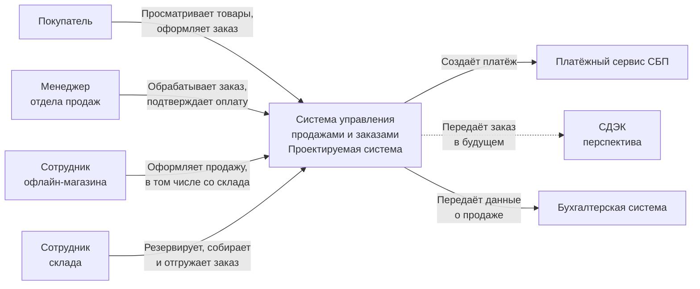

Отличное уточнение: этот пример значительно лучше, потому что в нём есть реальная бизнес-проблема, эволюция системы, несколько каналов продаж, склад, доставка и будущие точки роста. Ниже — переработанная глава 1.1 на его основе.

# Часть 1. Глава 1.1 — Первая архитектурная гипотеза

## Цель главы

Научиться превращать бизнес-задачу в **первую архитектурную гипотезу**: понятное, ограниченное и проверяемое описание будущего решения. На этом этапе мы не выбираем микросервисы, конкретную СУБД или облачного провайдера. Мы фиксируем бизнес-цель, границы системы, ключевых участников, внешние зависимости и допущения, которые потребуется проверить.

Контекстная диаграмма C4 — подходящая форма для такой гипотезы: она показывает одну систему в центре, её пользователей и внешние системы, без излишней технической детализации. [c4model](https://c4model.com/diagrams/system-context)

## Бизнес-кейс: интернет-магазин

Компания продаёт товары через офлайн-магазин и простой самописный сайт. Заказы обрабатываются вручную менеджерами отдела продаж. Остатки товаров ведутся в таблице Excel; карточки товаров на сайте обновляются нерегулярно.

Бизнес хочет автоматизировать обработку заказов. В перспективе планируется:

- автоматизировать размещение товаров на сайте;
- показывать на сайте реальный складской остаток;
- открыть несколько магазинов в других городах;
- добавить региональный склад;
- поддерживать бронирование товара, выбор ближайшего склада и региональные скидки;
- собирать один заказ с нескольких складов;
- интегрироваться со службой доставки СДЭК;
- расширить способы оплаты;
- повысить надёжность системы, организовать резервное копирование и, возможно, перейти в облако.

Важно: **не все эти потребности должны быть реализованы в первой версии**. Задача архитектора — отличить текущую бизнес-задачу от стратегических возможностей и не спроектировать избыточно сложную систему на старте.

## 1. Бизнес-цель решения

**Бизнес-цель** — измеримый результат, который система должна обеспечить для организации. Она отвечает на вопрос: *какое изменение в бизнесе мы хотим получить?*

Первая цель может быть сформулирована так:

```text
Для менеджеров отдела продаж, склада и покупателей
нужна возможность централизованно регистрировать и обрабатывать заказы
чтобы уменьшить ручную работу, снизить ошибки при продаже
и предоставить покупателям актуальную информацию о наличии товара.

Успех измеряется:
- долей заказов, обрабатываемых без ручного переноса данных;
- сокращением времени от оформления заказа до передачи на сборку;
- снижением числа продаж отсутствующего товара;
- сокращением времени обновления информации о товаре на сайте.
```

### Чего не должно быть в цели

Некорректно формулировать цель как:

- «Создать микросервисную платформу»;
- «Перейти в облако»;
- «Внедрить Kubernetes»;
- «Сделать современный сайт».

Это потенциальные средства или будущие решения. Они могут оказаться оправданными, но сначала нужно понять бизнес-задачу, ограничения и атрибуты качества.

## 2. Границы проектируемой системы

**Граница системы** определяет, за что отвечает создаваемое решение, а что остаётся внешним. Это ключевое раннее решение: оно влияет на владение данными, интеграции, эксплуатацию и возможности будущего развития.

Для первого этапа разумно включить в систему:

```text
Внутри системы:
- Каталог товаров и карточки товаров
- Управление остатками и резервами
- Оформление заказов с сайта
- Оформление заказов в офлайн-магазине
- Обработка заказов менеджером
- Передача заказа на склад для сборки
- Базовые статусы заказа
- Интеграция с оплатой СБП
- Базовое управление доставкой собственной службой
```

Вне системы на первом этапе:

```text
Внешние участники:
- Покупатель
- Менеджер отдела продаж
- Сотрудник склада
- Кассир / сотрудник офлайн-магазина
- Платёжный сервис СБП
- Служба доставки СДЭК
- Бухгалтерская система
- Система лояльности, если появится позже
```

### Почему склад входит в систему

Склад нельзя рассматривать только как «место, где лежат товары». Для автоматизации важны его информационные процессы:

- приёмка товара;
- списание при продаже;
- резервирование при оформлении заказа;
- сборка заказа;
- передача заказа в доставку;
- отражение фактического остатка.

Поэтому в первую архитектурную гипотезу входит не физический склад, а **складской контур системы**: данные о товарах, остатках, резервах и сборке заказов.

### Что сознательно отложено

Следующие возможности важны, но не обязательны для первой версии:

- несколько городов и региональный склад;
- выбор ближайшего склада;
- скидки по географическому признаку;
- сбор одного заказа с нескольких складов;
- интеграция с СДЭК;
- расширенные способы оплаты;
- облако и сложная отказоустойчивость.

Они должны быть отражены не как требования первой версии, а как **архитектурно значимые направления развития**. Именно они могут повлиять на базовые решения: например, на модель данных об остатках, идентификацию складов и разделение каталога и складского учёта.

## 3. Контекстная диаграмма C4

**System Context Diagram** показывает проектируемую систему как один блок, окружённый людьми и внешними системами. Она предназначена для общего понимания системы как техническими, так и нетехническими участниками. [c4model](https://c4model.com/diagrams/system-context)



Пунктирная линия к СДЭК показывает не текущую реализацию, а **планируемую внешнюю зависимость**. На этапе гипотезы важно уже видеть её, поскольку будущая интеграция может повлиять на модель заказа, статусы доставки и необходимость хранить данные получателя.

## 4. Ключевые бизнес-возможности

На уровне контекста не нужно детально описывать экраны и поля. Достаточно определить, **что система позволяет делать**.

| Бизнес-возможность | Канал | Почему важна |
|---|---|---|
| Просмотр карточки товара | Сайт | Покупатель получает информацию о товаре |
| Оформление заказа онлайн | Сайт | Снижает ручную работу менеджеров |
| Оформление продажи в магазине | Офлайн-магазин | Единый учёт продаж для онлайн- и офлайн-канала |
| Продажа товара со склада | Офлайн-магазин | Магазин может продать товар, отсутствующий в торговом зале |
| Резервирование товара | Сайт, магазин, склад | Снижает риск продажи одного товара двум покупателям |
| Обработка заказа менеджером | Отдел продаж | Сохраняет управляемый переход от ручного процесса к автоматизации |
| Передача заказа на сборку | Склад | Связывает продажу с физическим исполнением |
| Отображение остатка на сайте | Сайт | Повышает достоверность информации для покупателя |

## 5. Проверяемые допущения

**Допущение** — утверждение, принятое как рабочее, но пока не подтверждённое. Его нужно не скрывать, а фиксировать вместе со способом проверки и последствием ошибки.

| Допущение | Влияние на архитектуру | Как проверить | Риск при ошибке |
|---|---|---|---|
| В первый год будет один склад и один офлайн-магазин | Упрощает модель остатков и резервирования | Интервью с владельцем бизнеса и план развития | Потребуется ранняя поддержка нескольких складов |
| Заказы оформляют не более нескольких десятков сотрудников | Влияет на модель доступа и нагрузку | Подсчёт пользователей и анализ текущей нагрузки | Избыточная или недостаточная модель ролей |
| Остатки в Excel могут быть перенесены в систему один раз | Влияет на стратегию миграции данных | Аудит качества данных в Excel | Потребуется длительная параллельная работа с Excel |
| На старте достаточно оплаты наличными и через СБП | Влияет на платёжный контур | Подтверждение бизнес-требований | Потребуется расширяемая модель способов оплаты |
| Товар может быть зарезервирован на ограниченное время | Влияет на жизненный цикл заказа и остатков | Согласование правил с продажами и складом | «Зависшие» резервы и недоступный товар |
| Интеграция с СДЭК потребуется, но не в первой версии | Влияет на модель доставки и статусов заказа | Подтверждение roadmap с бизнесом | Жёстко связанная модель доставки затруднит интеграцию |

### Антипаттерн: проектирование «на вырост» без приоритетов

Если сразу строить систему для нескольких городов, нескольких складов, мультискладской сборки, сложного бронирования и облачной отказоустойчивости, первая версия может оказаться слишком дорогой и долгой.

Обратный антипаттерн — **игнорирование будущего**. Если модель остатков жёстко привязана к одному складу, а заказ содержит только один способ доставки, later расширение потребует существенной переделки.

Правильный подход — **эволюционная архитектура**: реализовать минимальный необходимый объём, но оставить понятные точки расширения.

Например, уже в первой версии заказ может содержать не строку «склад», а ссылку на идентификатор склада:

```text
Заказ
├── идентификатор покупателя
├── позиции
│   ├── идентификатор товара
│   ├── количество
│   └── идентификатор склада резервирования
├── способ оплаты
└── способ доставки
```

Это не означает, что система сразу умеет работать с несколькими складами. Но она не запрещает такое развитие.

## 6. Первая архитектурная гипотеза

```text
Архитектурная гипотеза:
Система управления продажами и заказами интернет-магазина

Бизнес-цель:
Автоматизировать обработку заказов для онлайн- и офлайн-каналов,
уменьшить ручную работу менеджеров и обеспечить достоверный
учёт товарных остатков.

Границы системы:
Система включает каталог, карточки товаров, учёт остатков,
резервирование, оформление заказов с сайта и в магазине,
обработку заказов менеджерами, передачу заказов на склад,
статусы сборки и базовую доставку собственной службой.

Внешние системы:
Платёжный сервис СБП, бухгалтерская система,
в перспективе — служба доставки СДЭК.

Ключевая гипотеза:
Единая система заказов и остатков позволит заменить ручную обработку
в Excel и переписку между менеджерами, магазином и складом.
При этом она должна допускать добавление новых магазинов, складов,
способов доставки и оплаты без полной переделки ядра системы.

Проверяемые допущения:
1. На первом этапе используется один склад и один магазин.
2. Остатки из Excel могут быть перенесены в систему.
3. Платежи ограничены наличными и СБП.
4. СДЭК потребуется в будущем, но не в первой версии.
5. Резервирование товара необходимо уже на первом этапе.

Отложенные возможности:
Несколько городов, региональный склад, выбор ближайшего склада,
скидки по региону, сборка заказа с нескольких складов,
расширенные способы оплаты и облачная эксплуатация.
```

## Задания для закрепления

### Задание 1. Разделите текущие и будущие требования

Распределите следующие пункты по трём группам: «первая версия», «архитектурно значимое будущее», «не относится к первой архитектурной гипотезе».

- Оплата через СБП.
- Выбор ближайшего склада.
- Резервирование ограниченного товара.
- Переход в облако.
- Отображение остатка на сайте.
- Сбор заказа с нескольких складов.
- Интеграция с СДЭК.
- Резервное копирование базы данных.

Ожидаемый результат: вы должны объяснить, почему элемент попадает в выбранную группу.

### Задание 2. Уточните границу системы

Руководитель предлагает: «Давайте сразу включим в систему СДЭК, бухгалтерию и программу лояльности».

Сформулируйте три аргумента, почему на этапе первой гипотезы это может быть преждевременно, и одно условие, при котором СДЭК всё же стоит включить в первую версию.

### Задание 3. Постройте контекстную диаграмму

Постройте System Context Diagram для описанного магазина.

Требования:

- одна проектируемая система в центре;
- минимум четыре роли пользователей;
- минимум три внешние системы;
- отдельное обозначение будущей интеграции с СДЭК;
- подписи стрелок с бизнес-смыслом, а не только «API request».

### Задание 4. Зафиксируйте допущения

Сформулируйте пять допущений для этого кейса. Для каждого укажите:

```text
Допущение: ...
Влияние на архитектуру: ...
Способ проверки: ...
Последствие при ошибке: ...
```

Особое внимание уделите конфликту «два покупателя заказывают последний экземпляр товара».

## Вопросы для самопроверки

**1. Что является корректной бизнес-целью для первого этапа?**

A. «Внедрить микросервисы и Kubernetes»  
B. «Автоматизировать обработку заказов и обеспечить единый учёт остатков»  
C. «Сделать сайт на современном фреймворке»  
D. «Перейти в облако»

**Ответить**

<details>
<summary>Показать правильный ответ</summary>

**Правильный ответ: B.**

Бизнес-цель описывает результат для организации. Технологии, стиль архитектуры и облачная модель — средства, выбор которых должен быть обоснован требованиями и ограничениями.

</details>

***

**2. Почему складской контур включается в границы системы, хотя физический склад остаётся внешним объектом?**

A. Потому что склад всегда должен быть отдельным микросервисом  
B. Потому что система должна управлять остатками, резервами и сборкой заказов  
C. Потому что склад не участвует в бизнес-процессе  
D. Потому что Excel нельзя использовать после запуска системы

**Ответить**

<details>
<summary>Показать правильный ответ</summary>

**Правильный ответ: B.**

В систему входит не здание или команда склада, а информационные процессы: учёт остатков, резервирование, сборка и отгрузка. Физический склад является внешним участником, но его операции должны быть отражены в системе.

</details>

***

**3. Как правильно отнестись к будущей интеграции с СДЭК на этапе первой гипотезы?**

A. Полностью игнорировать, чтобы не усложнять первую версию  
B. Немедленно реализовать полную интеграцию  
C. Зафиксировать как будущую внешнюю зависимость и учесть её влияние на модель заказа и доставки  
D. Выбрать СДЭК единственной службой доставки навсегда

**Ответить**

<details>
<summary>Показать правильный ответ</summary>

**Правильный ответ: C.**

Будущую возможность не нужно реализовывать сразу, но архитектор должен учитывать её влияние на ключевые модели. Это позволяет избежать жёсткой привязки к собственной доставке.

</details>

***

**4. Какое утверждение является проверяемым архитектурным допущением?**

A. «Система должна быть надёжной»  
B. «Предполагаем, что в первый год будет один склад; подтвердим планом развития бизнеса»  
C. «Нужна облачная архитектура»  
D. «Микросервисы лучше монолита»

**Ответить**

<details>
<summary>Показать правильный ответ</summary>

**Правильный ответ: B.**

Допущение конкретно, влияет на архитектуру и имеет способ проверки. Остальные варианты либо слишком общие, либо содержат готовое техническое решение без обоснования.

</details>

## Связь с следующей главой

В главе 1.2 мы формализуем этот кейс через **карту стейкхолдеров**, критические сценарии и критерии успешности. В частности, разберём конфликт между покупателем, менеджером и складом при ограниченном остатке товара, а также различие интересов онлайн-канала, офлайн-магазина и службы доставки.