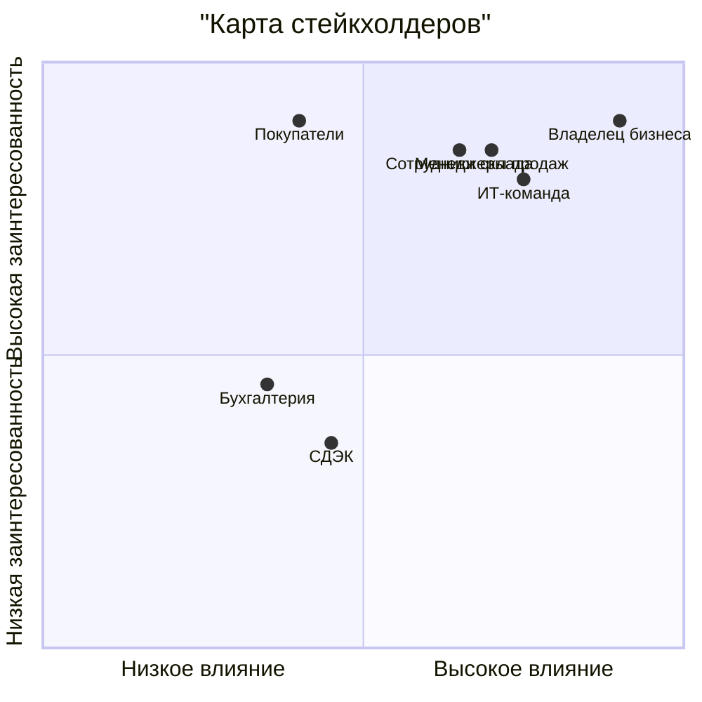

# Часть 1. Глава 1.2 — Стейкхолдеры и ключевые сценарии

## Цель главы

Научиться переходить от общей бизнес-задачи к конкретным интересам участников, критическим пользовательским сценариям и измеримым критериям успешности. В этой главе мы уточним первую архитектурную гипотезу интернет-магазина: определим, **кто** влияет на решение, **что** система должна позволять делать и **как** мы поймём, что автоматизация состоялась.

Стейкхолдеры — это лица и группы, имеющие интерес к системе и способные влиять на её требования, ограничения и приоритеты. Их интересы необходимо выявлять рано: они формируют архитектурно значимые сценарии и помогают управлять ожиданиями. [sei.cmu](https://www.sei.cmu.edu/documents/2913/2006_017_001_22556.pdf)

## Бизнес-кейс: напоминание

Компания продаёт товары через офлайн-магазин и сайт. Заказы обрабатываются менеджерами вручную, остатки ведутся в Excel. Нужно автоматизировать оформление и обработку заказов, складские операции, резервирование товара и отображение актуального наличия на сайте.

В будущем планируются новые магазины, региональный склад, интеграция с СДЭК, расширенные способы оплаты и более сложная логистика. Эти возможности пока не входят в первую версию, но уже влияют на выбор ключевых сценариев и модели данных.

## 1. Карта стейкхолдеров

**Карта стейкхолдеров** — это структурированный перечень участников, их интересов, ожиданий и степени влияния на систему. Она помогает не сводить проект к интересам одного заказчика и не упускать участников, чьи требования проявятся позднее.

Для каждого стейкхолдера полезно фиксировать:

- роль в бизнес-процессе;
- ключевой интерес;
- что для него означает успех;
- какие риски его беспокоят;
- степень влияния на архитектурные решения.

### Карта стейкхолдеров интернет-магазина

| Стейкхолдер | Роль и интерес | Что считает успехом | Архитектурно значимые ожидания |
|---|---|---|---|
| Владелец бизнеса | Снижение издержек, рост продаж, управляемость | Меньше ручной работы, меньше потерянных продаж, прозрачные показатели | Масштабируемость на новые магазины и склады, контролируемая стоимость |
| Менеджер отдела продаж | Быстрая обработка заказов без Excel и переписки | Заказ виден сразу, статус понятен, меньше ошибок | Удобный интерфейс, единая очередь заказов, понятные статусы |
| Покупатель сайта | Удобный заказ и достоверная информация | Понятная карточка товара, корректный остаток, прозрачный статус | Скорость сайта, корректность данных, уведомления |
| Покупатель офлайн-магазина | Возможность купить товар, даже если его нет в зале | Заказ со склада оформляется без долгого ожидания | Единый учёт остатков, резервирование |
| Сотрудник офлайн-магазина | Быстрое оформление продажи и заказов со склада | Не нужно звонить на склад и сверять Excel | Актуальные остатки, простая операция резервирования |
| Сотрудник склада | Понятные задания на сборку и достоверные остатки | Нет двойных продаж, понятно, что и когда собрать | Надёжное резервирование, статусы сборки, журнал операций |
| Бухгалтерия | Корректные данные о продажах и оплатах | Данные можно передать без ручного переноса | Согласованность данных, интеграция с учётом |
| ИТ-команда | Поддерживаемая и развиваемая система | Понятные интеграции, возможность развивать систему | Модульность, тестируемость, управляемые изменения |
| СДЭК, будущий партнёр | Стандартизированное взаимодействие | Корректная передача заказа и статусов доставки | Расширяемая модель доставки и статусов |

### Влияние и заинтересованность

Стейкхолдеров полезно разделить не только по ролям, но и по степени влияния:



Покупатели обычно не участвуют в принятии архитектурных решений, но их опыт определяет коммерческий успех. Поэтому их интересы должны быть представлены через измеримые сценарии, а не оставлены на усмотрение команды разработки.

## 2. Бизнес-возможности системы

**Бизнес-возможность** — способность системы обеспечить участнику выполнение значимого действия. В отличие от функции интерфейса, она формулируется с точки зрения бизнес-результата.

Для первой версии можно выделить следующие возможности:

| Бизнес-возможность | Основной участник | Критичность |
|---|---|---|
| Просматривать товар и его наличие | Покупатель | Высокая |
| Оформлять заказ на сайте | Покупатель | Высокая |
| Оформлять продажу или заказ со склада в магазине | Сотрудник магазина | Высокая |
| Резервировать товар при оформлении заказа | Система, склад | Критическая |
| Обрабатывать заказ менеджером | Менеджер продаж | Высокая |
| Передавать заказ на сборку | Менеджер, склад | Критическая |
| Отмечать сборку и отгрузку заказа | Сотрудник склада | Критическая |
| Принимать оплату наличными или через СБП | Покупатель, менеджер | Высокая |
| Обновлять карточку товара и остаток | Сотрудник каталога или менеджер | Высокая |
| Передавать данные о продаже в бухгалтерию | Бухгалтерия | Средняя |

### Важное различие

Функциональное требование отвечает на вопрос: *что именно делает система?*

Бизнес-возможность отвечает на вопрос: *какую ценность это создаёт?*

Пример:

```text
Бизнес-возможность:
Покупатель может оформить заказ на товар, доступный на складе.

Функциональные требования:
- Покупатель добавляет товар в корзину.
- Система проверяет доступный остаток.
- Система резервирует товар на заданный интервал.
- Система создаёт заказ со статусом «Ожидает подтверждения».
```

Если начать с функций, легко получить набор экранов и кнопок, не решающий главную бизнес-проблему — рассинхронизацию заказов, остатков и складских операций.

## 3. Критические пользовательские сценарии

**Критический сценарий** — последовательность действий, при которой система создаёт основную бизнес-ценность либо предотвращает существенный ущерб. Такие сценарии должны быть понятны бизнесу, проверяемы и пригодны для последующего проектирования.

Сценарий удобно описывать в формате:

```text
Как [роль],
я хочу [действие],
чтобы [результат].

Предусловия: ...
Основной поток: ...
Альтернативные потоки: ...
Критерий успеха: ...
```

### Сценарий 1. Заказ последнего товара двумя покупателями

**Как покупатель,** я хочу оформить заказ на товар, **чтобы** получить его, даже если остаток ограничен.

**Предусловия:** на складе остался один экземпляр товара.

**Основной поток:**

1. Покупатель A открывает карточку товара и видит остаток «1».
2. Покупатель A добавляет товар в корзину.
3. Система создаёт временный резерв на срок, например, 15 минут.
4. Покупатель A переходит к оплате через СБП.
5. После успешной оплаты резерв преобразуется в подтверждённый заказ.
6. Заказ передаётся на склад для сборки.

**Альтернативный поток:**

1. Пока покупатель A оплачивает заказ, покупатель B открывает ту же карточку.
2. Система показывает, что доступного остатка нет либо товар доступен только после подтверждения или отмены резерва.
3. Покупатель B не может оформить заказ на этот же экземпляр.

**Критерий успеха:** два покупателя не могут одновременно получить подтверждение на один и тот же физический экземпляр товара.

Этот сценарий архитектурно значим, потому что затрагивает согласованность данных, жизненный цикл резерва, поведение при неоплате и необходимость освобождать резерв по истечении времени.

### Сценарий 2. Продажа товара со склада через офлайн-магазин

**Как сотрудник офлайн-магазина,** я хочу оформить заказ на товар, которого нет в торговом зале, **чтобы** не потерять продажу.

**Основной поток:**

1. Сотрудник ищет товар в системе.
2. Система показывает остаток на складе.
3. Сотрудник оформляет заказ со способом получения «доставка со склада» или «самовывоз со склада».
4. Система резервирует товар.
5. Менеджер или склад подтверждает возможность исполнения.
6. Заказ передаётся на сборку.

**Критерий успеха:** остаток в магазине, на складе и на сайте согласован; товар не может быть продан дважды.

### Сценарий 3. Обработка заказа менеджером

**Как менеджер отдела продаж,** я хочу видеть новые заказы в единой очереди, **чтобы** обрабатывать их без Excel и ручной передачи информации.

**Основной поток:**

1. Покупатель оформляет заказ на сайте.
2. Заказ появляется в очереди менеджера со статусом «Новый».
3. Менеджер проверяет состав, способ оплаты и доставку.
4. Менеджер подтверждает заказ.
5. Система передаёт заказ на склад.
6. Статус меняется на «Передан на сборку».

**Критерий успеха:** от появления заказа до передачи на склад проходит ограниченное, измеримое время; данные не переносятся вручную.

### Сценарий 4. Обновление наличия на сайте

**Как сотрудник, отвечающий за каталог,** я хочу, чтобы на сайте отображался актуальный остаток, **чтобы** покупатели не заказывали отсутствующий товар.

**Основной поток:**

1. Склад фиксирует поступление, продажу, списание или сборку товара.
2. Система обновляет доступный остаток.
3. Сайт отображает актуальное значение.
4. При достижении нулевого остатка возможность заказа ограничивается.

**Критерий успеха:** расхождение между складским учётом и отображаемым остатком обнаруживается и устраняется в контролируемый срок.

## 4. Критерии успешности

**Критерий успешности** — измеримое условие, по которому бизнес и команда определяют, что решение работает. Без него архитектура оценивается по субъективным впечатлениям, а не по результату.

| Цель | Критерий успешности | Целевое значение для первой версии |
|---|---|---|
| Снизить ручную работу | Доля заказов, проходящих без ручного переноса данных | Не менее 90% |
| Ускорить обработку | Время от создания заказа до передачи на склад | Не более 30 минут в рабочее время |
| Исключить двойные продажи | Число подтверждённых заказов на один и тот же зарезервированный экземпляр | 0 за отчётный период |
| Повысить достоверность остатков | Расхождение между системой и фактическим складским учётом | Не более 1% позиций при ежедневной сверке |
| Сохранить удобство для покупателя | Время оформления заказа на сайте | Не более 3 минут для типового заказа |
| Обеспечить управляемый рост | Возможность добавить новый склад без изменения ключевых бизнес-правил | Подтверждается архитектурной оценкой |

Критерии успешности не обязаны быть окончательными. На раннем этапе важнее зафиксировать **проверяемые ориентиры**, которые затем будут уточнены в главе 1.3 через сценарии атрибутов качества.

## 5. Связь сценариев с будущей эволюцией

Некоторые сценарии первой версии уже готовят систему к развитию.

| Текущий сценарий | Будущая возможность | Что важно учесть сейчас |
|---|---|---|
| Резервирование товара на одном складе | Бронирование на нескольких складах | Идентификатор склада в позиции заказа и остатках |
| Один магазин и один склад | Несколько магазинов и региональный склад | Разделение понятий «магазин», «склад» и «канал продаж» |
| Собственная доставка | Интеграция с СДЭК | Модель способа доставки и независимые статусы доставки |
| Оплата наличными и СБП | Новые платёжные методы | Платёж как отдельное понятие, а не поле в заказе |
| Один сайт | Возможные новые каналы продаж | Единая модель товара, остатка и заказа |

### Антипаттерн: сценарий только «счастливого пути»

Если описывать только успешное оформление заказа, архитектор не увидит ключевых сложностей:

- покупатель не оплатил заказ, а товар зарезервирован;
- резерв истёк, но склад уже начал сборку;
- менеджер отменил заказ после резервирования;
- склад обнаружил расхождение фактического и учётного остатка;
- оплата через СБП прошла, но создание заказа не завершилось.

Именно альтернативные и исключительные потоки определяют многие архитектурные решения: жизненный цикл заказа, идемпотентность операций, правила компенсации и согласованность данных.

## Задания для закрепления

### Задание 1. Дополните карту стейкхолдеров

Добавьте в карту двух стейкхолдеров, не указанных явно: например, сотрудника, отвечающего за наполнение каталога, и представителя службы поддержки покупателей.

Для каждого укажите:

- интерес;
- критерий успеха;
- влияние на архитектуру;
- один критический сценарий.

### Задание 2. Определите критический сценарий

Опишите сценарий «Покупатель оформил заказ, но не завершил оплату через СБП».

Используйте структуру:

```text
Как ...
я хочу ...
чтобы ...

Предусловия: ...
Основной поток: ...
Альтернативные потоки: ...
Критерий успеха: ...
```

Обязательно рассмотрите, что происходит с резервом товара.

### Задание 3. Разделите возможности и функции

Разделите следующие формулировки на «бизнес-возможности» и «функциональные требования»:

- Покупатель может узнать, доступен ли товар.
- Система отображает остаток на карточке товара.
- Сотрудник склада может отметить заказ как собранный.
- Система уменьшает доступный остаток при подтверждении заказа.
- Менеджер может обработать заказ без Excel.
- Система отправляет уведомление об изменении статуса заказа.

### Задание 4. Сформулируйте критерии успешности

Предложите по одному измеримому критерию для следующих целей:

1. Снижение ручной работы менеджеров.
2. Предотвращение двойных продаж.
3. Актуальность остатков на сайте.
4. Готовность к добавлению нового склада.

## Вопросы для самопроверки

**1. Кто из перечисленных является стейкхолдером системы?**

A. Только владелец бизнеса  
B. Только покупатели сайта  
C. Все лица и группы, имеющие интерес к системе и влияющие на её требования  
D. Только сотрудники ИТ-отдела

**Ответить**

<details>
<summary>Показать правильный ответ</summary>

**Правильный ответ: C.**

Стейкхолдеры включают владельцев, пользователей, сотрудников, ИТ-команду, внешних партнёров и другие заинтересованные стороны. Их интересы необходимо выявлять и учитывать при формировании архитектурных приоритетов. [sei.cmu](https://www.sei.cmu.edu/documents/2913/2006_017_001_22556.pdf)

</details>

***

**2. Чем бизнес-возможность отличается от функционального требования?**

A. Бизнес-возможность всегда описывает экран интерфейса  
B. Бизнес-возможность описывает ценность для участника, а функциональное требование — конкретное поведение системы  
C. Функциональное требование важнее бизнес-возможности  
D. Бизнес-возможность формулируется только разработчиками

**Ответить**

<details>
<summary>Показать правильный ответ</summary>

**Правильный ответ: B.**

Бизнес-возможность отвечает на вопрос, какую ценность получает участник. Функциональное требование конкретизирует, как система должна себя вести для обеспечения этой возможности.

</details>

***

**3. Какой сценарий наиболее архитектурно значим для задачи предотвращения двойных продаж?**

A. Покупатель просматривает каталог  
B. Два покупателя одновременно пытаются заказать последний экземпляр товара  
C. Менеджер меняет цвет кнопки в интерфейсе  
D. Бухгалтерия получает отчёт в конце месяца

**Ответить**

<details>
<summary>Показать правильный ответ</summary>

**Правильный ответ: B.**

Этот сценарий выявляет необходимость управления резервами, жизненным циклом заказа и согласованностью остатков. Он непосредственно влияет на архитектуру системы.

</details>

***

**4. Почему важно описывать альтернативные потоки, а не только успешное оформление заказа?**

A. Чтобы увеличить объём документации  
B. Потому что именно исключительные ситуации выявляют требования к надёжности, согласованности и обработке ошибок  
C. Потому что успешный сценарий не нужен  
D. Потому что альтернативные потоки заменяют архитектурные решения

**Ответить**

<details>
<summary>Показать правильный ответ</summary>

**Правильный ответ: B.**

Неоплата, отмена, истечение резерва, расхождение остатков и сбой интеграции определяют многие архитектурные решения. Игнорирование таких потоков ведёт к системе, работающей только в идеальных условиях.

</details>

## Что будет в главе 1.3

В следующей главе мы переведём выявленные сценарии в **атрибуты качества**: производительность, доступность, согласованность, безопасность, модифицируемость и наблюдаемость. На примере интернет-магазина определим, какие из них критичны для первой версии, а какие являются требованиями будущего роста. Сценарии атрибутов качества связывают интересы стейкхолдеров с проверяемыми архитектурными требованиями. [apps.dtic](https://apps.dtic.mil/sti/tr/pdf/ADA632013.pdf)