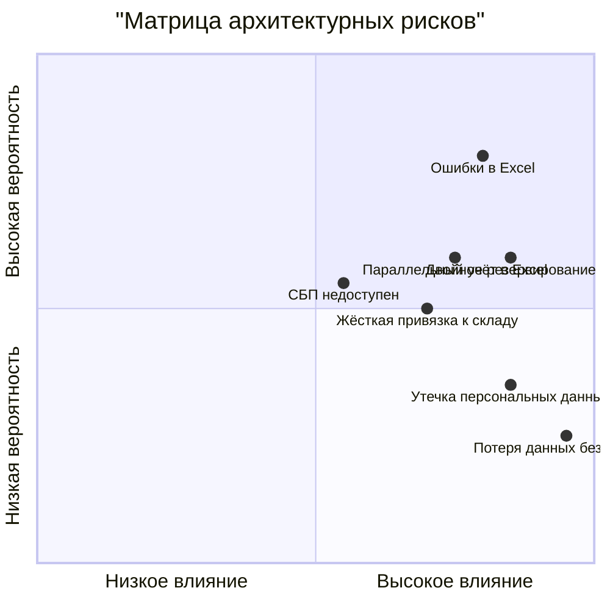

# Часть 1. Глава 1.4 — Ограничения, допущения и риски

## Цель главы

Научиться выявлять факторы, которые сужают пространство архитектурных решений: ограничения, допущения и риски. Если атрибуты качества определяют, **насколько хорошо** должна работать система, то эта глава отвечает на вопрос: **что может помешать реализовать эти требования и какие условия мы принимаем без полной уверенности?**

Ограничения и допущения необходимо фиксировать явно: они задают контекст архитектуры и позволяют проверять решения по мере появления новых фактов. Риски при этом связывают архитектурные решения с потенциальными последствиями для бизнес-целей. [swehb.nasa](https://swehb.nasa.gov/spaces/SWEHBVD/pages/102695442/SWE-057+-+Software+Architecture)

## Бизнес-кейс: текущая ситуация

Интернет-магазин использует:

- простой самописный сайт с карточками товаров;
- ручную обработку заказов менеджерами;
- Excel для учёта складских остатков;
- собственную службу доставки;
- оплату наличными и через СБП;
- один склад и один офлайн-магазин.

Бизнес хочет автоматизировать заказы и складской учёт, а в будущем развивать сеть магазинов, региональные склады, интеграцию с СДЭК и более сложную логистику.

## 1. Ограничения

**Ограничение** — условие, которое нельзя свободно изменить в рамках проекта. Оно задаёт рамку, внутри которой архитектор выбирает решение. Ограничения могут быть технологическими, организационными, финансовыми, регуляторными или связанными с существующими системами. [swehb.nasa](https://swehb.nasa.gov/spaces/SWEHBVD/pages/102695442/SWE-057+-+Software+Architecture)

### Технологические ограничения

| Ограничение | Влияние на архитектуру |
|---|---|
| Существующий сайт самописный и слабо документирован | Может потребоваться постепенная замена или интеграция, а не полная перестройка за один этап |
| Остатки ведутся в Excel | Нужны миграция данных, проверка качества и период сверки |
| Используется СБП и наличная оплата | Платёжная модель должна поддерживать оба способа и допускать расширение |
| Собственная служба доставки | Модель доставки должна быть расширяемой для будущей интеграции с СДЭК |
| Ограниченная ИТ-команда | Не следует сразу выбирать сложную распределённую архитектуру |

### Организационные и финансовые ограничения

| Ограничение | Влияние на архитектуру |
|---|---|
| Небольшой бюджет первой версии | Приоритет — автоматизация критических процессов, а не максимальная отказоустойчивость |
| Нет выделенной команды эксплуатации | Нужны простые процедуры развёртывания, мониторинга и восстановления |
| Сотрудники привыкли к Excel | Требуется обучение, поэтапный переход и контроль параллельного учёта |
| Бизнес хочет быстрый результат | Первая версия должна давать ценность за ограниченное время |

### Регуляторные ограничения

Для интернет-магазина обычно значимы:

- защита персональных данных покупателей и сотрудников;
- корректное хранение и передача данных заказов;
- требования к электронной коммерции и дистанционной продаже;
- правила хранения документов, подтверждающих оплату и продажу;
- требования к журналированию значимых операций.

Конкретный состав требований зависит от юрисдикции и типа данных, поэтому на этом этапе их следует зафиксировать как **обязательные ограничения для уточнения**, а не пытаться угадать все детали.

## 2. Допущения

**Допущение** — утверждение, которое принимается как рабочее, но пока не подтверждено. В отличие от ограничения, допущение в будущем может оказаться неверным; поэтому каждое существенное допущение должно иметь способ проверки и план действий при ошибке. [swehb.nasa](https://swehb.nasa.gov/spaces/SWEHBVD/pages/102695520/SWE-184+-+Software-related+Constraints+and+Assumptions)

### Реестр допущений

| ID | Допущение | Влияние на архитектуру | Способ проверки | Действие при ошибке |
|---|---|---|---|---|
| A-01 | В первый год будет один склад и один магазин | Упрощает модель остатков и резервов | Подтверждение плана развития бизнеса | Использовать идентификаторы склада и магазина с самого начала |
| A-02 | Данные из Excel можно перенести за ограниченное время | Влияет на план миграции | Аудит качества данных: дубли, пропуски, разные единицы измерения | Организовать поэтапную миграцию и параллельную сверку |
| A-03 | Количество одновременных пользователей невелико | Позволяет не проектировать высокую нагрузку на старте | Анализ статистики заказов и посещаемости | Пересмотреть требования к масштабированию |
| A-04 | Оплата наличными и СБП достаточна для первой версии | Упрощает платёжный контур | Подтверждение бизнес-требований | Предусмотреть расширяемую модель способов оплаты |
| A-05 | СДЭК потребуется позже | Влияет на модель доставки, но не требует немедленной интеграции | Roadmap бизнеса | Не привязывать заказ к единственному способу доставки |
| A-06 | Сотрудники готовы перейти с Excel на систему | Влияет на внедрение и качество данных | Интервью и пилот с сотрудниками | Поэтапный переход, обучение, контроль двойного учёта |
| A-07 | Персональные данные обрабатываются в ограниченном объёме | Влияет на требования безопасности | Инвентаризация данных и консультация по требованиям | Усилить меры защиты и пересмотреть хранение данных |

### Антипаттерн: скрытые допущения

Опасны не сами допущения, а неявные. Например, если команда молча предполагает, что «Excel всегда будет доступен», «один склад останется навсегда» или «СБП никогда не будет недоступен», эти предположения не попадут в план проверки и позже станут источником переделок.

## 3. Архитектурные риски

**Архитектурный риск** — решение, его отсутствие или неясное последствие, которое может помешать достижению бизнес-целей или атрибутов качества. В методике ATAM риском считается как непринятое важное решение, так и принятое решение, последствия которого недостаточно понятны. [sei.cmu](https://www.sei.cmu.edu/documents/2543/2018_010_001_515610.pdf)

Риск описывается по схеме:

```text
Условие: ...
Последствие: ...
Влияние на бизнес-цель: ...
Вероятность: ...
Влияние: ...
Приоритет: ...
Мера снижения: ...
```

### Реестр рисков

| ID | Риск | Последствие | Вероятность | Влияние | Приоритет | Мера снижения |
|---|---|---|---|---|---|---|
| R-01 | Два покупателя резервируют последний экземпляр товара | Двойная продажа, отмена, потеря доверия | Средняя | Высокое | Критический | Строгий контроль резерва, уникальность резервирования, тесты конкурентных операций |
| R-02 | Данные в Excel содержат ошибки | Неверные остатки, невозможность корректной миграции | Высокая | Высокое | Критический | Аудит данных до миграции, правила очистки, сверка после переноса |
| R-03 | Сотрудники продолжат вести Excel параллельно | Две версии истины, расхождение остатков | Средняя | Высокое | Высокий | Пилот, обучение, запрет параллельного учёта после контрольной даты |
| R-04 | СБП временно недоступен | Заказ оформлен, но оплата не завершена | Средняя | Среднее | Высокий | Статус «Ожидает оплаты», повторная оплата, ограниченный срок резерва |
| R-05 | Модель заказа жёстко привязана к одному складу | Дорогая переделка при открытии новых складов | Средняя | Высокое | Высокий | Идентификатор склада в позиции заказа и остатках |
| R-06 | Модель доставки привязана к собственной службе | Сложная интеграция СДЭК в будущем | Средняя | Среднее | Средний | Абстракция способа доставки и независимые статусы |
| R-07 | Нет резервных копий и процедуры восстановления | Потеря заказов, остатков и истории продаж | Низкая | Критическое | Высокий | Регулярное резервное копирование, проверка восстановления |
| R-08 | Персональные данные хранятся без разграничения доступа | Нарушение требований, утечка данных | Средняя | Высокое | Высокий | Ролевой доступ, шифрование, журнал аудита |

## 4. Ранжирование рисков

Риски ранжируют по двум основным параметрам:

- **Вероятность** — насколько возможно наступление события.
- **Влияние** — насколько серьёзны последствия для бизнеса.



Приоритет получают риски с высокой вероятностью и высоким влиянием. Однако риск с низкой вероятностью, но критическим влиянием — например, потеря всех данных — также требует ранней меры снижения.

## 5. Связь с атрибутами качества

Каждый существенный риск должен быть связан с атрибутом качества и критическим сценарием.

| Риск | Атрибут качества | Связанный сценарий |
|---|---|---|
| Двойное резервирование | Согласованность | Два покупателя заказывают последний экземпляр |
| Ошибки Excel | Согласованность, корректность данных | Миграция остатков в систему |
| Недоступность СБП | Доступность, устойчивость | Покупатель оформил заказ, но не завершил оплату |
| Жёсткая модель склада | Модифицируемость | Добавление нового склада |
| Отсутствие резервных копий | Восстанавливаемость | Восстановление после сбоя или потери данных |
| Слабый контроль доступа | Безопасность | Сотрудник пытается получить доступ к чужим заказам |

Такая трассировка позволяет понять, какие риски действительно архитектурно значимы, а какие относятся к организационным или операционным задачам.

## 6. Первичный реестр ограничений, допущений и рисков

```text
Ограничения:
C-01. Существующий сайт самописный и требует постепенной модернизации.
C-02. Остатки в настоящее время ведутся в Excel.
C-03. В первой версии поддерживаются наличная оплата и СБП.
C-04. Доставка выполняется собственной службой.
C-05. Бюджет и команда ограничены.

Допущения:
A-01. В первый год будет один склад и один магазин.
A-02. Данные из Excel могут быть перенесены после очистки.
A-03. Нагрузка на старте умеренная.
A-04. СДЭК потребуется в будущем, но не в первой версии.
A-05. Сотрудники готовы перейти на единую систему учёта.

Риски:
R-01. Двойное резервирование последнего товара.
R-02. Некачественные данные в Excel.
R-03. Параллельное ведение учёта в Excel.
R-04. Недоступность платёжного сервиса.
R-05. Жёсткая привязка модели к одному складу.
R-06. Отсутствие проверенной процедуры восстановления.
```

## Задания для закрепления

### Задание 1. Классифицируйте утверждения

Разделите следующие утверждения на ограничения, допущения и риски:

- «Бюджет первой версии ограничен».
- «Предполагаем, что в первый год откроется не более одного нового магазина».
- «Если данные из Excel содержат дубли, миграция остатков будет некорректной».
- «Система должна поддерживать СБП».
- «Возможно, сотрудники продолжат вести Excel параллельно».
- «СДЭК потребуется в будущем».

### Задание 2. Составьте реестр рисков

Выберите три риска из кейса и оформите каждый по шаблону:

```text
Условие: ...
Последствие: ...
Влияние на бизнес-цель: ...
Вероятность: ...
Влияние: ...
Приоритет: ...
Мера снижения: ...
```

### Задание 3. Определите проверку допущения

Для допущения «Сотрудники готовы перейти с Excel на единую систему» предложите:

- способ проверки;
- критерий успешности проверки;
- план действий, если допущение окажется неверным.

### Задание 4. Свяжите риск с атрибутом качества

Для каждого риска укажите атрибут качества и критический сценарий:

- двойное резервирование;
- недоступность СБП;
- потеря данных;
- жёсткая привязка к одному складу;
- несанкционированный доступ к заказам.

## Вопросы для самопроверки

**1. Чем ограничение отличается от допущения?**

A. Ограничение — это предположение, а допущение — обязательное условие  
B. Ограничение задаёт обязательную рамку, а допущение — рабочее утверждение, требующее проверки  
C. Они полностью совпадают  
D. Ограничения относятся только к технологиям

**Ответить**

<details>
<summary>Показать правильный ответ</summary>

**Правильный ответ: B.**

Ограничение нельзя свободно изменить в рамках проекта. Допущение принимается как рабочее, но должно быть проверено; при его ошибочности может потребоваться пересмотр архитектурных решений. [swehb.nasa](https://swehb.nasa.gov/spaces/SWEHBVD/pages/102695442/SWE-057+-+Software+Architecture)

</details>

***

**2. Что из перечисленного является архитектурным риском?**

A. «Система должна поддерживать СБП»  
B. «Модель заказа жёстко привязана к одному складу, хотя бизнес планирует новые склады»  
C. «Покупатель должен видеть карточку товара»  
D. «Менеджер оформляет заказ»

**Ответить**

<details>
<summary>Показать правильный ответ</summary>

**Правильный ответ: B.**

Это архитектурно значимое решение, которое может создать проблему при реализации подтверждённого направления развития бизнеса. В терминах ATAM риск — потенциально проблемное архитектурное решение или непринятое важное решение. [sei.cmu](https://www.sei.cmu.edu/documents/2368/2011_015_001_28266.pdf)

</details>

***

**3. Какой риск требует наиболее срочной меры, несмотря на низкую вероятность?**

A. Покупатель ошибочно добавил товар в корзину  
B. Полная потеря данных из-за отсутствия резервных копий  
C. Менеджер забыл подтвердить заказ  
D. Сотрудник склада неправильно указал цвет товара

**Ответить**

<details>
<summary>Показать правильный ответ</summary>

**Правильный ответ: B.**

При ранжировании учитывается не только вероятность, но и влияние. Потеря заказов, остатков и истории продаж имеет критические последствия, поэтому резервное копирование и проверка восстановления должны быть реализованы рано.

</details>

***

**4. Зачем связывать риск с атрибутом качества и сценарием?**

A. Чтобы увеличить число документов  
B. Чтобы понять, какие риски действительно влияют на архитектуру и бизнес-цели  
C. Чтобы исключить необходимость в тестировании  
D. Чтобы выбрать конкретную базу данных

**Ответить**

<details>
<summary>Показать правильный ответ</summary>

**Правильный ответ: B.**

Связь «риск — атрибут качества — сценарий» показывает, как потенциальная проблема угрожает бизнес-цели и какие архитектурные свойства необходимо обеспечить. Это соответствует сценарно-ориентированному подходу к анализу архитектуры. [sei.cmu](https://www.sei.cmu.edu/documents/2543/2018_010_001_515610.pdf)

</details>

## Что будет в главе 1.5

В следующей главе мы перейдём от выявленных ограничений и рисков к **компромиссам и архитектурным решениям**. На примере интернет-магазина сравним альтернативы: развивать текущий сайт или создать новую систему, вести остатки в единой базе или оставить Excel на переходный период, сразу закладывать мультискладскую модель или реализовать её позднее. Мы также введём ADR — архитектурную запись решения.