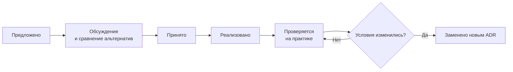

# Часть 1. Глава 1.5 — Компромиссы и ADR

## Цель главы

Научиться принимать архитектурные решения осознанно: сравнивать альтернативы по значимым критериям, оценивать обратимость решения и фиксировать результат в **ADR** (Architecture Decision Record). В этой главе мы переведём выявленные ранее ограничения, риски и атрибуты качества в конкретные, обоснованные решения для интернет-магазина.

**ADR** — краткая запись одного архитектурно значимого решения, его контекста и последствий. Распространённый формат включает название, статус, контекст, решение и последствия. [github](https://github.com/peter-evans/lightweight-architecture-decision-records)

## 1. Что такое архитектурный компромисс

**Компромисс** — осознанный выбор между альтернативами, при котором улучшение одного свойства системы приводит к ухудшению другого. Архитектор не ищет «идеальное» решение: он ищет решение, наиболее соответствующее бизнес-целям, ограничениям и приоритетам качества.

Для интернет-магазина типичные компромиссы:

| Компромисс | Улучшаем | Ухудшаем | Возможное решение |
|---|---|---|---|
| Строгий контроль резервов | Согласованность, предотвращение двойных продаж | Производительность и простоту реализации | Блокирующее резервирование только для подтверждения заказа |
| Мгновенное отображение остатка | Актуальность данных для покупателя | Нагрузку и сложность синхронизации | Обновление с небольшой контролируемой задержкой |
| Мультискладская модель сразу | Модифицируемость | Срок и стоимость первой версии | Минимальная поддержка идентификатора склада без полной мультискладской логики |
| Облачная отказоустойчивость | Доступность и восстановление | Стоимость и операционная сложность | Резервное копирование и простое восстановление на первом этапе |
| Готовность к СДЭК | Будущая интеграция | Абстракция и объём проектирования | Модель доставки, независимая от конкретного перевозчика |

## 2. Критерии сравнения альтернатив

Чтобы выбор не был субъективным, альтернативы сравнивают по заранее определённым критериям. Набор критериев должен следовать из бизнес-целей, атрибутов качества и ограничений.

Для нашего кейса можно использовать:

| Критерий | Вопрос | Связь с кейсом |
|---|---|---|
| Соответствие бизнес-цели | Решает ли вариант главную задачу? | Автоматизация заказов и остатков |
| Согласованность данных | Исключает ли вариант двойные продажи? | Резервирование последнего товара |
| Стоимость реализации | Сколько времени и ресурсов потребуется? | Ограниченный бюджет |
| Скорость поставки | Как быстро бизнес получит ценность? | Необходимость уйти от Excel |
| Модифицируемость | Насколько легко добавить склад, магазин или доставку? | Планы расширения |
| Эксплуатационная сложность | Сможет ли небольшая команда поддерживать решение? | Нет выделенной ИТ-команды |
| Риск | Какие негативные последствия возможны? | Ошибки Excel, недоступность СБП |

## 3. Пример решения: развивать текущий сайт или создать новую систему

### Альтернатива A. Доработать существующий сайт

Существующий самописный сайт дополняется модулями заказов, складского учёта и резервирования.

**Плюсы:**

- не требуется немедленная замена привычного канала продаж;
- можно использовать существующие карточки товаров;
- потенциально меньшая начальная стоимость.

**Минусы:**

- качество и документация текущего кода неизвестны;
- сайт, вероятно, не проектировался для складских операций, резервов и статусов заказов;
- риск накопления технического долга;
- сложнее обеспечить согласованность между сайтом, заказами и складом.

### Альтернатива B. Создать новую систему управления заказами и остатками

Создаётся отдельная система, а текущий сайт либо интегрируется с ней, либо постепенно заменяется.

**Плюсы:**

- можно заложить корректную модель товара, остатка, резерва, заказа и склада;
- проще обеспечить целостность данных и развитие системы;
- снижается зависимость от качества старого самописного кода.

**Минусы:**

- выше начальная стоимость и срок;
- требуется миграция данных;
- необходимо обеспечить работу текущего сайта на переходный период.

### Сравнение

| Критерий | A. Доработка сайта | B. Новая система |
|---|---|---|
| Соответствие бизнес-цели | Среднее | Высокое |
| Согласованность остатков | Низкое или среднее | Высокое |
| Стоимость первого этапа | Средняя | Высокая |
| Скорость поставки | Высокая | Средняя |
| Модифицируемость | Низкая | Высокая |
| Эксплуатационная сложность | Средняя | Средняя |
| Риск накопления долга | Высокий | Средний |

**Возможное решение:** создать новую систему управления заказами и остатками, сохранив текущий сайт как временный канал отображения каталога. Это позволяет не переписывать всё немедленно, но даёт надёжное ядро для заказов, резервов и складского учёта.

## 4. Обратимость решений

Не все архитектурные решения равноценны по цене изменения. Полезно различать:

- **обратимые решения** — их можно изменить с умеренными затратами;
- **трудно обратимые решения** — изменение требует миграции данных, перестройки интеграций или длительной переделки.

Такое различие иногда описывают как «двери в два действия» и «двери в одно действие»: первые можно относительно легко изменить, вторые требуют существенных затрат на возврат. [compilenrun](https://www.compilenrun.com/docs/fundamental/architecture/arch-fundamentals/arch-trade-offs/)

| Решение | Обратимость | Почему |
|---|---|---|
| Изменить кнопку оформления заказа | Высокая | Не влияет на данные и внешние контракты |
| Добавить поле «идентификатор склада» в модель остатков | Средняя | Влияет на данные, но может быть реализовано заранее |
| Сделать заказ жёстко привязанным к одному складу | Низкая | Потребуется значительная перестройка при расширении |
| Выбрать конкретную службу доставки как единственную | Низкая | Влияет на интеграции и бизнес-процессы |
| Выбрать способ резервирования | Средняя | Можно изменить, но потребуются тесты и миграция данных |
| Определить формат хранения заказов | Низкая | Исторические данные накапливаются в production |

### Практическое правило

Для трудно обратимых решений нужно больше доказательств, анализа и документации. Для обратимых решений допустим более быстрый выбор и последующая корректировка.

## 5. Структура ADR

Минимальный формат ADR включает:

- **название** — краткое обозначение решения;
- **статус** — предложено, принято, заменено, отклонено;
- **контекст** — проблема, ограничения, требования и рассматриваемые альтернативы;
- **решение** — что именно выбрано;
- **последствия** — положительные, отрицательные и нейтральные результаты. [github](https://github.com/peter-evans/lightweight-architecture-decision-records)

### ADR-001: отдельная система заказов и остатков

```text
# ADR-001: Создать отдельную систему управления заказами и остатками

Статус: Принято

## Контекст

Заказы обрабатываются менеджерами вручную, остатки ведутся в Excel.
Существующий самописный сайт не обеспечивает надёжного резервирования,
управления статусами заказов и складского учёта.

Бизнес планирует открыть новые магазины и региональный склад,
а также интегрироваться со службой доставки СДЭК.

Критические требования:
- предотвращение двойных продаж;
- единый учёт остатков для сайта, магазина и склада;
- возможность добавления новых складов и каналов продаж;
- ограниченный бюджет и небольшая команда.

## Рассмотренные варианты

1. Доработать существующий сайт.
2. Создать отдельную систему управления заказами и остатками.
3. Использовать готовую товароучётную платформу.

## Решение

Создаётся отдельная система управления заказами и остатками.
Текущий сайт на переходный период сохраняется как канал каталога
и интегрируется с новой системой.

## Последствия

Положительные:
- появляется единый источник данных о заказах и остатках;
- можно реализовать надёжное резервирование;
- упрощается добавление новых складов и магазинов;
- снижается зависимость от качества старого сайта.

Отрицательные:
- выше начальная стоимость и срок реализации;
- требуется миграция данных из Excel;
- необходим переходный период интеграции с текущим сайтом.

Нейтральные:
- текущий сайт будет заменяться или дорабатываться постепенно.
```

## 6. Жизненный цикл решения

Решение не заканчивается в момент его принятия. ADR имеет жизненный цикл:



Статусы обычно включают:

- **Proposed** — решение предложено, но ещё не согласовано;
- **Accepted** — решение принято;
- **Superseded** — решение заменено более новым;
- **Deprecated** — решение больше не применяется. [github](https://github.com/peter-evans/lightweight-architecture-decision-records)

### Когда пересматривать решение

ADR должен фиксировать не только выбор, но и условия, при которых его стоит пересмотреть.

Пример:

```text
Решение о едином складе будет пересмотрено, если:
- подтверждается открытие второго склада;
- объём заказов превышает согласованный порог;
- появляется необходимость сборки одного заказа с нескольких складов;
- интеграция с СДЭК становится обязательной для первой версии.
```

## 7. Антипаттерны принятия решений

### Решение без альтернатив

Формулировка «будем использовать микросервисы» без сравнения с монолитом или модульным монолитом не является обоснованным архитектурным решением. Она фиксирует средство, но не показывает, почему оно подходит.

### ADR как формальность

Если ADR пишут после реализации, чтобы «закрыть документацию», он не выполняет свою функцию. Его ценность — зафиксировать контекст и причины выбора в момент принятия решения.

### Необратимое решение под видом простого

Выбор модели данных, формата интеграции или привязки к внешнему сервису может казаться технической деталью, но позже потребует дорогой миграции. Такие решения требуют отдельного анализа.

### Отсутствие последствий

Если в ADR указано только преимущество решения, оно превращается в рекламу. Нужно честно фиксировать и отрицательные последствия: стоимость, сложность, ограничения и риски.

## Задания для закрепления

### Задание 1. Сравните альтернативы

Сравните два варианта учёта остатков:

- A. Продолжать вести Excel параллельно с новой системой.
- B. Перенести остатки в новую систему и прекратить ведение Excel после контрольной даты.

Оцените варианты по критериям: согласованность, стоимость, риск, скорость внедрения и удобство для сотрудников. Сформулируйте рекомендацию.

### Задание 2. Определите обратимость

Разделите решения на легко обратимые и трудно обратимые:

- изменить текст на карточке товара;
- выбрать формат хранения заказов;
- добавить фильтр в каталоге;
- привязать заказ к единственной службе доставки;
- добавить идентификатор склада в модель остатков;
- выбрать способ резервирования товара.

### Задание 3. Составьте ADR

Напишите ADR-002 на тему:

> «Использовать временное резервирование товара при оформлении заказа».

Включите:

- контекст с риском двойной продажи;
- минимум две альтернативы;
- выбранное решение;
- положительные и отрицательные последствия;
- условия пересмотра решения.

### Задание 4. Найдите антипаттерн

Проанализируйте формулировку:

> «Мы решили использовать микросервисы, потому что это современный подход».

Объясните, почему это не является полноценным ADR, и перепишите её в формате: контекст, альтернативы, критерии, решение, последствия.

## Вопросы для самопроверки

**1. Что обязательно должно быть в ADR?**

A. Только название решения  
B. Контекст, решение и последствия  
C. Исходный код системы  
D. Полная спецификация всех экранов

**Ответить**

<details>
<summary>Показать правильный ответ</summary>

**Правильный ответ: B.**

ADR фиксирует контекст, в котором принималось решение, само решение и его последствия. Дополнительно обычно указываются название, дата и статус. [github](https://github.com/peter-evans/lightweight-architecture-decision-records)

</details>

***

**2. Какое решение следует считать трудно обратимым?**

A. Изменить надпись на кнопке  
B. Добавить фильтр в каталоге  
C. Сделать заказ жёстко привязанным к одному складу при планируемом расширении сети  
D. Изменить цвет элемента интерфейса

**Ответить**

<details>
<summary>Показать правильный ответ</summary>

**Правильный ответ: C.**

Такое решение влияет на модель данных и бизнес-логику. При появлении новых складов его изменение потребует существенной переработки, миграции данных и изменения процессов.

</details>

***

**3. Зачем в ADR фиксировать отрицательные последствия?**

A. Чтобы обосновать отказ от решения  
B. Чтобы сделать выбор честным и управляемым, а также заранее видеть стоимость компромисса  
C. Чтобы увеличить объём документа  
D. Чтобы избежать необходимости в тестировании

**Ответить**

<details>
<summary>Показать правильный ответ</summary>

**Правильный ответ: B.**

Последствия включают не только выгоды, но и издержки, ограничения и риски. Это позволяет позже оценить, остаётся ли решение обоснованным при изменении условий.

</details>

***

**4. Когда ADR следует перевести в статус «Superseded»?**

A. Когда решение начали реализовывать  
B. Когда оно было принято  
C. Когда новое решение заменяет прежнее  
D. Когда документ долго не редактировался

**Ответить**

<details>
<summary>Показать правильный ответ</summary>

**Правильный ответ: C.**

Статус «Superseded» означает, что прежнее решение заменено новым. Старый ADR обычно сохраняется, поскольку содержит важный исторический контекст. [github](https://github.com/peter-evans/lightweight-architecture-decision-records)

</details>

## Что будет в главе 1.6

В следующей главе мы оформим принятые решения в **архитектурные представления**: построим модель C4 на уровнях контекста и контейнеров, добавим динамическую диаграмму оформления заказа, рассмотрим представление развёртывания и свяжем требования, сценарии и решения через трассировку.