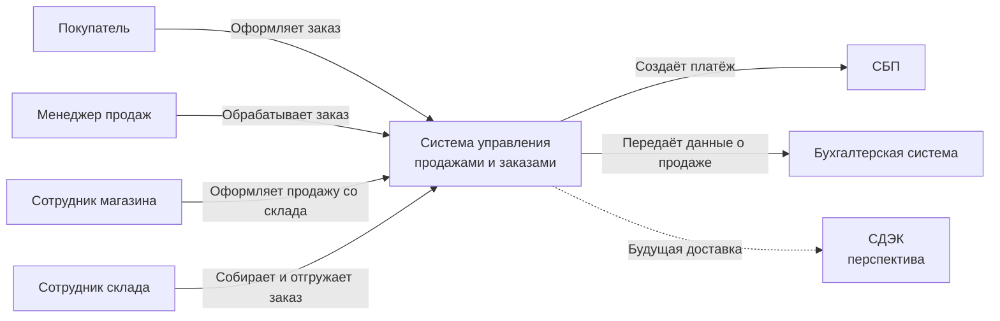
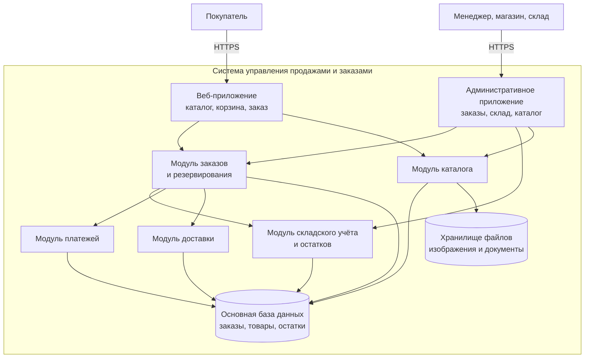
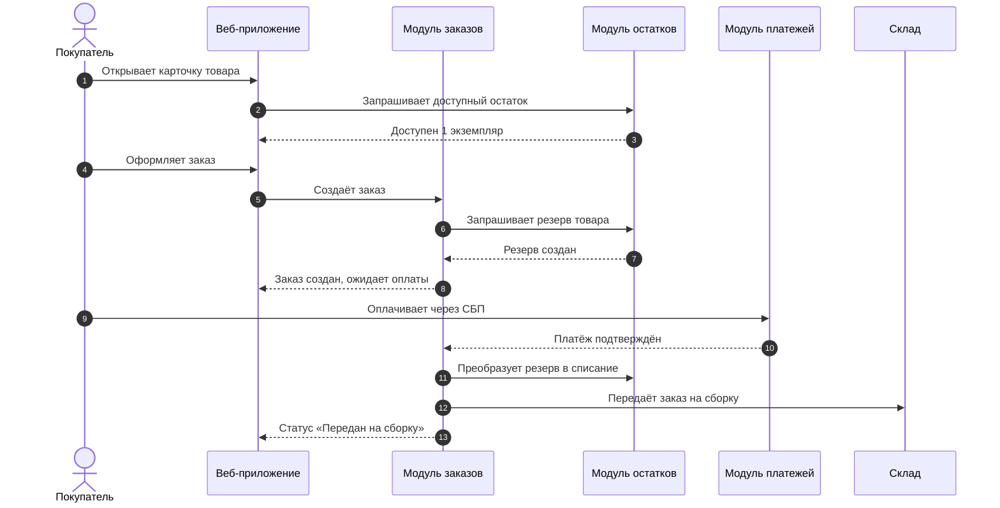
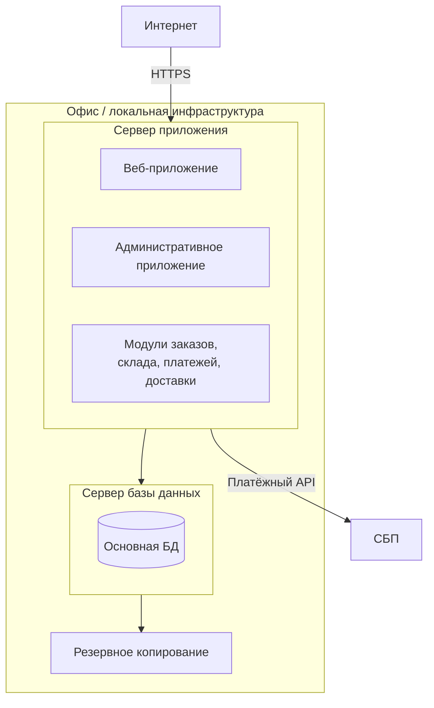

# Часть 1. Глава 1.6 — Архитектурные представления

## Цель главы

Научиться описывать архитектуру с разных точек зрения, не смешивая уровень бизнес-контекста, внутреннее устройство системы и инфраструктуру развёртывания. Мы оформим решения по интернет-магазину в набор согласованных представлений: контекстную и контейнерную диаграммы C4, динамическую диаграмму оформления заказа, представление развёртывания и матрицу трассировки требований.

Модель C4 использует статические представления Context, Containers, Components и Code, а также вспомогательные динамические и развёртывательные диаграммы. Контейнерная диаграмма показывает приложения и хранилища данных внутри системы, а динамическая — их взаимодействие в конкретном сценарии. [c4model](https://c4model.com/diagrams)

## Зачем нужны разные представления

Одна диаграмма не может одинаково хорошо ответить на все вопросы:

- владельцу бизнеса важно видеть границы системы и внешних участников;
- разработчику — состав приложений, хранилищ и интеграций;
- сотруднику эксплуатации — где компоненты выполняются и как они развёртываются;
- аналитику — как сценарий связан с требованиями и архитектурными решениями.

Поэтому архитектура описывается несколькими согласованными представлениями. Каждое отвечает на свой вопрос и имеет свою аудиторию.

| Представление | Главный вопрос | Основная аудитория |
|---|---|---|
| Контекстная диаграмма | С чем взаимодействует система? | Бизнес, стейкхолдеры |
| Контейнерная диаграмма | Из каких приложений и хранилищ состоит система? | Разработчики, архитекторы |
| Динамическая диаграмма | Как элементы взаимодействуют в сценарии? | Разработчики, аналитики |
| Диаграмма развёртывания | Где выполняются компоненты? | Эксплуатация, DevOps |
| Матрица трассировки | Как требования связаны с решениями? | Архитекторы, руководители проекта |

## 1. Контекстное представление

Контекстная диаграмма уже была построена в главе 1.1. Она остаётся верхним уровнем модели и показывает систему управления продажами и заказами вместе с покупателями, сотрудниками и внешними сервисами.

## 2. Контейнерное представление

**Контейнер** в C4 — это приложение или хранилище данных. Контейнерная диаграмма показывает, как система разделена на крупные исполняемые единицы, какие технологии используются на высоком уровне и как они взаимодействуют. [c4model](https://c4model.com/abstractions/container)

Для первой версии не нужно сразу выделять микросервисы. Более уместен **модульный монолит**: единое приложение с чётко разделёнными модулями каталога, заказов, складского учёта, платежей и доставки.

### Почему модульный монолит

Для небольшой команды и первого этапа модульный монолит обычно предпочтительнее микросервисной архитектуры:

- меньше операционной сложности;
- проще обеспечить согласованность остатков и резервов;
- проще отлаживать сквозные сценарии;
- ниже инфраструктурные затраты;
- сохраняется возможность последующего выделения модулей.

При этом внутри монолита модули должны иметь ясные границы: заказы не должны напрямую изменять таблицы склада, а складской модуль — произвольно менять статус заказа. Это создаёт основу для будущего разделения, если бизнес-нагрузка и команда вырастут.

### Антипаттерн: распределённый монолит

Если приложение разделено на несколько сервисов, но все они обращаются к одной общей базе данных и изменяют одни и те же таблицы, возникает распределённый монолит. Система получает сетевые задержки и сложность распределённого взаимодействия, но не получает независимости модулей.

## 3. Динамическое представление

**Динамическая диаграмма** показывает, как элементы системы взаимодействуют во времени для реализации конкретного сценария. Она дополняет статическую модель: контейнерная диаграмма отвечает на вопрос «что есть», динамическая — «как это работает». [c4model](https://c4model.com/diagrams/dynamic)

Рассмотрим критический сценарий: покупатель оформляет заказ на последний экземпляр товара.

### Ключевые правила сценария

- Резерв создаётся до перехода к оплате.
- Один физический экземпляр может быть зарезервирован только один раз.
- При неоплате резерв освобождается по истечении установленного времени.
- После подтверждения оплаты резерв преобразуется в подтверждённое списание.
- Заказ передаётся на склад только после подтверждения оплаты или явного согласования менеджером.

Этот сценарий связывает требования согласованности, производительности и устойчивости с конкретным поведением системы.

## 4. Представление развёртывания

**Диаграмма развёртывания** показывает, где выполняются экземпляры приложений и хранилищ в конкретной среде: на сервере, виртуальной машине, в контейнере или облачном окружении. Она отделена от контейнерной диаграммы, поскольку одна и та же система может развёртываться по-разному в development, staging и production. [c4model](https://c4model.com/diagrams/container)

Для первой версии допустима простая конфигурация:

### Что важно зафиксировать уже сейчас

- Разделение приложения и базы данных.
- Регулярное резервное копирование.
- Проверяемая процедура восстановления.
- Ограничение сетевого доступа к базе данных.
- Разделение сред разработки, тестирования и production.

Переход в облако не является обязательным для первой версии. Однако если бизнес рассматривает его как вероятное будущее, не следует выбирать решения, которые сделают миграцию неоправданно дорогой: например, жёсткую привязку к локальным путям файловой системы или нестандартным механизмам развёртывания.

## 5. Трассировка требований

**Трассировка требований** — связь между бизнес-целями, сценариями, атрибутами качества, рисками и архитектурными решениями. Она позволяет проверить, что каждое важное требование имеет реализацию, а каждое решение обосновано потребностью.

| Требование / риск | Сценарий | Атрибут качества | Архитектурное решение | Представление |
|---|---|---|---|---|
| Предотвратить двойную продажу | Два покупателя заказывают последний товар | Согласованность | Резервирование до оплаты; единственная точка изменения остатка | Динамическая диаграмма, модуль остатков |
| Автоматизировать обработку заказов | Менеджер обрабатывает заказ без Excel | Производительность, удобство | Единая очередь заказов и статусы | Контейнерная диаграмма |
| Отображать актуальный остаток | Покупатель видит наличие на сайте | Согласованность, производительность | Обновление остатка с контролируемой задержкой | Контейнерная и динамическая диаграммы |
| Поддержать будущие склады | Добавление нового склада | Модифицируемость | Идентификатор склада в модели остатков и позиций заказа | Контейнерная диаграмма, ADR |
| Поддержать СДЭК в будущем | Передача заказа внешней службе доставки | Модифицируемость | Модуль доставки, независимый от перевозчика | Контейнерная диаграмма |
| Сохранить данные при сбое | Восстановление после отказа | Восстанавливаемость | Регулярные резервные копии и проверка восстановления | Диаграмма развёртывания |

### Правило трассировки

Для каждого архитектурно значимого решения должно быть возможно ответить:

1. Какую бизнес-цель оно поддерживает?
2. Какой сценарий оно реализует?
3. Какой атрибут качества улучшает?
4. Какой риск снижает?
5. В каком представлении это видно?

Если ответить не удаётся, решение либо избыточно, либо недостаточно обосновано.

## Задания для закрепления

### Задание 1. Разделите представления

Определите, к какому представлению относится каждый вопрос:

- «Какие внешние системы взаимодействуют с магазином?»
- «Из каких приложений и баз данных состоит система?»
- «Как происходит резервирование товара при заказе?»
- «На каком сервере выполняется приложение?»
- «Какой ADR обосновывает выбор модульного монолита?»

### Задание 2. Постройте контейнерную диаграмму

Постройте контейнерную диаграмму для системы интернет-магазина.

Требования:

- минимум пять контейнеров;
- отдельные модули заказов, остатков, каталога, платежей и доставки;
- основная база данных;
- хранилище файлов;
- указание протокола для внешних интеграций.

### Задание 3. Опишите динамический сценарий

Постройте динамическую диаграмму для сценария «Покупатель оформил заказ, но не завершил оплату через СБП».

Обязательно покажите:

- создание резерва;
- ожидание оплаты;
- истечение срока резерва;
- освобождение товара;
- изменение статуса заказа.

### Задание 4. Составьте матрицу трассировки

Выберите три требования или риска и свяжите каждый с:

- критическим сценарием;
- атрибутом качества;
- архитектурным решением;
- представлением, в котором решение отображается.

## Вопросы для самопроверки

**1. Что показывает контейнерная диаграмма C4?**

A. Только пользователей и внешние системы  
B. Приложения, хранилища данных и их высокоуровневые взаимодействия  
C. Все классы и методы системы  
D. Физические серверы и сетевые маршруты

**Ответить**

Показать правильный ответ

**Правильный ответ: B.**

Контейнер в C4 — приложение или хранилище данных. Контейнерная диаграмма показывает состав системы, распределение ответственности и основные взаимодействия. [c4model](https://c4model.com/abstractions/container)

***

**2. Чем динамическая диаграмма отличается от контейнерной?**

A. Она показывает физическое размещение серверов  
B. Она показывает взаимодействие элементов во времени для конкретного сценария  
C. Она заменяет контекстную диаграмму  
D. Она описывает исходный код классов

**Ответить**

Показать правильный ответ

**Правильный ответ: B.**

Динамическая диаграмма демонстрирует сотрудничество элементов системы при выполнении сценария, например оформления или оплаты заказа. [c4model](https://c4model.com/diagrams/dynamic)

***

**3. Почему диаграмму развёртывания не следует смешивать с контейнерной диаграммой?**

A. Потому что развёртывание не относится к архитектуре  
B. Потому что одно и то же приложение может развёртываться по-разному в разных средах  
C. Потому что контейнерная диаграмма показывает пользователей  
D. Потому что развёртывание описывает только бизнес-процессы

**Ответить**

Показать правильный ответ

**Правильный ответ: B.**

Контейнерная диаграмма описывает логическую структуру приложений и хранилищ, а диаграмма развёртывания — их размещение в конкретной среде: на серверах, виртуальных машинах или в контейнерах. [c4model](https://c4model.com/diagrams/container)

***

**4. Что обеспечивает трассировка требований?**

A. Автоматическое создание кода  
B. Связь между бизнес-целями, сценариями, качеством, рисками и архитектурными решениями  
C. Ускорение работы базы данных  
D. Отказ от архитектурной документации

**Ответить**

Показать правильный ответ

**Правильный ответ: B.**

Трассировка позволяет проверить, что каждое значимое требование имеет архитектурное обоснование и реализацию, а каждое решение связано с реальной потребностью.

## Итог части 1

После этой главы у нас есть согласованная стартовая архитектура интернет-магазина:

- бизнес-цель — автоматизация заказов и складского учёта;
- границы — единая система заказов, остатков, резервирования и складских операций;
- стейкхолдеры — владелец, менеджеры, магазин, склад, покупатели, бухгалтерия и будущий партнёр по доставке;
- критические сценарии — резервирование, продажа со склада, обработка заказа, оплата и обновление остатков;
- атрибуты качества — согласованность, производительность, модифицируемость, доступность и безопасность;
- ограничения, допущения и риски — Excel, ограниченный бюджет, будущие склады и СДЭК;
- решения — новая система управления заказами и остатками, модульный монолит, расширяемая модель склада и доставки;
- представления — контекст, контейнеры, динамика, развёртывание и трассировка.

## Что будет в части 2

Во второй части мы перейдём к распределённому проектированию. На примере интернет-магазина разберём декомпозицию предметной области, выбор между модульным монолитом и микросервисами, контракты API, события «Заказ оплачен» и «Остаток изменён», владение данными, а также согласованность распределённых операций — в том числе резервирование, оплату и передачу заказа на склад.