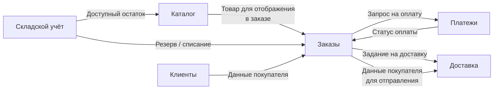

# Часть 2. Глава 2.1 — Декомпозиция предметной области

## Цель главы

Научиться разделять систему на осмысленные предметные области, определить их границы, владение данными и правила согласованности. Мы применим эти идеи к интернет-магазину: разделим каталог, заказы, складской учёт, платежи и доставку, а затем определим, какие данные принадлежат каждому контексту и где проходят точки интеграции.

**Bounded Context** — явная граница, внутри которой конкретная доменная модель и её термины имеют однозначное значение. Один и тот же термин может означать разное в разных контекстах: например, «товар» в каталоге и «складская позиция» в учёте остатков. [oreilly](https://www.oreilly.com/library/view/domain-driven-design-distilled/9780134434964/ch02.html)

## 1. Зачем нужна декомпозиция

Если все понятия — товар, остаток, заказ, оплата, доставка, клиент — поместить в одну общую модель, система быстро становится трудной для понимания и изменения.

Например, слово **«товар»** имеет разный смысл:

| Контекст | Что означает «товар» | Ключевые данные |
|---|---|---|
| Каталог | Товар, который видит покупатель | Название, описание, изображения, цена, характеристики |
| Складской учёт | Физически учитываемая позиция | SKU, остаток, зарезервировано, доступно, местонахождение |
| Заказ | Позиция покупки | Товар, количество, цена на момент заказа, сумма |
| Доставка | Грузовое место или отправление | Вес, габариты, адрес, статус перевозки |

Попытка сделать один универсальный объект «Товар» для всех задач приводит к избыточной модели: каталог получает складские поля, склад — маркетинговые, а заказ — свойства, которые ему не нужны.

## 2. Bounded Context

**Bounded Context** определяет область, в которой действует согласованный язык и набор бизнес-правил. Внутри границы термины имеют точное значение; за её пределами они могут интерпретироваться иначе. [oreilly](https://www.oreilly.com/library/view/domain-driven-design-distilled/9780134434964/ch02.html)

Для интернет-магазина выделим следующие контексты.

| Контекст | Ответственность | Владеет данными | Не владеет |
|---|---|---|---|
| Каталог | Представление товаров покупателю | Название, описание, изображения, характеристики, цена для отображения | Фактическим складским остатком |
| Заказы | Жизненный цикл заказа | Заказ, позиции заказа, статус, сумма, способ доставки и оплаты | Складскими остатками |
| Складской учёт | Достоверность наличия и движение товара | SKU, остаток, резерв, поступление, списание, сборка | Описанием товара для сайта |
| Платежи | Проведение и учёт оплаты | Платёж, сумма, статус, внешний идентификатор СБП | Составом заказа |
| Доставка | Организация передачи заказа получателю | Способ доставки, адрес, статус отправления | Правилами складского резерва |
| Клиенты | Учёт покупателя и его контактных данных | Профиль, контакты, адреса | Историей заказов |

### Важное уточнение

Контекст — это не обязательно отдельный микросервис. На первом этапе все контексты могут находиться внутри одного модульного монолита. Значение имеет не физическое разделение, а ясность границ: какие данные принадлежат контексту, какие правила он enforce’ит и через какие контракты взаимодействует с другими.

## 3. Контекстная карта

**Context Map** — представление, которое показывает ограниченные контексты и характер отношений между ними: кто является источником данных, кто потребителем, где требуется перевод модели. [qconlondon](https://qconlondon.com/london-2009/qconlondon.com/dl/qcon-london-2009/slides/EricEvans_WhatIveLearnedAboutDDDSinceTheBook.pdf)



### Отношения между контекстами

| Отношение | Смысл | Пример |
|---|---|---|
| Upstream → Downstream | Один контекст является источником модели или событий, другой их потребляет | Складской учёт передаёт доступный остаток каталогу |
| Антикоррупционный слой | Преобразует внешнюю модель в собственную, защищая внутреннюю модель | Модуль платежей переводит ответ СБП в внутренний статус платежа |
| Партнёрство | Контексты согласованно развиваются | Заказы и складской учёт согласуют жизненный цикл резерва |
| Shared Kernel | Небольшая общая модель, совместно используемая контекстами | Общие идентификаторы товара, заказа и склада |

Для первой версии рекомендуется избегать сложного Shared Kernel. Достаточно договориться об идентификаторах и базовых контрактах, а модели каждого контекста оставить независимыми.

## 4. Агрегаты и инварианты

**Агрегат** — группа связанных объектов, которая изменяется как единое целое ради сохранения бизнес-инвариантов. У агрегата есть корень (**aggregate root**): внешние компоненты обращаются к агрегату через него, а не изменяют внутренние объекты напрямую. [peopleanalyst](https://peopleanalyst.com/library/libdc52c2a720ec3213)

**Инвариант** — правило, которое должно оставаться истинным после каждой значимой операции.

Примеры инвариантов:

- сумма заказа равна сумме его позиций;
- нельзя зарезервировать больше товара, чем доступно;
- заказ нельзя передать на сборку до подтверждения оплаты или явного согласования;
- один физический экземпляр не может быть зарезервирован дважды;
- отменённый заказ не может быть отправлен на сборку.

### Агрегат «Заказ»

```text
Агрегат: Заказ

Корень агрегата:
Order
├── идентификатор заказа
├── идентификатор покупателя
├── статус
├── сумма
├── способ оплаты
├── способ доставки
└── позиции
    ├── идентификатор позиции
    ├── идентификатор товара
    ├── идентификатор склада
    ├── количество
    └── цена
```

Инварианты агрегата:

```text
1. Заказ содержит хотя бы одну позицию.
2. Сумма заказа равна сумме позиций.
3. Статус заказа изменяется только по допустимым переходам.
4. Нельзя добавить позицию в подтверждённый заказ
   без явной бизнес-операции изменения.
5. Заказ не может быть передан на сборку,
   пока не подтверждена оплата или не получено согласование менеджера.
```

### Агрегат «Складская позиция»

```text
Агрегат: Складская позиция

Корень агрегата:
StockItem
├── идентификатор SKU
├── идентификатор склада
├── физический остаток
├── зарезервировано
├── доступно
└── журнал движений
```

Инварианты агрегата:

```text
1. Доступно = физический остаток - зарезервировано.
2. Зарезервировано >= 0.
3. Физический остаток >= 0.
4. Нельзя создать резерв, если доступно < запрашиваемого количества.
5. Каждое изменение остатка имеет запись в журнале движений.
```

### Граница согласованности

Агрегат задаёт границу **транзакционной согласованности**. Если для соблюдения правила необходимо атомарно изменить несколько данных, они, как правило, должны находиться в одном агрегате. [corecursive](https://corecursive.com/018-micro-services-and-domain-driven-design-with-vaughn-vernon/)

Поэтому резервирование последнего экземпляра должно выполняться внутри агрегата складской позиции: только он знает доступный остаток и может атомарно увеличить значение «зарезервировано».

При этом заказ и складская позиция — разные агрегаты. Заказ не должен напрямую изменять остаток. Он запрашивает операцию резервирования у складского контекста.

## 5. Владение бизнес-возможностями

Каждый контекст должен владеть своими данными и правилами. Это позволяет ответить на вопрос: **кто является источником истины?**

| Вопрос | Владелец ответа |
|---|---|
| Какой товар показывать покупателю? | Каталог |
| Сколько экземпляров фактически доступно? | Складской учёт |
| Можно ли зарезервировать товар? | Складской учёт |
| Каков состав и статус заказа? | Заказы |
| Был ли платёж успешным? | Платежи |
| Куда и как доставить заказ? | Доставка |
| Кто такой покупатель? | Клиенты |

### Антипаттерн: общая таблица «на всё»

Если заказы, склад, каталог и платежи читают и изменяют одни и те же таблицы, границы исчезают. В результате:

- непонятно, кто отвечает за корректность данных;
- любое изменение затрагивает несколько команд и модулей;
- возникают скрытые зависимости;
- сложно тестировать и развивать систему;
- при будущем разделении на сервисы потребуется масштабная миграция.

## 6. Пример: резервирование последнего товара

```text
1. Модуль заказов получает запрос на создание заказа.
2. Модуль заказов создаёт агрегат «Заказ» со статусом «Черновик».
3. Модуль заказов обращается к складскому контексту:
   «Зарезервируй 1 экземпляр SKU-123 на складе S-1».
4. Складской контекст загружает агрегат «Складская позиция».
5. Проверяется инвариант:
   доступно >= 1.
6. Если инвариант выполняется:
   зарезервировано += 1,
   доступно = физический остаток - зарезервировано.
7. Складской контекст возвращает идентификатор резерва.
8. Модуль заказов сохраняет заказ со статусом «Ожидает оплаты».
```

Если два запроса приходят одновременно, складской контекст должен гарантировать, что резерв получит только один из них. Второй запрос получает отказ или предложение альтернативы.

## 7. События между контекстами

Контексты могут обмениваться не только запросами, но и фактами о произошедших событиях.

| Событие | Источник | Потребители |
|---|---|---|
| `OrderCreated` | Заказы | Складской учёт, аналитика |
| `StockReserved` | Складской учёт | Заказы, каталог |
| `PaymentConfirmed` | Платежи | Заказы, складской учёт |
| `OrderReadyForFulfillment` | Заказы | Склад, доставка |
| `StockChanged` | Складской учёт | Каталог |
| `OrderShipped` | Доставка | Заказы, клиенты |

Событие фиксирует уже произошедший факт и формулируется в прошедшем времени. Например, `PaymentConfirmed` означает, что платёж подтверждён, а не что его нужно подтвердить.

## Задания для закрепления

### Задание 1. Определите контексты

Разделите систему интернет-магазина на ограниченные контексты. Для каждого укажите:

- ответственность;
- данные, которыми он владеет;
- данные, которые он получает из других контекстов;
- ключевые бизнес-правила.

### Задание 2. Найдите разные значения термина

Проанализируйте термин «товар» в контекстах каталога, складского учёта и заказа. Составьте таблицу: какие атрибуты нужны каждому контексту и какие не нужны.

### Задание 3. Определите агрегаты

Для складского учёта определите агрегат, его корень и инварианты. Объясните, почему резервирование должно происходить внутри этого агрегата.

### Задание 4. Постройте контекстную карту

Постройте контекстную карту для шести контекстов: каталог, заказы, складской учёт, платежи, доставка, клиенты. Укажите направления зависимостей и события, передаваемые между контекстами.

## Вопросы для самопроверки

**1. Что такое bounded context?**

A. Отдельный сервер приложения  
B. Граница, внутри которой доменная модель и термины имеют однозначное значение  
C. Таблица базы данных  
D. Способ развёртывания приложения

**Ответить**

<details>
<summary>Показать правильный ответ</summary>

**Правильный ответ: B.**

Bounded context определяет границу применения конкретной модели. Внутри неё термины и правила согласованы; за её пределами тот же термин может иметь иной смысл. [oreilly](https://www.oreilly.com/library/view/domain-driven-design-distilled/9780134434964/ch02.html)

</details>

***

**2. Почему «товар» может означать разное в каталоге и на складе?**

A. Потому что это ошибка проектирования  
B. Потому что разные контексты решают разные задачи и используют разные модели  
C. Потому что товар нельзя хранить в базе данных  
D. Потому что каталог всегда должен владеть остатками

**Ответить**

<details>
<summary>Показать правильный ответ</summary>

**Правильный ответ: B.**

В каталоге товар — объект витрины, в складском учёте — учитываемая складская позиция, а в заказе — позиция покупки. Разные модели отражают разные обязанности контекстов.

</details>

***

**3. Что такое инвариант агрегата?**

A. Любое поле в базе данных  
B. Правило, которое должно оставаться истинным после значимых изменений агрегата  
C. Название таблицы  
D. Способ развёртывания сервиса

**Ответить**

<details>
<summary>Показать правильный ответ</summary>

**Правильный ответ: B.**

Инвариант — бизнес-правило согласованности, например: «нельзя зарезервировать больше товара, чем доступно». Агрегат существует в том числе для защиты таких правил. [peopleanalyst](https://peopleanalyst.com/library/libdc52c2a720ec3213)

</details>

***

**4. Почему заказ не должен напрямую изменять таблицу складских остатков?**

A. Потому что это замедляет интерфейс  
B. Потому что остатками владеет складской контекст, и изменение должно проходить через его правила и агрегат  
C. Потому что заказы не связаны с товарами  
D. Потому что склад не участвует в обработке заказа

**Ответить**

<details>
<summary>Показать правильный ответ</summary>

**Правильный ответ: B.**

Прямое изменение чужих данных разрушает владение данными и позволяет обойти инварианты складского учёта. Заказ должен запрашивать операцию резервирования у складского контекста.

</details>

## Что будет в главе 2.2

В следующей главе мы оценим, почему для первой версии интернет-магазина целесообразен **модульный монолит**, сравним его с микросервисной архитектурой и слоистой архитектурой, а также сформулируем критерии выбора архитектурного стиля: размер команды, скорость поставки, требования согласованности, нагрузка и планы развития.