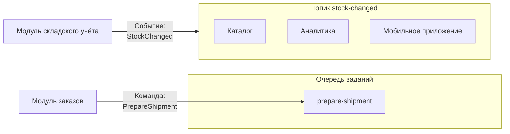
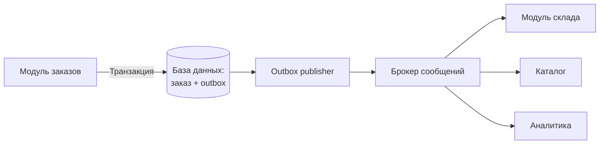
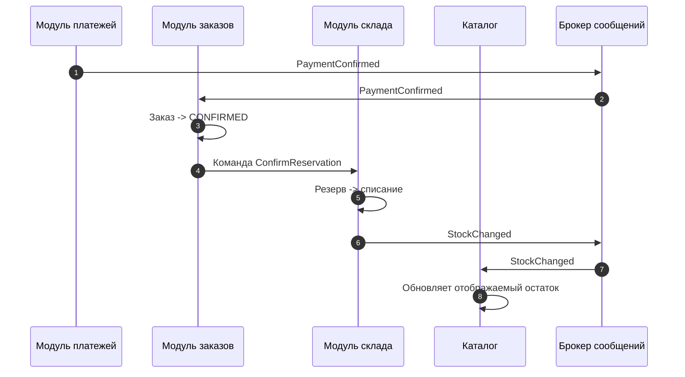

# Часть 2. Глава 2.4 — Асинхронные сообщения и события

## Цель главы

Научиться различать команды и события, выбирать между очередью и pub/sub, проектировать схемы сообщений и эволюционировать событийные контракты без нарушения работы потребителей. Мы применим эти принципы к интернет-магазину: созданию заказа, резервированию товара, подтверждению оплаты и обновлению остатков.

Асинхронный обмен полезен, когда отправителю не нужно немедленно ждать результата: он публикует факт или передаёт задание, а получатель обрабатывает его самостоятельно. Это повышает устойчивость и развязывает модули, но требует аккуратной работы с повторами, порядком сообщений и согласованностью. [dl.acm](https://dl.acm.org/doi/abs/10.5555/940308)

## 1. Команды и события

**Команда** — сообщение, которое предписывает выполнить действие. Она направляется конкретному обработчику и выражает намерение изменить состояние системы.

**Событие** — сообщение о факте, который уже произошёл. Оно формулируется в прошедшем времени и не содержит указания «что сделать»: потребители сами решают, как реагировать. [github](https://github.com/travisjneuman/.claude/blob/master/skills/event-driven-architecture/SKILL.md)

| Характеристика | Команда | Событие |
|---|---|---|
| Смысл | «Сделай это» | «Это уже произошло» |
| Время | Будущее или imperative | Прошедшее |
| Адресат | Один конкретный обработчик | Один или несколько подписчиков |
| Пример | `ReserveStock` | `StockReserved` |
| Ответ | Может ожидать результат | Обычно результат не ожидается |
| Отказ | Отправитель обычно узнаёт о невозможности выполнения | Потребитель обрабатывает факт самостоятельно |

### Примеры для интернет-магазина

| Тип | Сообщение | Смысл |
|---|---|---|
| Команда | `ReserveStock` | Зарезервировать товар для заказа |
| Команда | `ProcessPayment` | Инициировать обработку платежа |
| Команда | `PrepareShipment` | Подготовить отправление |
| Событие | `OrderCreated` | Заказ создан |
| Событие | `StockReserved` | Товар зарезервирован |
| Событие | `PaymentConfirmed` | Оплата подтверждена |
| Событие | `StockChanged` | Остаток изменился |
| Событие | `OrderShipped` | Заказ передан в доставку |

Типичная ошибка — называть событием команду. Например, `ConfirmPayment` — это команда, а `PaymentConfirmed` — событие.

## 2. Очередь и pub/sub

**Очередь** — канал, в котором сообщение обычно обрабатывается одним потребителем. Она подходит для распределения заданий и сглаживания пиков нагрузки.

**Pub/sub** — модель «издатель — подписчики»: издатель публикует сообщение, не зная, кто его получит, а несколько подписчиков получают собственную копию. [enterpriseintegrationpatterns](https://www.enterpriseintegrationpatterns.com/docs/hohpeg_enterpriseintegrationpatterns.pdf)

| Критерий | Очередь | Pub/sub |
|---|---|---|
| Число обработчиков | Обычно один | Несколько |
| Назначение | Выполнить задание | Распространить факт |
| Пример | Обработать платёж | Уведомить каталог, аналитику и склад об изменении остатка |
| Связанность | Отправитель знает задачу | Издатель не знает потребителей |
| Масштабирование | Несколько экземпляров обрабатывают разные сообщения | Каждый подписчик получает своё сообщение |

### Применение к интернет-магазину



- `PrepareShipment` — команда, её должен обработать один обработчик доставки.
- `StockChanged` — событие, оно может быть интересно каталогу, аналитике и мобильному приложению.

## 3. Схемы сообщений

Сообщение должно содержать достаточно данных, чтобы потребитель мог обработать его без дополнительного запроса к источнику, но не должно превращаться в копию всей базы данных.

### Общие поля конверта

```json
{
  "messageId": "msg-9f31c2d4-77aa-4b1e-9f0d-2a5b7c8e9101",
  "eventType": "StockReserved",
  "eventVersion": 1,
  "occurredAt": "2026-11-01T19:32:10Z",
  "producer": "inventory-service",
  "correlationId": "ord-50021",
  "causationId": "res-90311",
  "data": {}
}
```

| Поле | Назначение |
|---|---|
| `messageId` | Уникальный идентификатор сообщения для дедупликации |
| `eventType` | Тип сообщения |
| `eventVersion` | Версия схемы |
| `occurredAt` | Момент наступления факта |
| `producer` | Источник события |
| `correlationId` | Связь с бизнес-операцией, например заказом |
| `causationId` | Связь с сообщением, вызвавшим данное событие |

### Событие `StockReserved`

```json
{
  "messageId": "msg-9f31c2d4-77aa-4b1e-9f0d-2a5b7c8e9101",
  "eventType": "StockReserved",
  "eventVersion": 1,
  "occurredAt": "2026-11-01T19:32:10Z",
  "producer": "inventory-service",
  "correlationId": "ord-50021",
  "data": {
    "reservationId": "res-90311",
    "orderId": "ord-50021",
    "sku": "SKU-123",
    "warehouseId": "wh-1",
    "quantity": 1,
    "expiresAt": "2026-11-01T19:47:10Z"
  }
}
```

### Событие `PaymentConfirmed`

```json
{
  "messageId": "msg-4b7d0a91-2f3e-4c8a-9d21-7b6a5f4e3210",
  "eventType": "PaymentConfirmed",
  "eventVersion": 1,
  "occurredAt": "2026-11-01T19:35:42Z",
  "producer": "payment-service",
  "correlationId": "ord-50021",
  "data": {
    "paymentId": "pay-70114",
    "orderId": "ord-50021",
    "amount": 4590.00,
    "currency": "RUB",
    "method": "SBP"
  }
}
```

## 4. Эволюция событийных контрактов

Сообщения живут дольше кода: потребитель может получить событие, опубликованное до его обновления. Поэтому схему нельзя менять произвольно. [iankduncan](https://www.iankduncan.com/engineering/2025-11-14-event-design-for-streaming-systems/)

### Совместимые изменения

| Изменение | Совместимость |
|---|---|
| Добавить необязательное поле | Обычно совместимо |
| Добавить новое поле со значением по умолчанию | Обычно совместимо |
| Добавить новый тип события | Обычно совместимо |
| Переименовать поле | Несовместимо |
| Удалить поле, которое используют потребители | Несовместимо |
| Изменить тип поля | Несовместимо |
| Изменить смысл значения статуса | Несовместимо |

### Пример эволюции

Исходная версия:

```json
{
  "eventType": "StockReserved",
  "eventVersion": 1,
  "data": {
    "reservationId": "res-90311",
    "orderId": "ord-50021",
    "sku": "SKU-123",
    "quantity": 1
  }
}
```

Совместимое добавление:

```json
{
  "eventType": "StockReserved",
  "eventVersion": 2,
  "data": {
    "reservationId": "res-90311",
    "orderId": "ord-50021",
    "sku": "SKU-123",
    "quantity": 1,
    "warehouseId": "wh-1",
    "expiresAt": "2026-11-01T19:47:10Z"
  }
}
```

Потребитель версии 1 может игнорировать новые поля. Потребитель версии 2 использует их, если они присутствуют.

### Несовместимое изменение

Удаление `orderId` или изменение `quantity` со числа на строку нарушит работу существующих потребителей. Такое изменение требует новой версии события и согласованного плана перехода.

## 5. Надёжная публикация событий

Распространённая проблема — **dual write**: в одной операции нужно сохранить изменение в базе данных и опубликовать сообщение. Если сохранить заказ удалось, а публикация события не удалась, потребители не узнают о факте. Если событие опубликовано, а транзакция не завершилась, потребители получат ложный факт. [docs.aws.amazon](https://docs.aws.amazon.com/prescriptive-guidance/latest/cloud-design-patterns/transactional-outbox.html)

### Антипаттерн: публикация события в середине транзакции

```text
1. Начать транзакцию.
2. Сохранить заказ.
3. Отправить событие в брокер.
4. Зафиксировать транзакцию.
```

Если шаг 3 выполнен, а шаг 4 не удался, событие уже ушло, хотя заказ не сохранён.

### Решение: transactional outbox

**Transactional outbox** сохраняет бизнес-изменение и событие в одной локальной транзакции. Отдельный процесс затем читает записи outbox и публикует их в брокере. [docs.aws.amazon](https://docs.aws.amazon.com/prescriptive-guidance/latest/cloud-design-patterns/transactional-outbox.html)



```text
1. В одной транзакции:
   - сохранить заказ;
   - записать событие OrderCreated в таблицу outbox.

2. Отдельный процесс:
   - читает неопубликованные записи outbox;
   - публикует событие в брокер;
   - помечает запись как опубликованную.

3. При сбое публикация повторяется.
```

Потребители должны быть готовы к повторной доставке и использовать `messageId` для дедупликации.

## 6. Повторы, порядок и dead letter queue

Асинхронная обработка не гарантирует однократную доставку. На практике обычно обеспечивается **at-least-once delivery**: сообщение может быть доставлено более одного раза, но не должно быть потеряно.

| Вопрос | Практика |
|---|---|
| Что делать при повторе? | Использовать `messageId` и идемпотентную обработку |
| Что делать при сбое обработчика? | Повторять с ограничением и задержкой |
| Что делать с постоянно падающим сообщением? | Перенести в dead letter queue |
| Как обрабатывать порядок? | Использовать ключ партиционирования, например `orderId` |
| Как связывать сообщения? | Использовать `correlationId` и `causationId` |

### Dead letter queue

**Dead letter queue (DLQ)** — отдельная очередь для сообщений, которые не удалось обработать после заданного числа попыток. Она не является местом, куда сообщения отправляют и забывают: требуется мониторинг, разбор причин и процедура повторной обработки.

Для интернет-магазина DLQ особенно важна для событий `PaymentConfirmed` и `StockReserved`: их потеря может привести к зависшему заказу или некорректному остатку.

## 7. Динамический сценарий: оплата и склад



Здесь оплата и заказ связываются событием, а заказ и склад — командой. Это осознанный выбор: склад должен получить точное указание подтвердить резерв, а другие потребители должны узнать о факте изменения остатка.

## Задания для закрепления

### Задание 1. Разделите команды и события

Определите тип каждого сообщения:

- `CancelOrder`
- `OrderCancelled`
- `ReserveStock`
- `StockReserved`
- `ShipOrder`
- `OrderShipped`
- `ProcessPayment`
- `PaymentFailed`

### Задание 2. Выберите канал

Для каждого случая выберите очередь или pub/sub и обоснуйте выбор:

- передать заказ на сборку;
- уведомить каталог, аналитику и мобильное приложение об изменении остатка;
- запустить формирование отправления;
- уведомить несколько систем о подтверждении оплаты.

### Задание 3. Спроектируйте событие

Создайте схему события `OrderCancelled` версии 1. Включите общие поля конверта и данные, необходимые складу для освобождения резерва.

### Задание 4. Объясните outbox

Опишите, что произойдёт без transactional outbox, если система сохранит заказ, но не сможет опубликовать `OrderCreated`. Предложите решение и объясните, как потребитель должен обрабатывать повторную доставку.

## Вопросы для самопроверки

**1. Чем событие отличается от команды?**

A. Событие всегда требует немедленного ответа  
B. Событие сообщает о произошедшем факте, а команда предписывает выполнить действие  
C. Команда рассылается всем подписчикам  
D. Событие не имеет данных

**Ответить**

<details>
<summary>Показать правильный ответ</summary>

**Правильный ответ: B.**

Команда выражает намерение: `ReserveStock`. Событие фиксирует факт: `StockReserved`. События обычно публикуются для нескольких заинтересованных потребителей. [github](https://github.com/travisjneuman/.claude/blob/master/skills/event-driven-architecture/SKILL.md)

</details>

***

**2. Когда целесообразнее использовать pub/sub, а не очередь?**

A. Когда задание должен выполнить ровно один обработчик  
B. Когда несколько независимых потребителей должны узнать об одном факте  
C. Когда нужно гарантировать строгий порядок обработки одним сервисом  
D. Когда сообщение должно быть удалено после первой обработки

**Ответить**

<details>
<summary>Показать правильный ответ</summary>

**Правильный ответ: B.**

Pub/sub подходит для распространения события нескольким подписчикам. Очередь чаще используется для передачи задания одному обработчику. [enterpriseintegrationpatterns](https://www.enterpriseintegrationpatterns.com/docs/hohpeg_enterpriseintegrationpatterns.pdf)

</details>

***

**3. Какую проблему решает transactional outbox?**

A. Проблему медленного интерфейса  
B. Проблему dual write: рассогласования между сохранением данных и публикацией сообщения  
C. Проблему отсутствия версий API  
D. Проблему выбора облачного провайдера

**Ответить**

<details>
<summary>Показать правильный ответ</summary>

**Правильный ответ: B.**

Outbox сохраняет бизнес-изменение и событие в одной локальной транзакции, а публикация выполняется отдельным процессом. Это снижает риск потери или преждевременной публикации события. [docs.aws.amazon](https://docs.aws.amazon.com/prescriptive-guidance/latest/cloud-design-patterns/transactional-outbox.html)

</details>

***

**4. Почему потребитель событий должен поддерживать идемпотентность?**

A. Потому что сообщения всегда доставляются ровно один раз  
B. Потому что при практической доставке at-least-once сообщение может быть обработано повторно  
C. Потому что события не содержат идентификаторов  
D. Потому что брокер не хранит сообщения

**Ответить**

<details>
<summary>Показать правильный ответ</summary>

**Правильный ответ: B.**

При повторной доставке обработчик не должен повторно списывать товар, менять статус заказа или создавать дубликат. Для этого используются `messageId`, уникальные бизнес-ключи и идемпотентные операции.

</details>

## Что будет в главе 2.5

В следующей главе мы рассмотрим архитектуру данных: кто владеет данными о товаре, заказе, остатке и платеже; как выбрать модель хранения для разных задач; когда оправдана полиглотная персистентность; и как организовать аналитический поток данных без нагрузки на операционную базу интернет-магазина.