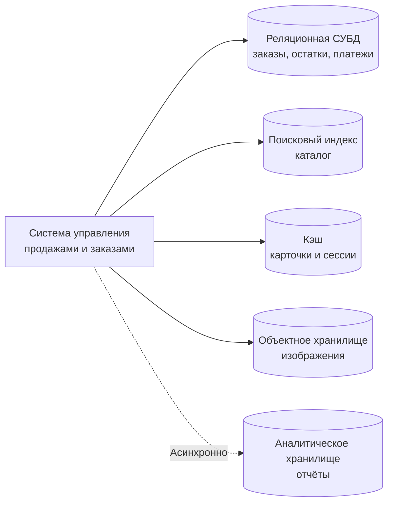
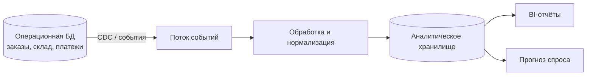

# Часть 2. Глава 2.5 — Архитектура данных

## Цель главы

Научиться определять владельцев данных, выбирать модель хранения под конкретный сценарий доступа и организовывать аналитические потоки без перегрузки операционной системы. Мы применим эти принципы к интернет-магазину: разделим данные каталога, заказов, склада, платежей и доставки, а затем определим, где нужна строгая транзакционность, где — быстрый поиск, а где — аналитическая витрина.

Не существует универсальной базы данных для всех задач: разные хранилища оптимизированы под разные модели доступа. Поэтому современные системы нередко используют несколько технологий хранения — подход, известный как **полиглотная персистентность**. [martin.kleppmann](https://martin.kleppmann.com/papers/olep-cacm.pdf)

## 1. Владение данными

**Владение данными** означает, что у каждого контекста есть определённый источник истины: он отвечает за корректность, жизненный цикл и правила изменения своих данных. Другие контексты получают эти данные через API, события или специально подготовленные проекции, но не изменяют их напрямую. [microservices](https://microservices.io/patterns/cn/data/database-per-service.html)

| Данные | Владелец | Кто потребляет | Способ получения |
|---|---|---|---|
| Карточка товара, описание, изображения | Каталог | Сайт, заказы | API, событие `ProductUpdated` |
| Фактический остаток и резерв | Складской учёт | Каталог, заказы, аналитика | API, события `StockChanged`, `StockReserved` |
| Заказ, позиции, статус | Заказы | Платежи, склад, доставка, аналитика | API, события заказа |
| Платёж и его статус | Платежи | Заказы, бухгалтерия | API, событие `PaymentConfirmed` |
| Отправление и статус доставки | Доставка | Заказы, покупатель | API, событие `OrderShipped` |
| Профиль и адрес покупателя | Клиенты | Заказы, доставка | API |

### Правило источника истины

Для каждого вопроса должен быть один владелец ответа:

```text
Сколько товара доступно?         -> Складской учёт
Каков статус заказа?             -> Заказы
Был ли платёж успешным?          -> Платежи
Какой товар показывать на сайте? -> Каталог
Куда доставить заказ?            -> Доставка
```

Если несколько модулей могут изменять одно и то же поле, источник истины размывается. Например, если и заказы, и склад могут напрямую менять `availableQuantity`, невозможно определить, какое значение корректно после сбоя или конкурентного обновления.

## 2. Операционные и аналитические данные

**Операционные данные** поддерживают текущие бизнес-процессы: оформление заказа, резервирование, сборку, оплату и доставку. Для них важны транзакционность, низкая задержка и корректность при конкурентном доступе.

**Аналитические данные** используются для отчётов, прогнозов и управленческих решений: продажи по дням, популярные товары, доля отмен, эффективность складов. Для них важны гибкие запросы, история и возможность агрегации больших объёмов.

| Характеристика | Операционные данные | Аналитические данные |
|---|---|---|
| Основная операция | Создание, изменение, точечное чтение | Агрегация, группировка, исторический анализ |
| Пример | «Зарезервируй один экземпляр SKU-123» | «Какие товары чаще всего отменяют в регионе?» |
| Важное свойство | Транзакционность и согласованность | Гибкость запросов и производительность аналитики |
| Типичное хранилище | Реляционная СУБД | Хранилище данных, колоночная СУБД, озеро данных |
| Обновление | В момент бизнес-операции | Периодически или потоково |

## 3. Выбор модели хранения

Выбор хранилища определяется не названием технологии, а сценарием доступа.

| Задача | Требования | Подходящее решение |
|---|---|---|
| Заказы, остатки, резервы, платежи | Транзакции, целостность, конкурентные обновления | Реляционная СУБД |
| Поиск по каталогу, фильтры, подсказки | Полнотекстовый поиск, фасеты, релевантность | Поисковый индекс |
| Кэш карточек, сессии, лимиты | Очень быстрое чтение, короткоживущие данные | Кэш в памяти |
| Документы и изображения | Хранение больших объектов | Объектное хранилище |
| История событий и интеграции | Упорядоченный поток, повторное воспроизведение | Брокер сообщений или журнал событий |
| Отчёты и аналитика | Агрегации по большим объёмам | Хранилище данных или колоночная СУБД |

### Пример для интернет-магазина

```text
Реляционная СУБД:
- заказы
- позиции заказа
- складские позиции
- резервы
- платежи
- отправления

Поисковый индекс:
- карточки товаров
- поиск по названию и характеристикам
- фильтры по цене, бренду и наличию

Кэш:
- популярные карточки товаров
- результаты частых запросов каталога

Объектное хранилище:
- изображения товаров
- документы покупателя

Аналитическое хранилище:
- продажи по дням
- отмены и причины
- оборачиваемость товаров
- эффективность складов
```

## 4. Полиглотная персистентность

**Полиглотная персистентность** — использование разных технологий хранения для разных задач. Она оправдана, когда у данных действительно разные модели доступа и требования. [martin.kleppmann](https://martin.kleppmann.com/papers/olep-cacm.pdf)



### Когда это оправданно

- Каталогу нужны поиск, фильтры и релевантность, а не только точечное чтение по идентификатору.
- Заказам и складу нужны транзакции и строгие инварианты.
- Аналитике нужны агрегации по большим историческим объёмам.
- Изображениям нужно дешёвое и масштабируемое хранилище больших объектов.

### Когда это избыточно

Если команда небольшая, нагрузка умеренная, а аналитика ограничивается несколькими отчётами, добавление поискового движка, кэша, озера данных и потоковой платформы может усложнить систему без ощутимой пользы.

**Правило:** сначала определить сценарий доступа и ограничение, затем выбирать технологию, а не наоборот.

## 5. Данные каталога и остатки

Каталог и складской учёт используют разные представления одного товара.

### Каталог

```json
{
  "productId": "prod-889",
  "sku": "SKU-123",
  "title": "Зимняя куртка",
  "description": "Тёплая куртка для города",
  "brand": "Example",
  "price": 4590.00,
  "images": [
    "https://cdn.example.com/products/889/1.jpg"
  ],
  "attributes": {
    "color": "black",
    "size": "L"
  },
  "displayedAvailability": "IN_STOCK"
}
```

### Складская позиция

```json
{
  "stockItemId": "stock-771",
  "sku": "SKU-123",
  "warehouseId": "wh-1",
  "physicalQuantity": 12,
  "reservedQuantity": 3,
  "availableQuantity": 9,
  "version": 47
}
```

Каталог не должен вычислять доступность из складских таблиц. Он получает факт об остатке через API или событие `StockChanged` и хранит собственное отображаемое состояние.

### Инвариант склада

```text
availableQuantity = physicalQuantity - reservedQuantity
```

Это правило принадлежит складскому контексту. Каталог может отображать `IN_STOCK`, `LOW_STOCK` или `OUT_OF_STOCK`, но не должен быть источником истины о точном количестве.

## 6. Аналитический поток данных

Аналитические запросы не должны выполняться в основной операционной базе в часы пик: тяжёлые отчёты могут замедлить оформление заказов и резервирование.



### Варианты организации

| Вариант | Как работает | Когда подходит |
|---|---|---|
| Отчёты из операционной БД | SQL-запросы к основной базе | Малый объём данных и редкие отчёты |
| Реплика для чтения | Отчёты идут в реплику | Нужна разгрузка основной базы, но аналитика простая |
| CDC в аналитическое хранилище | Изменения передаются в отдельное хранилище | Нужны история, сложные отчёты и прогнозы |
| События в аналитическое хранилище | Бизнес-события поступают в поток | Нужны сквозная аналитика и обработка в реальном времени |

Для первой версии достаточно начать с ограниченного набора отчётов и не строить сложную платформу данных. Однако полезно сразу сохранять ключевые бизнес-события: `OrderCreated`, `PaymentConfirmed`, `StockReserved`, `OrderCancelled`, `OrderShipped`.

## 7. CQRS: когда разделять чтение и запись

**CQRS** (Command Query Responsibility Segregation) — принцип, при котором модель записи и модель чтения могут различаться. Запись оптимизируется под бизнес-правила и транзакции, а чтение — под удобные и быстрые запросы. [microservices](https://microservices.io/patterns/cn/data/database-per-service.html)

Для интернет-магазина это может выглядеть так:

```text
Запись:
- создание заказа
- резервирование товара
- подтверждение оплаты
- изменение складского остатка

Чтение:
- карточка товара с отображаемым наличием
- список заказов менеджера
- история статусов заказа
- аналитические отчёты
```

### Когда CQRS избыточен

Если запросы просты, а нагрузка умеренная, отдельная модель чтения добавляет задержку, сложность и риск рассогласования. На первом этапе достаточно реляционной базы, индексов и, при необходимости, кэша.

CQRS становится полезным, когда появляются сложные витрины, разные профили чтения и записи либо необходимость собирать данные нескольких контекстов в одном представлении. [github](https://github.com/denyspoltorak/metapatterns/wiki/Polyglot-Persistence)

## 8. Антипаттерны

### Общая база для всех модулей

Если заказы, склад, каталог и платежи работают с одними таблицами, владение данными исчезает. Изменения становятся небезопасными, а границы контекстов — фиктивными. [microservices](https://microservices.io/patterns/cn/data/database-per-service.html)

### База данных как интеграционная шина

Если модули обмениваются данными, напрямую читая таблицы друг друга, возникает скрытая связанность. Изменение схемы одного модуля ломает другие, даже если публичный API не менялся.

### Аналитика в операционной базе

Тяжёлые отчёты в основной базе могут блокировать транзакции и ухудшать время отклика критичных операций. Аналитическую нагрузку следует изолировать.

### Преждевременный выбор NoSQL

Выбор документной или графической СУБД без анализа транзакций, связей и сценариев доступа часто приводит к тому, что сложные связи приходится поддерживать в приложении, а согласованность — реализовывать вручную.

## Задания для закрепления

### Задание 1. Определите владельца данных

Для каждого вопроса укажите контекст-владелец:

- Какое описание товара показывать на сайте?
- Сколько экземпляров доступно на складе?
- Каков текущий статус заказа?
- Был ли платёж подтверждён?
- Какой адрес доставки указал покупатель?
- Какой статус у отправления?

### Задание 2. Выберите хранилище

Подберите тип хранилища для следующих задач и обоснуйте выбор:

- заказы и резервы;
- поиск по каталогу;
- кэш популярных карточек;
- изображения товаров;
- отчёт по продажам за два года;
- поток событий для аналитики.

### Задание 3. Спроектируйте событие для каталога

Создайте схему события `StockChanged`, которое каталог использует для обновления отображаемого остатка. Учтите `warehouseId`, `sku`, старое и новое доступное количество, время события и версию схемы.

### Задание 4. Оцените необходимость CQRS

В интернет-магазине появились требования:

- менеджеру нужен список заказов с фильтрами по статусу, складу и дате;
- аналитику нужны отчёты по продажам и отменам;
- покупателю нужна карточка товара с остатком;
- складу нужна очередь заданий на сборку.

Определите, для каких задач достаточно основной базы, а где оправданы отдельная витрина чтения или аналитическое хранилище.

## Вопросы для самопроверки

**1. Кто должен быть источником истины о доступном остатке товара?**

A. Каталог  
B. Модуль заказов  
C. Складской учёт  
D. Платёжный модуль

**Ответить**

<details>
<summary>Показать правильный ответ</summary>

**Правильный ответ: C.**

Складской контекст владеет физическим остатком, резервами и правилами их изменения. Каталог может отображать доступность, но не должен быть источником точного складского остатка.

</details>

***

**2. Что такое полиглотная персистентность?**

A. Использование одной базы данных для всех задач  
B. Использование разных технологий хранения для разных моделей доступа  
C. Хранение всех данных в JSON-файлах  
D. Обязательное использование микросервисов

**Ответить**

<details>
<summary>Показать правильный ответ</summary>

**Правильный ответ: B.**

Полиглотная персистентность предполагает выбор хранилища под задачу: реляционная СУБД для транзакций, поисковый индекс для каталога, объектное хранилище для файлов, аналитическое хранилище для отчётов. [martin.kleppmann](https://martin.kleppmann.com/papers/olep-cacm.pdf)

</details>

***

**3. Почему тяжёлые аналитические отчёты не следует выполнять в основной операционной базе?**

A. Потому что SQL не подходит для отчётов  
B. Потому что они могут создавать нагрузку и мешать критичным транзакциям оформления заказов и резервирования  
C. Потому что аналитические данные нельзя хранить в таблицах  
D. Потому что отчёты всегда должны быть в реальном времени

**Ответить**

<details>
<summary>Показать правильный ответ</summary>

**Правильный ответ: B.**

Операционная база оптимизирована для транзакционной работы. Тяжёлые агрегации лучше выносить в реплику, аналитическое хранилище или поток событий. [thedailybyte.substack](https://thedailybyte.substack.com/p/database-per-service-pattern-data)

</details>

***

**4. Когда CQRS оправдан?**

A. Всегда, независимо от нагрузки  
B. Когда модели чтения и записи существенно различаются или нужны специализированные витрины  
C. Только при использовании микросервисов  
D. Только при использовании NoSQL

**Ответить**

<details>
<summary>Показать правильный ответ</summary>

**Правильный ответ: B.**

CQRS разделяет модели записи и чтения. Он полезен при сложных запросах, разных профилях нагрузки или необходимости собирать данные нескольких контекстов, но избыточен для простых CRUD-сценариев. [microservices](https://microservices.io/patterns/cn/data/database-per-service.html)

</details>

## Что будет в главе 2.6

В следующей главе мы рассмотрим согласованность распределённых операций: что происходит, если заказ подтверждён, а платёжный сервис недоступен; как реализовать eventual consistency; когда применять Saga; как обеспечить идемпотентную обработку и использовать transactional outbox для надёжной публикации событий.