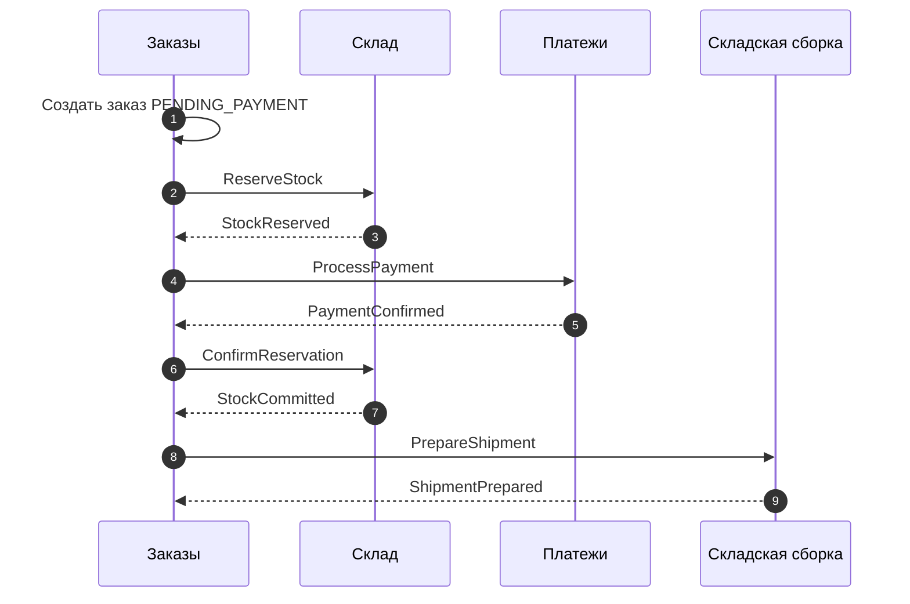
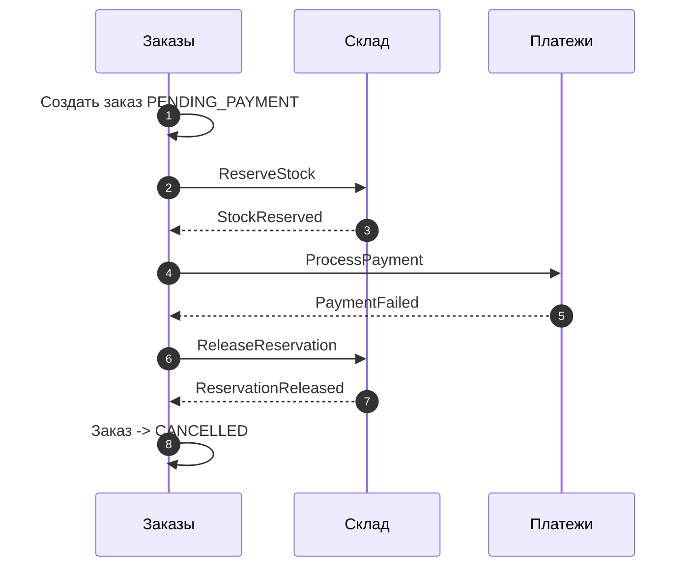
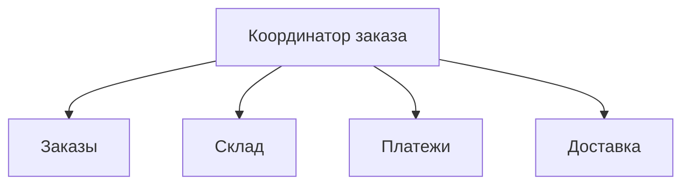
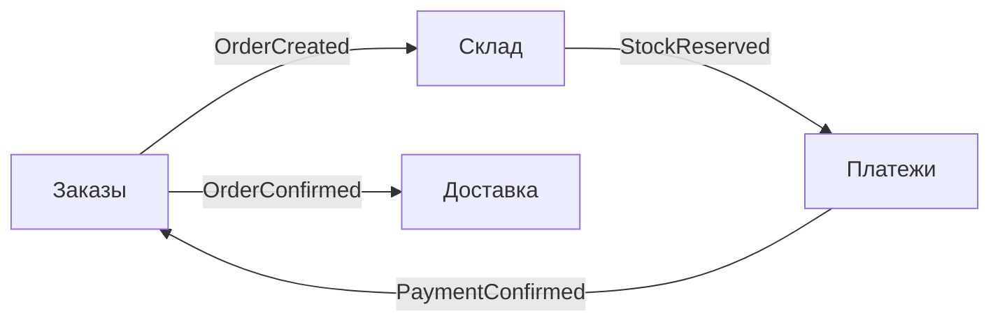
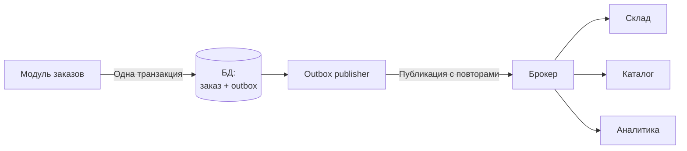

# Часть 2. Глава 2.6 — Согласованность распределённых операций

## Цель главы

Научиться проектировать бизнес-операции, которые затрагивают несколько контекстов, без ложного предположения о единой транзакции. Мы разберём eventual consistency, паттерн Saga, идемпотентную обработку и transactional outbox на примере оформления, оплаты и передачи заказа на склад в интернет-магазине.

Когда несколько сервисов или модулей владеют собственными данными, нельзя рассчитывать на одну общую транзакцию базы данных. Вместо этого операция разбивается на последовательность локальных транзакций, а при сбое выполняются компенсирующие действия. Такой подход называется **Saga**. [docs.aws.amazon](https://docs.aws.amazon.com/prescriptive-guidance/latest/modernization-data-persistence/saga-pattern.html)

## 1. Проблема распределённой операции

Рассмотрим сценарий:

```text
1. Покупатель оформляет заказ.
2. Система резервирует товар на складе.
3. Система инициирует оплату через СБП.
4. После подтверждения оплаты заказ передаётся на склад.
5. Склад начинает сборку.
```

Эти шаги затрагивают разные контексты: заказы, складской учёт, платежи и доставку. Если оплата не прошла, нельзя оставить товар зарезервированным навсегда. Если заказ отменён после резервирования, склад должен освободить товар. Если платёж подтверждён, но передача на склад не удалась, заказ не должен «зависнуть» без видимой причины.

### Что нельзя предполагать

- Что сеть всегда доступна.
- Что сообщение будет доставлено ровно один раз.
- Что все модули используют одну транзакцию.
- Что сбой произойдёт только до начала операции.
- Что пользователь не обновит страницу и не повторит запрос.

## 2. Eventual consistency

**Eventual consistency** — модель согласованности, при которой после изменения данных система может кратковременно находиться в промежуточном состоянии, но при отсутствии новых изменений все реплики и проекции в конечном счёте сходятся к одному значению. [docs.aws.amazon](https://docs.aws.amazon.com/prescriptive-guidance/latest/cloud-design-patterns/saga-orchestration.html)

Для интернет-магазина это означает:

```text
Склад изменил остаток.
Каталог обновит отображаемое наличие через несколько секунд.
В этот короткий интервал сайт может показать устаревшее значение.

Однако резервирование и подтверждение заказа
должны быть согласованы строго:
один физический экземпляр не может быть продан дважды.
```

### Где допустима eventual consistency

| Операция | Допустима ли задержка | Обоснование |
|---|---|---|
| Обновление остатка на сайте | Да, секунды | Покупатель может увидеть устаревшее значение, но заказ не будет оформлен, если резерва нет |
| Пересчёт аналитики | Да, минуты или часы | Отчёты не влияют на текущую продажу |
| Уведомление о статусе доставки | Обычно да | Небольшая задержка не нарушает бизнес-процесс |
| Резервирование последнего товара | Нет | Требуется строгий контроль, чтобы исключить двойную продажу |
| Подтверждение оплаты | Нет | Нельзя дважды списать средства или дважды подтвердить заказ |

### Антипаттерн: eventual consistency вместо бизнес-правила

Нельзя сказать: «Мы используем eventual consistency, поэтому двойная продажа возможна, но потом данные выровняются». Если бизнес-инвариант требует исключить двойную продажу, эта операция должна быть согласована строго, а eventual consistency применяется только к производным данным — например, к отображению остатка.

## 3. Паттерн Saga

**Saga** — последовательность локальных транзакций. Каждая транзакция изменяет данные одного владельца и публикует событие или вызывает следующую операцию. Если шаг невозможен, выполняются компенсирующие транзакции для уже выполненных шагов. [docs.aws.amazon](https://docs.aws.amazon.com/prescriptive-guidance/latest/modernization-data-persistence/saga-pattern.html)

### Пример Saga: оформление и оплата заказа

| Шаг | Локальная транзакция | Компенсация |
|---|---|---|
| 1 | Создать заказ со статусом `PENDING_PAYMENT` | Отменить заказ |
| 2 | Зарезервировать товар на складе | Освободить резерв |
| 3 | Инициировать платёж | Отменить платёж, если это возможно |
| 4 | Подтвердить оплату | — |
| 5 | Преобразовать резерв в списание | Восстановить резерв, если это допустимо |
| 6 | Передать заказ на сборку | Отменить складское задание |

### Успешный путь



### Компенсация при отказе оплаты



Компенсация — это не технический `ROLLBACK` базы данных. Это **бизнес-операция обратного действия**: освободить резерв, отменить заказ, аннулировать платёж или отменить складское задание. [docs.aws.amazon](https://docs.aws.amazon.com/prescriptive-guidance/latest/cloud-design-patterns/saga-patterns.html)

## 4. Оркестрация и хореография

Существует два основных способа координации Saga.

### Оркестрация

Центральный координатор явно управляет шагами, обрабатывает успехи, отказы, повторы и компенсации. [docs.aws.amazon](https://docs.aws.amazon.com/prescriptive-guidance/latest/cloud-design-patterns/saga-orchestration.html)



**Плюсы:**

- понятный центральный жизненный цикл;
- проще отслеживать состояние процесса;
- легче реализовать сложные ветвления и компенсации.

**Минусы:**

- координатор может стать точкой связанности;
- требуется его надёжность и наблюдаемость;
- при ошибочном проектировании возникает «умный центр» с бизнес-логикой всех контекстов.

### Хореография

Контексты реагируют на события друг друга без центрального координатора. [docs.aws.amazon](https://docs.aws.amazon.com/prescriptive-guidance/latest/cloud-design-patterns/saga-choreography.md)



**Плюсы:**

- меньше центральной связанности;
- контексты развиваются более независимо;
- естественно подходит для простых цепочек событий.

**Минусы:**

- сложнее понять полный поток процесса;
- труднее отслеживать состояние и находить причину сбоя;
- при большом числе шагов возникает «неявный workflow», распределённый по подписчикам.

### Выбор для интернет-магазина

Для первой версии разумна **оркестрация жизненного цикла заказа** внутри модуля заказов: он является владельцем статуса заказа и координирует склад, платежи и доставку. При этом отдельные шаги могут быть событийными: например, каталог реагирует на `StockChanged`, а аналитика — на `OrderCreated`.

## 5. Идемпотентная обработка

**Идемпотентный потребитель** — обработчик, который при повторном получении одного и того же сообщения не выполняет бизнес-эффект повторно. Это необходимо, поскольку асинхронные системы обычно гарантируют доставку **at-least-once**, а не ровно один раз. [learn.microsoft](https://learn.microsoft.com/en-us/azure/architecture/patterns/idempotent-consumer)

### Проблема

```text
1. Платёжный модуль публикует PaymentConfirmed.
2. Модуль заказов получает сообщение.
3. Заказ переводится в CONFIRMED.
4. Подтверждение обработки не сохраняется из-за сбоя.
5. Брокер доставляет сообщение повторно.
6. Без защиты заказ может быть обработан повторно.
```

### Решение: маркер дедупликации

Обработчик сохраняет маркер обработки и бизнес-эффект в одной транзакции. При повторной доставке он находит маркер и пропускает сообщение. [learn.microsoft](https://learn.microsoft.com/en-us/azure/architecture/patterns/idempotent-consumer)

```text
Транзакция обработчика:
1. Проверить, обработано ли message-9f31...
2. Если нет:
   - перевести заказ в CONFIRMED;
   - сохранить message-9f31... как обработанное.
3. Зафиксировать транзакцию.

Повторная доставка:
1. Найти message-9f31...
2. Маркер найден.
3. Пропустить обработку.
```

### Идемпотентность операций

| Операция | Защита от повтора |
|---|---|
| Создание заказа | `Idempotency-Key` клиента |
| Резервирование | Уникальный `reservationRequestId` или `orderId + itemId` |
| Подтверждение платежа | `paymentId` и статус платежа |
| Освобождение резерва | `reservationId` |
| Передача на сборку | `orderId` и уникальный идентификатор складского задания |

## 6. Transactional outbox

Проблема **dual write** возникает, когда нужно атомарно сохранить изменение в базе и опубликовать сообщение. Если эти действия выполняются раздельно, возможна потеря события либо публикация события о несостоявшемся изменении. 

**Transactional outbox** решает проблему так:

1. В одной локальной транзакции сохраняются бизнес-данные и запись события в таблицу outbox.
2. Отдельный процесс читает неопубликованные записи.
3. Он публикует их в брокер.
4. После успешной публикации запись помечается как отправленная.
5. При сбое публикация повторяется. 



### Пример outbox-записи

```json
{
  "outboxId": "obx-731",
  "aggregateType": "Order",
  "aggregateId": "ord-50021",
  "eventType": "PaymentConfirmed",
  "eventVersion": 1,
  "payload": {
    "orderId": "ord-50021",
    "paymentId": "pay-70114",
    "status": "CONFIRMED"
  },
  "occurredAt": "2026-11-01T19:35:42Z",
  "published": false
}
```

### Почему это надёжнее

```text
Без outbox:
Сохранить заказ -> Отправить событие
Возможные сбои:
- заказ сохранён, событие потеряно;
- событие отправлено, заказ не сохранён.

С outbox:
Сохранить заказ + событие в одной транзакции
-> отдельная публикация с повторами
Событие не будет потеряно, если сохранена бизнес-операция.
```

## 7. Жизненный цикл заказа и согласованность

```text
DRAFT
  └─> PENDING_PAYMENT
        ├─> CONFIRMED           после PaymentConfirmed
        │     └─> READY_FOR_FULFILLMENT
        │           └─> PICKING
        │                 └─> SHIPPED
        └─> CANCELLED           при отказе оплаты или истечении резерва
```

Ключевые правила:

- переход `PENDING_PAYMENT -> CONFIRMED` возможен только после события `PaymentConfirmed`;
- переход `CONFIRMED -> READY_FOR_FULFILLMENT` требует подтверждённого резерва;
- отмена в статусе `PENDING_PAYMENT` освобождает резерв;
- отмена после начала сборки требует отдельной бизнес-операции и может быть невозможна без согласования склада;
- повторное получение `PaymentConfirmed` не должно повторно переводить заказ или списывать товар.

## Задания для закрепления

### Задание 1. Определите компенсации

Для каждого шага предложите компенсирующее действие:

- создать заказ;
- зарезервировать товар;
- инициировать платёж;
- подтвердить платёж;
- передать заказ на сборку;
- создать отправление.

Укажите, для каких шагов компенсация невозможна или требует особой бизнес-логики.

### Задание 2. Выберите модель согласованности

Разделите операции на строгую согласованность и eventual consistency:

- резервирование последнего экземпляра;
- обновление остатка на сайте;
- подтверждение оплаты;
- пересчёт отчёта по продажам;
- уведомление покупателя о статусе доставки;
- преобразование резерва в списание.

### Задание 3. Спроектируйте идемпотентного потребителя

Опишите обработку события `PaymentConfirmed` так, чтобы повторная доставка не приводила к повторному подтверждению заказа. Укажите, какие данные сохраняются в одной транзакции.

### Задание 4. Постройте Saga

Постройте диаграмму Saga для сценария «Покупатель оформил заказ, товар зарезервирован, но платёж отклонён». Покажите успешные шаги и компенсации.

## Вопросы для самопроверки

**1. Что такое Saga в распределённой системе?**

A. Единая транзакция нескольких баз данных  
B. Последовательность локальных транзакций с компенсациями при сбое  
C. Способ кэширования данных  
D. Вид HTTP-запроса

**Ответить**

<details>
<summary>Показать правильный ответ</summary>

**Правильный ответ: B.**

Saga координирует несколько локальных транзакций. Если одна из них невозможна, выполняются компенсирующие бизнес-операции для уже выполненных шагов. [docs.aws.amazon](https://docs.aws.amazon.com/prescriptive-guidance/latest/modernization-data-persistence/saga-pattern.html)

</details>

***

**2. Чем компенсирующая транзакция отличается от обычного rollback?**

A. Ничем, это синонимы  
B. Компенсация — бизнес-операция обратного действия, а rollback отменяет изменения в рамках одной транзакции  
C. Компенсация всегда мгновенна и технически гарантирована  
D. Rollback применяется только к сообщениям

**Ответить**

<details>
<summary>Показать правильный ответ</summary>

**Правильный ответ: B.**

Компенсация отменяет бизнес-эффект ранее выполненного шага: например, освобождает резерв или отменяет заказ. Она не является автоматическим откатом распределённой транзакции. [docs.aws.amazon](https://docs.aws.amazon.com/prescriptive-guidance/latest/cloud-design-patterns/saga-patterns.html)

</details>

***

**3. Зачем идемпотентному потребителю сохранять маркер обработки в одной транзакции с бизнес-эффектом?**

A. Чтобы ускорить чтение из кэша  
B. Чтобы при повторной доставке сообщения избежать повторного применения бизнес-эффекта  
C. Чтобы обойти ограничение внешнего ключа  
D. Чтобы гарантировать строгий порядок всех сообщений

**Ответить**

<details>
<summary>Показать правильный ответ</summary>

**Правильный ответ: B.**

Если маркер и бизнес-изменение фиксируются атомарно, повторная доставка либо находит маркер и пропускается, либо безопасно обрабатывается заново. [learn.microsoft](https://learn.microsoft.com/en-us/azure/architecture/patterns/idempotent-consumer)

</details>

***

**4. Какую проблему решает transactional outbox?**

A. Проблему медленного поиска по каталогу  
B. Проблему рассогласования между сохранением бизнес-данных и публикацией события  
C. Проблему выбора облачного региона  
D. Проблему отсутствия HTTP-статусов

**Ответить**

<details>
<summary>Показать правильный ответ</summary>

**Правильный ответ: B.**

Outbox сохраняет бизнес-изменение и событие в одной локальной транзакции, после чего отдельный процесс публикует событие с повторами. Это устраняет риск dual write. 

</details>

## Итог части 2

После этой главы мы умеем:

- выделять ограниченные контексты и определять владельцев данных;
- выбирать архитектурный стиль на основе ограничений и целей бизнеса;
- проектировать синхронные API-контракты с идемпотентностью и версионированием;
- различать команды и события, выбирать очередь или pub/sub;
- организовывать владение данными и аналитические потоки;
- обеспечивать согласованность распределённых операций через Saga, идемпотентность и transactional outbox.

## Что будет в части 3

В третьей части мы перейдём к качеству и надёжности. На примере интернет-магазина рассчитаем профиль нагрузки и ёмкость, спроектируем масштабирование и кэширование, разберём отказы СБП и складских интеграций, определим RTO/RPO, построим модель угроз, введём SLI/SLO и бюджет ошибок, а затем проверим архитектуру нагрузочными испытаниями и учениями по отказоустойчивости.