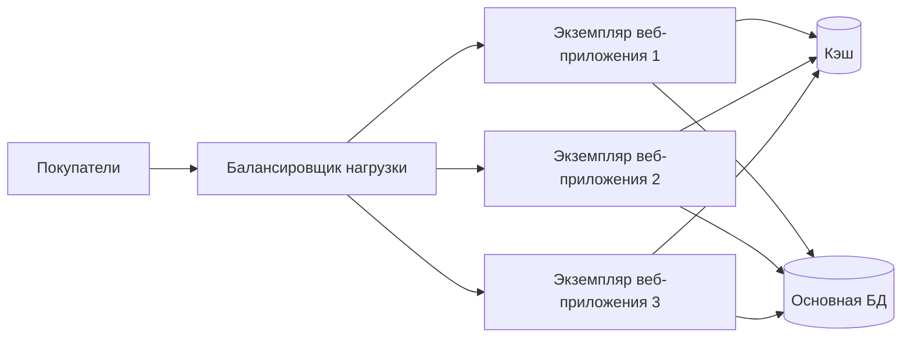
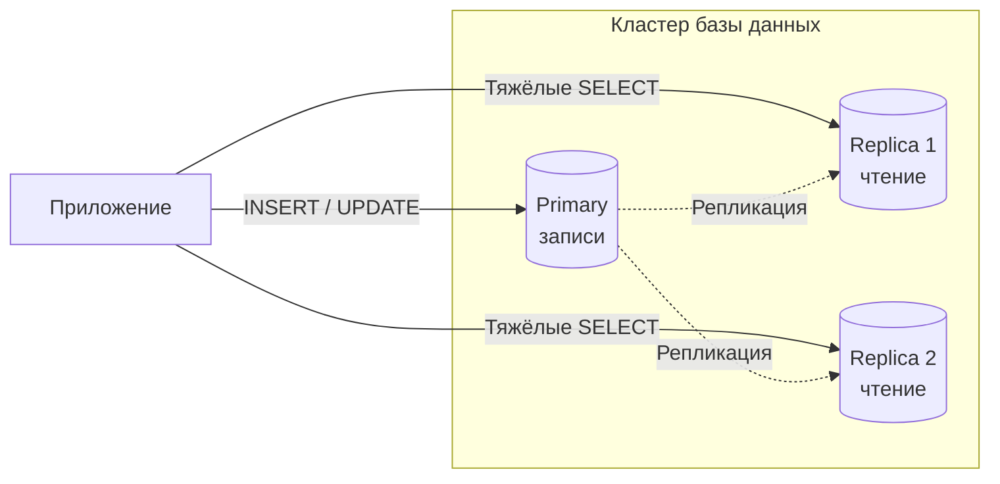

# Часть 3. Глава 3.2 — Производительность и масштабирование

## Цель главы

Научиться проектировать систему так, чтобы она сохраняла целевые показатели при росте нагрузки: масштабировать Stateless-компоненты, разгружать чтение кэшем и репликами, распределять нагрузку и управлять перегрузкой через backpressure. Мы применим эти решения к интернет-магазину, где витрина, заказы, складской учёт и внешние интеграции имеют разные профили нагрузки.

**Масштабирование** — способность системы обрабатывать возрастающую нагрузку без пропорционального ухудшения целевых показателей. Различают вертикальное масштабирование — увеличение ресурсов одного узла — и горизонтальное — добавление узлов. [mariadb](https://mariadb.com/database-topics/scalability/)

## 1. Профиль нагрузки интернет-магазина

Из главы 3.1 мы имеем следующие ориентиры:

| Контур | Пиковая нагрузка | Характер нагрузки |
|---|---:|---|
| Витрина | 25 запросов/с | Много чтений, мало записей |
| Заказы | 0,5 запроса/с | Мало операций, высокая критичность |
| Склад | 0,5 операции/с | Критичные конкурентные обновления |
| Платежи | 0,25 операции/с | Зависимость от внешнего сервиса |
| Администрирование | 1 операция/с | Отчёты и ручные операции |

Вывод: основная нагрузка приходится на чтение каталога, а критическая согласованность — на складские резервы. Поэтому нельзя применять одинаковые стратегии масштабирования ко всем контурам.

## 2. Горизонтальное масштабирование

**Горизонтальное масштабирование** предполагает добавление экземпляров приложения за балансировщиком нагрузки. Оно эффективно, когда экземпляры не хранят важное состояние в локальной памяти.

### Stateless-приложение

Приложение называется **stateless**, если запрос можно обработать на любом экземпляре без обращения к локальному состоянию предыдущего запроса.

Для интернет-магазина:

```text
Можно хранить вне экземпляра:
- сессию пользователя;
- содержимое корзины;
- кэш карточек;
- блокировки и резервы;
- состояние заказа.

Нельзя полагаться на локальную память:
- "заказ создаётся на том же экземпляре, где лежит корзина";
- "резерв хранится в Map в памяти приложения";
- "сессия пользователя хранится только на одном сервере".
```

### Схема масштабирования



Если один экземпляр выходит из строя, балансировщик перестаёт направлять к нему запросы, а остальные продолжают обслуживать пользователей.

## 3. Кэширование данных

**Кэш** хранит копии часто запрашиваемых данных ближе к приложению, чтобы уменьшить число обращений к более медленному источнику. Кэш особенно эффективен для чтения, которое повторяется чаще, чем изменяется. [github](https://github.com/Guo-astro/engineering-handbook/blob/main/content/hld/part-1-core-fundamentals/00-scalability.md)

### Что кэшировать

| Данные | Тип кэша | Время жизни | Риск |
|---|---|---|---|
| Карточка товара | Приложение или распределённый кэш | 5–15 минут | Устаревшая цена или описание |
| Результаты поиска | Кэш по параметрам запроса | 1–5 минут | Неверная видимость новых товаров |
| Популярные категории | Кэш | 10–30 минут | Устаревшие подборки |
| Справочники способов доставки и оплаты | Кэш | 1–24 часа | Несогласованность с настройками |
| Остаток товара | Короткий кэш или без кэша | Секунды | Неверное отображение доступности |

### Кэш карточки товара

```text
Ключ:       product:prod-889:v3
Значение:   JSON карточки товара
TTL:        10 минут
Инвалидация: событие ProductUpdated
```

Версия `v3` позволяет сбросить кэш при изменении структуры карточки. Событие `ProductUpdated` позволяет инвалидировать конкретный ключ сразу после изменения, не ожидая истечения TTL.

### Кэш и остатки

Остаток товара — не лучший кандидат на долгий кэш. Если закэшировать значение на 10 минут, покупатель может увидеть «в наличии», хотя товар уже продан.

Практичное решение:

```text
Каталог:
- кэширует статические данные карточки;
- получает доступность отдельным запросом или из короткоживущей проекции.

Склад:
- является источником истины;
- при резервировании выполняет строгую проверку;
- публикует StockChanged;
- каталог обновляет отображаемый остаток.
```

Таким образом, кэш ускоряет витрину, но не подменяет складской контроль.

### Антипаттерн: кэш как источник истины

Если приложение сначала смотрит в кэш и только при отсутствии значения обращается к складу, а инвалидация не работает, система может продать отсутствующий товар. Кэш должен быть производным от источника истины, а не заменять его.

## 4. Партиционирование нагрузки

**Партиционирование** — разделение данных или обработки на части, которые можно обрабатывать независимо. Оно снижает конкуренцию за общий ресурс и позволяет масштабировать отдельные участки системы. [learn.microsoft](https://learn.microsoft.com/en-us/azure/architecture/patterns/sharding)

### Виды партиционирования

| Вид | Что разделяется | Пример |
|---|---|---|
| Вертикальное | Данные по бизнес-областям | Каталог, заказы, склад в отдельных схемах |
| Горизонтальное | Строки одной таблицы | Заказы по дате или идентификатору покупателя |
| Партиционирование очереди | Сообщения по ключу | События заказа по `orderId` |
| Партиционирование вычислений | Обработка по типу задачи | Отдельные потребители для платежей и доставки |

### Партиционирование сообщений

События одного заказа должны обрабатываться в правильном порядке. Для этого их направляют в одну партицию по ключу:

```text
Ключ партиционирования: orderId

ord-50021 -> partition 2
ord-50022 -> partition 7
ord-50023 -> partition 2
```

Так события `OrderCreated`, `PaymentConfirmed` и `OrderShipped` одного заказа не будут конкурировать за порядок в разных партициях.

### Когда не нужно шардирование

**Шардирование** — горизонтальное разделение данных между несколькими независимыми узлами. Оно увеличивает ёмкость записи и хранения, но добавляет сложность маршрутизации, кросс-шардных запросов и миграций. [learn.microsoft](https://learn.microsoft.com/en-us/azure/architecture/patterns/sharding)

Для первой версии интернет-магазина шардирование избыточно: объём данных измеряется сотнями мегабайт в год, а нагрузка на запись невелика. Сначала следует использовать индексы, корректные запросы, кэш и, при необходимости, реплику чтения.

## 5. Реплики чтения

**Реплика чтения** — копия основной базы данных, которая принимает запросы чтения. Основной узел обрабатывает записи, а реплики получают изменения через репликацию. Это увеличивает пропускную способность чтения, но не решает проблему масштабирования записи. [mariadb](https://mariadb.com/database-topics/scalability/)



### Правила использования

- Записи и критичные чтения перед подтверждением идут в primary.
- Отчёты и тяжёлые выборки направляются в реплику.
- Приложение учитывает задержку репликации.
- Нельзя читать из реплики данные, только что записанные в primary, если бизнес требует немедленной видимости.

Для интернет-магазина реплика полезна для отчётов и аналитики, но резервирование последнего товара должно выполняться на primary.

## 6. Backpressure

**Backpressure** — механизм, при котором система сигнализирует о перегрузке и ограничивает приём новой работы, вместо того чтобы бесконечно накапливать запросы и деградировать. [github](https://github.com/ismanf/just-system-design/blob/main/10-scalability/backpressure.md)

Без backpressure при пиковой нагрузке возможна следующая последовательность:

```text
Рост запросов
-> рост очередей
-> рост задержки
-> исчерпание пула соединений
-> тайм-ауты
-> повторные запросы
-> ещё большая нагрузка
-> отказ системы
```

### Механизмы управления

| Механизм | Суть | Пример |
|---|---|---|
| Ограничение concurrency | Не более N одновременных обработок | Не более 20 параллельных запросов к СБП |
| Ограничение очереди | Не более M сообщений в очереди | Не более 10 000 заданий на сборку |
| Load shedding | Отказ в обработке менее важной нагрузки | Отключить рекомендации при перегрузке |
| Rate limiting | Ограничение частоты запросов | Не более 100 запросов в минуту от одного клиента |
| Приоритизация | Сначала критичные операции | Заказы и резервы важнее рекомендаций |
| Queue-based load leveling | Очередь сглаживает всплески | Пиковые задания на сборку обрабатываются равномерно |

### Пример: защита складского контура

```text
При пиковой распродаже:
1. Витрина генерирует много запросов просмотра.
2. Заказы создают запросы на резервирование.
3. Складской модуль имеет ограниченный пул соединений.

Решение:
- просмотр каталога обслуживается из кэша;
- резервирование имеет отдельный пул соединений;
- при исчерпании пула новые запросы получают 503 с Retry-After;
- аналитика и массовое обновление каталога приостанавливаются.
```

Ответ `503 Service Unavailable` с заголовком `Retry-After` честно сообщает клиенту, что сервис временно перегружен, вместо того чтобы удерживать запрос до тайм-аута. [mapagam](https://mapagam.com/backend/microservices-design-patterns/implementing-backpressure-patterns)

## 7. Очередь как сглаживание нагрузки

**Queue-based load leveling** помещает устойчивую очередь между источником всплесков и потребителем. Производитель быстро принимает задание, а потребитель обрабатывает его с постоянной, посильной скоростью. [github](https://github.com/ismanf/just-system-design/blob/main/10-scalability/backpressure.md)


Это подходит для формирования отправлений, генерации документов, отправки уведомлений и массового обновления каталога. Но не подходит для резервирования последнего товара: покупатель должен получить синхронный и однозначный ответ.

## 8. Практическая стратегия для первой версии

| Контур | Стратегия |
|---|---|
| Витрина | Горизонтальное масштабирование приложения, кэш карточек и поиска, CDN для статики |
| Заказы | Несколько экземпляров, отдельный пул соединений, идемпотентные операции |
| Склад | Строгие транзакции на primary, ограничение concurrency, мониторинг блокировок |
| Платежи | Тайм-ауты, ограничение параллельных вызовов, повтор только для безопасных операций |
| Аналитика | Реплика чтения или отдельное хранилище, запрет тяжёлых отчётов в primary |
| Очереди | Ограниченная глубина, DLQ, мониторинг lag |

### ADR-003: кэширование витрины

```text
# ADR-003: Использовать кэш для витрины каталога

Статус: Принято

## Контекст

Витрина создаёт основную нагрузку: поиск, карточки товаров,
категории и фильтры. Остатки изменяются складским контуром,
а каталог должен быстро отображать товары покупателям.

## Решение

Внедряется распределённый кэш для карточек товаров,
результатов поиска и справочников.

Остаток не кэшируется надолго. Каталог получает доступность
из короткоживущей проекции либо отдельного запроса к складскому
контуру. Склад остаётся источником истины.

## Последствия

Положительные:
- снижается нагрузка на основную базу;
- ускоряется отображение каталога;
- система лучше переносит пиковые распродажи.

Отрицательные:
- возможна кратковременная неактуальность данных;
- требуется стратегия инвалидации;
- добавляется зависимость от кэша.

Условия пересмотра:
- если доля cache miss станет высокой;
- если требования к актуальности остатков изменятся;
- если кэш станет узким местом.
```

## Задания для закрепления

### Задание 1. Определите стратегию масштабирования

Для каждого компонента выберите подходящий способ масштабирования и обоснуйте его:

- веб-приложение витрины;
- модуль заказов;
- модуль складского учёта;
- поиск по каталогу;
- отчёты по продажам;
- отправка email-уведомлений.

### Задание 2. Спроектируйте кэш

Спроектируйте кэш для карточки товара:

- ключ;
- значение;
- TTL;
- событие инвалидации;
- поведение при cache miss;
- что нельзя кэшировать и почему.

### Задание 3. Определите backpressure

Пиковая распродажа создаёт 200 запросов резервирования в секунду, но складской модуль устойчиво обрабатывает только 50 операций в секунду.

Предложите стратегию:

- что делать с новыми запросами;
- какие операции приоритизировать;
- как уведомить клиента;
- как избежать лавины повторов.

### Задание 4. Разделите чтение и запись

Определите, какие запросы должны идти в primary, а какие могут выполняться в реплике:

- создание заказа;
- резервирование товара;
- получение заказа по идентификатору сразу после оплаты;
- отчёт по продажам за прошлый месяц;
- список заказов менеджера;
- поиск по каталогу.

## Вопросы для самопроверки

**1. Какое условие необходимо для эффективного горизонтального масштабирования приложения?**

A. Хранение сессий в локальной памяти каждого экземпляра  
B. Отсутствие важного состояния, привязанного к конкретному экземпляру  
C. Использование только одного экземпляра  
D. Отказ от базы данных

**Ответить**

<details>
<summary>Показать правильный ответ</summary>

**Правильный ответ: B.**

Если состояние пользователя, корзины или резерва хранится в памяти конкретного экземпляра, балансировщик не может свободно распределять запросы. Состояние следует выносить в общее хранилище или кэш.

</details>

***

**2. Почему остаток товара не следует долго кэшировать?**

A. Потому что кэш не поддерживает числа  
B. Потому что устаревший остаток может привести к заказу отсутствующего товара  
C. Потому что кэш всегда медленнее базы данных  
D. Потому что склад не изменяет остатки

**Ответить**

<details>
<summary>Показать правильный ответ</summary>

**Правильный ответ: B.**

Кэш ускоряет отображение, но склад остаётся источником истины. Для доступности допустима лишь короткоживущая проекция, а резервирование всегда проверяется по актуальному состоянию склада.

</details>

***

**3. Что такое backpressure?**

A. Увеличение числа экземпляров при росте нагрузки  
B. Механизм ограничения приёма работы при перегрузке, чтобы система не деградировала неконтролируемо  
C. Копирование базы данных для чтения  
D. Разделение таблицы на несколько узлов

**Ответить**

<details>
<summary>Показать правильный ответ</summary>

**Правильный ответ: B.**

Backpressure ограничивает приём новой работы: через ограничение параллелизма, размер очереди, rate limiting или load shedding. Это защищает систему от лавины тайм-аутов и повторов. [github](https://github.com/ismanf/just-system-design/blob/main/10-scalability/backpressure.md)

</details>

***

**4. Чем шардирование отличается от репликации?**

A. Шардирование копирует одни и те же данные, репликация делит данные на части  
B. Шардирование делит данные на части между узлами, а репликация создаёт копии данных  
C. Они полностью совпадают  
D. Репликация увеличивает запись, а шардирование только чтение

**Ответить**

<details>
<summary>Показать правильный ответ</summary>

**Правильный ответ: B.**

Репликация повышает доступность и масштабирует чтение, создавая копии данных. Шардирование распределяет разные части данных по узлам и может масштабировать запись и хранение. [learn.microsoft](https://learn.microsoft.com/en-us/azure/architecture/patterns/sharding)

</details>

## Что будет в главе 3.3

В следующей главе мы спроектируем устойчивость к отказам: разберём модели возможных отказов СБП, складских операций и брокера сообщений; настроим тайм-ауты и повторные попытки; применим circuit breaker и bulkhead, чтобы сбой одного внешнего сервиса не остановил оформление заказов.