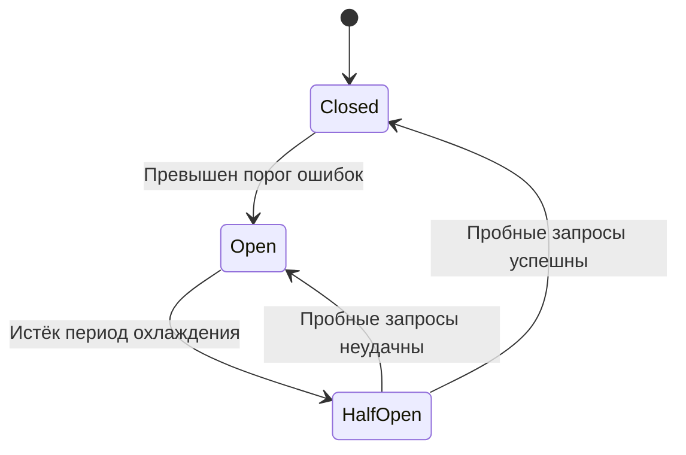
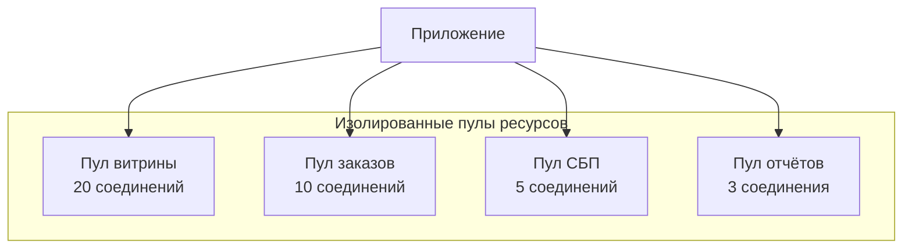
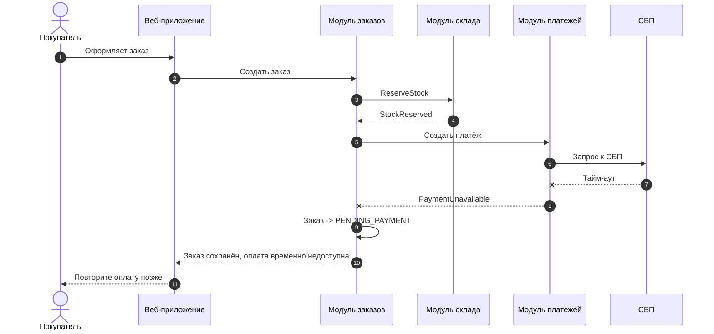

# Часть 3. Глава 3.3 — Устойчивость к отказам

## Цель главы

Научиться выявлять возможные отказы, определять их влияние на бизнес-процессы и применять механизмы устойчивости: тайм-ауты, повторные попытки, circuit breaker и bulkhead. Мы применим эти решения к интернет-магазину, где критичны доступность СБП, корректность складских операций и стабильность оформления заказов.

**Устойчивость к отказам** — способность системы сохранять работоспособность или деградировать контролируемо при сбое компонента или внешней зависимости. Анализ режимов отказа (Failure Mode Analysis) помогает заранее определить точки отказа, их влияние и меры реагирования. [learn.microsoft](https://learn.microsoft.com/en-us/azure/well-architected/reliability/failure-mode-analysis)

## 1. Модель возможных отказов

Нельзя проектировать устойчивость абстрактно. Сначала нужно определить, **что именно может отказать**, **как это проявится** и **что важно сохранить**.

### Компоненты и зависимости

| Компонент | Возможные отказы | Влияние |
|---|---|---|
| Веб-приложение | Недоступность, медленный ответ, ошибка релиза | Покупатель не может оформить заказ |
| Основная БД | Недоступность, блокировки, медленные запросы | Останавливаются заказы, резервы и платежи |
| Модуль склада | Ошибка резервирования, блокировка записи | Двойные продажи или невозможность оформить заказ |
| СБП | Тайм-аут, недоступность, отклонённый платёж | Заказ остаётся неоплаченным |
| Брокер сообщений | Недоступность, задержка, потеря соединения | События не доходят до потребителей |
| Служба доставки | Тайм-аут, ошибка интеграции | Заказ не передаётся в доставку |
| Кэш | Недоступность, вытеснение данных | Рост нагрузки на БД и замедление витрины |

### Формат анализа отказа

```text
Компонент: ...
Отказ: ...
Триггер: ...
Затронутый сценарий: ...
Влияние на бизнес: ...
Требуемая реакция: ...
Мера устойчивости: ...
```

## 2. Тайм-ауты

**Тайм-аут** — максимальное время ожидания ответа от зависимости. Без него вызывающий компонент может бесконечно ждать недоступный сервис, удерживать соединения и исчерпывать ресурсы.

### Правила установки тайм-аутов

Тайм-аут вызывающей стороны должен быть меньше или равен бюджету времени всей пользовательской операции.

```text
Покупатель оформляет заказ.
Целевое время ответа: 2 секунды.

Бюджет:
- валидация и создание заказа: 300 мс;
- резервирование: 500 мс;
- создание платежа: 800 мс;
- суммарный бюджет: не более 1,6 с;
- резерв на обработку и сеть: 400 мс.
```

| Вызов | Тайм-аут | Обоснование |
|---|---:|---|
| Получение карточки товара из кэша | 50 мс | Кэш должен быть быстрым |
| Запрос остатка к складу | 300 мс | Критично, но не должно блокировать витрину |
| Резервирование товара | 500 мс | Критичная операция |
| Создание платежа в СБП | 800 мс | Внешняя зависимость |
| Публикация события | 200 мс | Не должна блокировать основной сценарий |

### Антипаттерн: тайм-аут без бюджета

Если каждый из пяти вызовов имеет тайм-аут 5 секунд, пользовательская операция может длиться 25 секунд. Тайм-ауты нужно задавать не изолированно, а с учётом общего бюджета запроса.

## 3. Повторные попытки

**Повтор (retry)** применяется к временным отказам: кратковременной потере сети, тайм-ауту, ошибке 503 или разрыву соединения. Повторять каждую ошибку опасно: конфликт состояния, ошибка валидации или отказ в доступе при повторе не исчезнут. [learn.microsoft](https://learn.microsoft.com/en-us/azure/well-architected/design-guides/handle-transient-faults)

### Какие ошибки можно повторять

| Ошибка | Повторять? | Причина |
|---|---|---|
| Сетевой тайм-аут | Да, если операция идемпотентна | Ответ мог не дойти |
| `503 Service Unavailable` | Да | Временная перегрузка |
| `429 Too Many Requests` | Да, с учётом `Retry-After` | Ограничение частоты |
| `400 Bad Request` | Нет | Ошибка в запросе |
| `401 Unauthorized` | Нет без обновления токена | Проблема аутентификации |
| `403 Forbidden` | Нет | Недостаточно прав |
| `409 Conflict` | Обычно нет | Конфликт бизнес-состояния |
| `500 Internal Server Error` | Осторожно | Зависит от идемпотентности и природы ошибки |

### Exponential backoff и jitter

**Exponential backoff** увеличивает интервал между попытками, а **jitter** добавляет случайную задержку, чтобы множество клиентов не повторяли запросы одновременно. [learn.microsoft](https://learn.microsoft.com/en-us/azure/well-architected/design-guides/handle-transient-faults)

```text
Попытка 1: через 200 мс ± jitter
Попытка 2: через 400 мс ± jitter
Попытка 3: через 800 мс ± jitter
Попытка 4: не выполняется, включается circuit breaker
```

### Правила безопасного retry

- Повторять только идемпотентные операции.
- Ограничивать число попыток.
- Ограничивать общее время повторов бюджетом запроса.
- Использовать backoff и jitter.
- Учитывать заголовок `Retry-After`.
- Не повторять неидемпотентные операции без ключа идемпотентности.

Для создания заказа и резервирования повтор допустим только с тем же `Idempotency-Key`. Иначе повтор может создать второй заказ или второй резерв.

## 4. Circuit breaker

**Circuit breaker** предотвращает повторные вызовы зависимости, которая с высокой вероятностью недоступна. После превышения порога ошибок «предохранитель» открывается, и запросы завершаются быстро либо обслуживаются резервным сценарием. [learn.microsoft](https://learn.microsoft.com/sl-si/azure/architecture/antipatterns/retry-storm/?view=vsts)

### Состояния circuit breaker



| Состояние | Поведение |
|---|---|
| Closed | Запросы идут к зависимости нормально |
| Open | Запросы не отправляются; возвращается ошибка или fallback |
| Half-open | Отправляется ограниченное число пробных запросов |

### Пример: интеграция с СБП

```text
Порог: 50% ошибок за последние 20 запросов
Период охлаждения: 30 секунд
Half-open: 3 пробных запроса

Если СБП недоступен:
1. Первые запросы завершаются тайм-аутом.
2. Circuit breaker открывается.
3. Новые попытки оплаты не отправляются.
4. Покупатель видит: «Оплата временно недоступна,
   заказ сохранён, попробуйте позже».
5. Через 30 секунд отправляются пробные запросы.
```

### Что важно сохранить

Даже при открытом circuit breaker заказ и резерв не должны теряться. Заказ остаётся в статусе `PENDING_PAYMENT`, а резерв имеет ограниченный срок жизни. Покупатель может повторить оплату позже.

## 5. Bulkhead

**Bulkhead** изолирует ресурсы для разных зависимостей или типов нагрузки. Если один внешний сервис перегружен, он не должен исчерпать пулы соединений, потоки и память, необходимые другим критичным операциям. [learn.microsoft](https://learn.microsoft.com/sl-si/azure/architecture/antipatterns/retry-storm/?view=vsts)



### Пример изоляции

| Пул | Ограничение | Защищаемый сценарий |
|---|---:|---|
| Витрина | 20 соединений | Просмотр каталога |
| Заказы и склад | 10 соединений | Оформление и резервирование |
| СБП | 5 одновременных вызовов | Оплата |
| Отчёты | 3 соединения | Аналитика |
| Очереди | 10 параллельных сообщений | Доставка и уведомления |

Если СБП завис, его пул из 5 соединений исчерпается, но пул заказов и склада сохранится. Покупатели по-прежнему смогут просматривать каталог и создавать заказы, а оплата будет временно недоступна.

### Антипаттерн: общий пул на всё

Если веб-витрина, заказы, платежи и отчёты используют один пул из 30 соединений, медленные отчёты или зависший СБП могут заблокировать критичный путь оформления заказа.

## 6. Fallback и деградация

**Fallback** — запасной сценарий при недоступности зависимости. Он не должен скрывать факт сбоя, но позволяет сохранить полезную функциональность.

| Недоступная зависимость | Fallback |
|---|---|
| Кэш | Обратиться к базе данных, ограничить частоту запросов |
| СБП | Сохранить заказ в статусе `PENDING_PAYMENT`, предложить повторить оплату |
| СДЭК | Разрешить оформление с собственной доставкой или отложить расчёт доставки |
| Сервис рекомендаций | Скрыть блок рекомендаций |
| Аналитика | Продолжать продажи, буферизовать события |
| Служба уведомлений | Сохранить уведомление в очереди для повторной отправки |

### Принцип graceful degradation

Система должна деградировать по приоритету:

```text
Критично сохранить:
- заказ;
- резерв;
- корректность остатков;
- возможность оплаты позже.

Можно временно отключить:
- рекомендации;
- персонализацию;
- сложные фильтры;
- аналитические виджеты;
- необязательные уведомления.
```

## 7. Сценарий: СБП недоступен



Ключевые решения:

- заказ не удаляется;
- резерв сохраняется до истечения срока;
- операция повторяется только по политике retry;
- при устойчивом сбое включается circuit breaker;
- пользователь получает понятное сообщение;
- событие `PaymentFailed` или `PaymentUnavailable` фиксируется для мониторинга.

## 8. Антипаттерны устойчивости

### Retry storm

Множество клиентов немедленно повторяют запросы, усиливая нагрузку на уже перегруженный сервис. Лечение — exponential backoff, jitter, ограничение попыток и circuit breaker. [learn.microsoft](https://learn.microsoft.com/en-us/azure/well-architected/design-guides/handle-transient-faults)

### Retry неидемпотентной операции

Повтор создания платежа или резервирования без ключа идемпотентности может привести к двойному списанию или двойному резерву.

### Тайм-аут больше бюджета пользователя

Отдельные тайм-ауты могут быть разумными, но их сумма делает оформление заказа невозможным для покупателя.

### Отказ без деградации

Если недоступность рекомендаций или аналитики останавливает оформление заказа, границы критичности определены неверно.

### Скрытый сбой

Если система «проглатывает» ошибку и возвращает успешный ответ, заказ может остаться без резерва или оплаты. Ошибки должны фиксироваться, а критичные — влиять на состояние операции.

## Задания для закрепления

### Задание 1. Проведите FMA

Выберите три зависимости интернет-магазина: СБП, складской модуль и брокер сообщений. Для каждой заполните:

```text
Компонент: ...
Отказ: ...
Триггер: ...
Затронутый сценарий: ...
Влияние на бизнес: ...
Мера устойчивости: ...
Fallback: ...
```

### Задание 2. Настройте retry

Для вызова создания платежа в СБП определите:

- какие ошибки можно повторять;
- сколько попыток допустимо;
- интервалы между попытками;
- нужен ли jitter;
- при каком условии повтор запрещён;
- как обеспечить идемпотентность.

### Задание 3. Спроектируйте bulkhead

Определите отдельные пулы ресурсов для витрины, заказов, склада, СБП и отчётов. Укажите ограничения и объясните, какой сценарий защищает каждый пул.

### Задание 4. Определите fallback

Для каждого сбоя предложите fallback и определите, какая функциональность может временно деградировать:

- кэш недоступен;
- СБП недоступен;
- СДЭК недоступен;
- сервис рекомендаций недоступен;
- брокер сообщений недоступен.

## Вопросы для самопроверки

**1. Какие ошибки обычно допустимо повторять?**

A. `400 Bad Request`  
B. `403 Forbidden`  
C. `503 Service Unavailable` для идемпотентной операции  
D. `409 Conflict`

**Ответить**

<details>
<summary>Показать правильный ответ</summary>

**Правильный ответ: C.**

`503` обычно означает временную недоступность или перегрузку. Повтор оправдан, если операция идемпотентна и соблюдается политика backoff. [learn.microsoft](https://learn.microsoft.com/en-us/azure/well-architected/design-guides/handle-transient-faults)

</details>

***

**2. Зачем нужен circuit breaker?**

A. Чтобы увеличить число повторов  
B. Чтобы прекратить вызовы зависимости, которая с высокой вероятностью недоступна, и дать ей время восстановиться  
C. Чтобы скрыть ошибки от пользователя  
D. Чтобы объединить все пулы соединений

**Ответить**

<details>
<summary>Показать правильный ответ</summary>

**Правильный ответ: B.**

Circuit breaker предотвращает повторные обращения к неисправной зависимости, снижает нагрузку и позволяет использовать fallback. [learn.microsoft](https://learn.microsoft.com/sl-si/azure/architecture/antipatterns/retry-storm/?view=vsts)

</details>

***

**3. Что защищает паттерн bulkhead?**

A. От потери данных в кэше  
B. От того, что сбой одной зависимости исчерпает ресурсы, необходимые другим операциям  
C. От медленного SQL-запроса в отчёте  
D. От неправильной версии API

**Ответить**

<details>
<summary>Показать правильный ответ</summary>

**Правильный ответ: B.**

Bulkhead изолирует пулы соединений, потоки и лимиты параллелизма. Например, зависший СБП не должен заблокировать оформление заказов и работу склада. [learn.microsoft](https://learn.microsoft.com/sl-si/azure/architecture/antipatterns/retry-storm/?view=vsts)

</details>

***

**4. Почему повтор неидемпотентной операции опасен?**

A. Потому что он всегда ускоряет систему  
B. Потому что он может создать дубликат заказа, платежа или резерва  
C. Потому что он отключает circuit breaker  
D. Потому что он уменьшает задержку

**Ответить**

<details>
<summary>Показать правильный ответ</summary>

**Правильный ответ: B.**

Повтор неидемпотентной операции может привести к дополнительному бизнес-эффекту. Поэтому такие операции требуют ключа идемпотентности или не должны повторяться автоматически. [docs.aws.amazon](https://docs.aws.amazon.com/prescriptive-guidance/latest/cloud-design-patterns/retry-backoff.html)

</details>

## Что будет в главе 3.4

В следующей главе мы определим целевые показатели доступности и восстановления: RTO и RPO, топологии высокой доступности, стратегию резервного копирования, проверку восстановления и аварийное переключение. Отдельно рассмотрим, какой уровень отказоустойчивости оправдан для первой версии интернет-магазина, а какой следует отложить до роста нагрузки и команды.