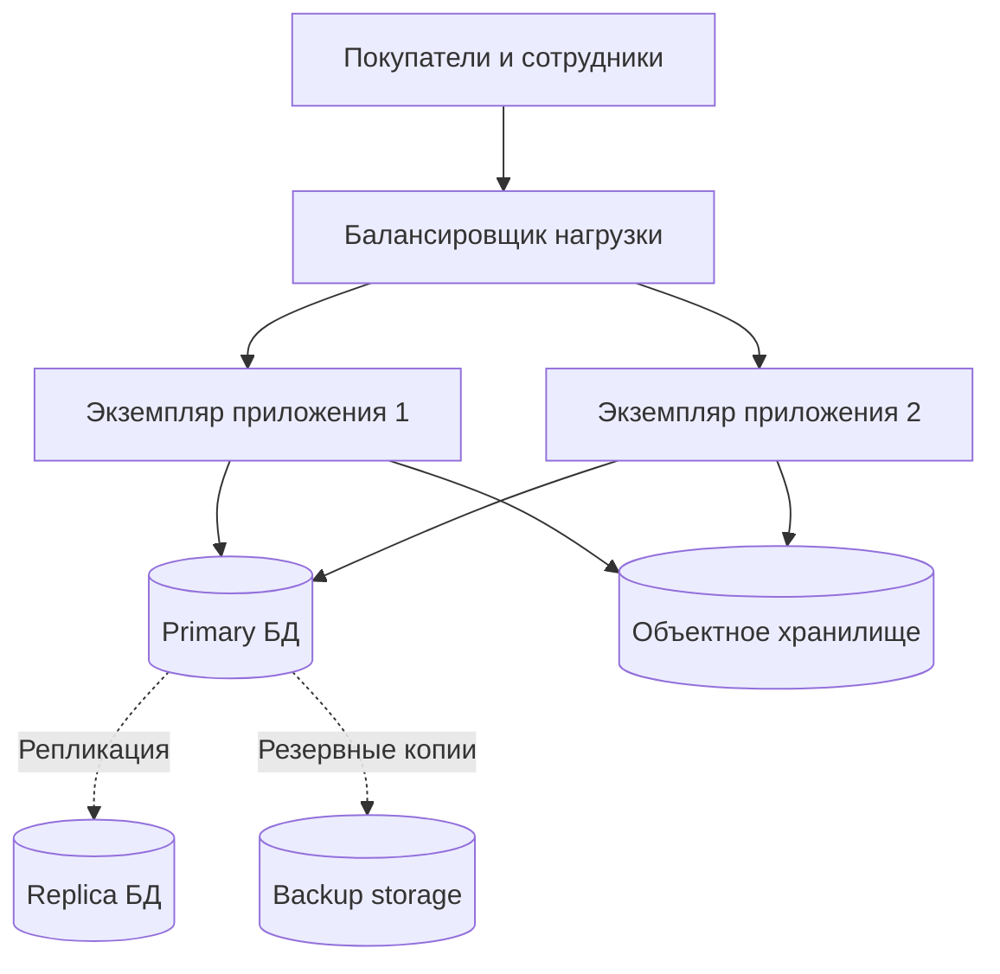

# Часть 3. Глава 3.4 — Доступность и восстановление

## Цель главы

Научиться определять целевые показатели доступности и восстановления, выбирать соразмерную топологию высокой доступности и проектировать проверяемые процедуры резервного копирования и аварийного переключения. Для интернет-магазина важно не追求 максимальную отказоустойчивость любой ценой, а согласовать уровень надёжности с бизнес-рисками, стоимостью и зрелостью команды.

**Доступность** — способность системы выполнять ожидаемые функции в согласованный период времени. **Восстановление** — способность вернуть работоспособность и данные в пределах согласованных целевых показателей RTO и RPO. [sre](https://sre.google/sre-book/availability-table/)

## 1. RTO и RPO

**RTO** (Recovery Time Objective) — максимально допустимое время восстановления работоспособности после инцидента.

**RPO** (Recovery Point Objective) — максимально допустимая потеря данных, выраженная во времени: до какой последней точки система должна быть восстановлена. [learn.microsoft](https://learn.microsoft.com/en-us/azure/well-architected/reliability/disaster-recovery)

| Показатель | Вопрос | Пример |
|---|---|---|
| RTO | Как быстро система должна снова работать? | Не более 4 часов |
| RPO | Сколько данных допустимо потерять? | Не более 15 минут |

### Пример для интернет-магазина

```text
Инцидент: основной сервер базы данных вышел из строя в 19:00.

RTO = 4 часа:
система должна снова принимать заказы не позднее 23:00.

RPO = 15 минут:
после восстановления можно потерять не более 15 минут данных.
Если последняя успешная резервная копия была в 18:30,
а RPO равен 15 минутам, эта копия не удовлетворяет требованию.
```

### Целевые значения для первой версии

| Контур | RTO | RPO | Обоснование |
|---|---:|---:|---|
| Витрина каталога | 4 часа | 24 часа | Каталог можно восстановить из источника и кэша |
| Заказы | 2 часа | 5 минут | Потеря заказов и резервов недопустима |
| Складской учёт | 2 часа | 5 минут | Некорректные остатки приводят к двойным продажам |
| Платежи | 4 часа | 15 минут | Внешний провайдер хранит часть данных |
| Аналитика | 24 часа | 24 часа | Отчёты не блокируют продажи |

Эти значения не являются универсальными. Они должны быть согласованы с владельцем бизнеса: более низкий RTO и RPO обычно требуют более дорогой инфраструктуры и более сложных процессов.

## 2. Уровни доступности

Доступность часто выражают в процентах за период. Однако процент сам по себе не описывает, какие сценарии затронуты и как долго пользователь испытывает проблему. [sre](https://sre.google/sre-book/availability-table/)

| Доступность | Допустимый простой за месяц | Комментарий |
|---:|---:|---|
| 99% | Около 7,2 часа | Минимальный уровень для некритичной системы |
| 99,5% | Около 3,6 часа | Разумный старт для небольшого магазина |
| 99,9% | Около 43 минуты | Требует автоматизации и зрелой эксплуатации |
| 99,95% | Около 21,6 минуты | Требует резервирования критичных компонентов |
| 99,99% | Около 4,3 минуты | Обычно требует multi-AZ или multi-region |

Для первой версии разумно выбрать **99,5% для сервиса заказов** и **99,9% для критического пути резервирования**, если инфраструктура это позволяет. Более высокие значения без выделенной команды эксплуатации часто превращаются в формальное обещание.

## 3. Топологии высокой доступности

### Active-passive cold standby

Резервная среда не работает или развёртывается минимально. При аварии её нужно развернуть и восстановить данные.

```text
Плюсы: низкая стоимость.
Минусы: высокий RTO, возможен большой RPO.
```

### Active-passive warm standby

Резервная среда развёрнута и работает с уменьшенной мощностью, но не принимает production-трафик. При аварии трафик переключается на неё. [learn.microsoft](https://learn.microsoft.com/en-us/azure/well-architected/reliability/disaster-recovery)

```text
Плюсы: умеренный RTO.
Минусы: выше стоимость, требуется регулярная проверка переключения.
```

### Active-active

Несколько сред одновременно обслуживают трафик. При отказе одной остальные продолжают работу. [learn.microsoft](https://learn.microsoft.com/en-us/azure/well-architected/design-guides/disaster-recovery)

```text
Плюсы: минимальный RTO.
Минусы: высокая стоимость, сложная согласованность данных,
сложнее устранение инцидентов.
```

### Сравнение

| Топология | RTO | RPO | Стоимость | Сложность | Когда подходит |
|---|---:|---:|---|---|---|
| Backup and restore | Часы — сутки | Часы — сутки | Низкая | Низкая | Первая версия, некритичные системы |
| Cold standby | Часы | Часы | Низкая — средняя | Средняя | Ограниченный бюджет |
| Warm standby | Минуты — часы | Минуты | Средняя | Средняя — высокая | Критичные продажи |
| Active-active | Секунды — минуты | Близко к нулю | Высокая | Высокая | Крупный магазин, несколько регионов |

## 4. Топология для первой версии

Для интернет-магазина на первом этапе разумна конфигурация:

```text
- два экземпляра приложения за балансировщиком;
- основная база данных с автоматическими резервными копиями;
- реплика базы данных для чтения и резервирования;
- объектное хранилище с версионированием;
- отдельная среда staging;
- документированная процедура восстановления.
```



Это не multi-region active-active, но уже защищает от отказа одного экземпляра приложения и позволяет восстановить базу при потере данных.

### Что не следует делать сразу

- Разворачивать систему в нескольких регионах без необходимости.
- Строить active-active для базы данных без опыта эксплуатации.
- Обещать RTO 5 минут без проверенных учений.
- Заменять проверку восстановления регулярным созданием резервных копий.

## 5. Резервное копирование

**Резервная копия** — отдельная копия данных, позволяющая восстановить систему при потере, повреждении или аварии. Копия должна храниться отдельно от основной системы. [learn.microsoft](https://learn.microsoft.com/en-us/azure/well-architected/reliability/disaster-recovery)

### Стратегия для интернет-магазина

| Данные | Частота копирования | Хранение | RPO |
|---|---|---:|---:|
| Полная копия БД | Ежедневно | Отдельное хранилище, 30 дней | До 24 часов |
| Инкрементальная копия / WAL | Каждые 5–15 минут | Отдельное хранилище, 7–30 дней | 5–15 минут |
| Объекты: изображения, документы | По изменению или ежедневно | Версионирование | До 24 часов |
| Конфигурация и IaC | При каждом изменении | Git-репозиторий | Почти нулевой |
| Секреты | По изменению | Управляемое хранилище секретов | Согласно политике |

### Правило 3-2-1

Практическая стратегия резервного копирования:

```text
3 копии данных;
2 разных типа носителя или хранилища;
1 копия вне основной площадки.
```

Для интернет-магазина это может означать:

```text
1. Основная база данных.
2. Автоматическая резервная копия в отдельном хранилище.
3. Копия в другом регионе или на независимой площадке.
```

## 6. Проверка восстановления

Резервная копия бесполезна, если её нельзя восстановить. Проверка восстановления — обязательная операционная процедура, а не дополнительное пожелание. [learn.microsoft](https://learn.microsoft.com/azure/well-architected/reliability/testing-strategy)

### План проверки

```text
Периодичность: ежемесячно.

Сценарий:
1. Развернуть копию базы данных в изолированной среде.
2. Восстановить данные на контрольную точку.
3. Запустить приложение.
4. Проверить:
   - вход сотрудника;
   - создание тестового заказа;
   - резервирование товара;
   - отмену заказа и освобождение резерва;
   - целостность складских остатков.
5. Зафиксировать фактическое время восстановления.
6. Сравнить его с целевым RTO.
```

### Метрики проверки

| Метрика | Целевое значение |
|---|---:|
| Время восстановления БД | Не более 60 минут |
| Время запуска приложения | Не более 15 минут |
| Время проверки критичного сценария | Не более 30 минут |
| Фактический RTO | Не более 2 часов |
| Фактический RPO | Не более 5 минут |

## 7. Аварийное переключение

**Failover** — переход на резервную среду при отказе основной. Он может быть автоматическим или выполняться по runbook.

### Runbook: отказ основной базы данных

```text
1. Зафиксировать время начала инцидента.
2. Проверить доступность primary и реплики.
3. Остановить запись в повреждённый primary.
4. Продвинуть реплику до последней доступной транзакции.
5. Переключить строку подключения приложения на новую primary.
6. Проверить критичный сценарий:
   - создание заказа;
   - резервирование;
   - отмена и освобождение резерва.
7. Сообщить статус бизнесу.
8. Зафиксировать фактические RTO и RPO.
9. Провести разбор инцидента.
```

### Что должно быть заранее подготовлено

- Документированная процедура переключения.
- Права у дежурного инженера.
- Проверенные строки подключения и секреты.
- Мониторинг доступности базы и задержки репликации.
- Регулярные учения по восстановлению.

### Антипаттерн: непроверенный failover

Если процедура переключения существует только в документации и ни разу не выполнялась, при реальном инциденте могут обнаружиться неверные секреты, устаревшие адреса, отсутствие прав или несовместимая версия базы. RTO в этом случае невозможно гарантировать.

## 8. Деградация вместо полной остановки

При частичном сбое система должна сохранять наиболее ценные функции.

| Отказ | Доступная функциональность | Недоступная функциональность |
|---|---|---|
| Кэш недоступен | Каталог из БД, заказы, склад | Ускоренная витрина |
| СБП недоступен | Просмотр, корзина, создание заказа | Онлайн-оплата |
| СДЭК недоступен | Заказы с собственной доставкой | Расчёт доставки СДЭК |
| Аналитика недоступна | Все продажи и склад | Отчёты и прогнозы |
| Реплика недоступна | Продажи и склад | Тяжёлые отчёты |

## Задания для закрепления

### Задание 1. Определите RTO и RPO

Для каждого сценария предложите RTO и RPO, обоснуйте выбор:

- отказ веб-приложения;
- повреждение основной базы данных;
- недоступность СБП;
- потеря объектного хранилища изображений;
- сбой аналитического хранилища.

### Задание 2. Выберите топологию

Сравните backup and restore, warm standby и active-active для интернет-магазина. Определите, какую топологию вы выбрали бы:

- на запуске;
- при 50 000 заказов в месяц;
- при нескольких городах и региональных складах.

### Задание 3. Составьте план резервного копирования

Определите:

- какие данные копируются;
- частоту полного и инкрементального копирования;
- срок хранения;
- место хранения;
- RPO для каждого типа данных;
- способ проверки восстановления.

### Задание 4. Напишите runbook

Составьте runbook для сценария «Основная база данных недоступна». Включите шаги до, во время и после переключения, а также метрики, которые нужно зафиксировать.

## Вопросы для самопроверки

**1. Что означает RPO?**

A. Максимальное время восстановления сервиса  
B. Максимально допустимая потеря данных, выраженная во времени  
C. Процент доступности за месяц  
D. Количество резервных копий

**Ответить**

<details>
<summary>Показать правильный ответ</summary>

**Правильный ответ: B.**

RPO определяет, сколько данных допустимо потерять. Например, RPO 15 минут означает, что система должна быть способна восстановиться до состояния не старше 15 минут. [learn.microsoft](https://learn.microsoft.com/en-us/azure/well-architected/reliability/disaster-recovery)

</details>

***

**2. Какая топология обычно обеспечивает наименьший RTO?**

A. Backup and restore  
B. Cold standby  
C. Warm standby  
D. Active-active

**Ответить**

<details>
<summary>Показать правильный ответ</summary>

**Правильный ответ: D.**

В active-active несколько сред одновременно обслуживают трафик, поэтому отказ одной не требует развёртывания или длительного переключения. [learn.microsoft](https://learn.microsoft.com/en-us/azure/well-architected/design-guides/disaster-recovery)

</details>

***

**3. Почему создания резервных копий недостаточно для обеспечения восстановления?**

A. Потому что копии занимают место  
B. Потому что необходимо регулярно проверять, что копию можно восстановить в пределах RTO и RPO  
C. Потому что резервные копии нельзя автоматизировать  
D. Потому что восстановление всегда выполняется мгновенно

**Ответить**

<details>
<summary>Показать правильный ответ</summary>

**Правильный ответ: B.**

Копия может оказаться повреждённой, неполной или требовать слишком долгого восстановления. Только регулярная проверка восстановления подтверждает достижимость RTO и RPO. [learn.microsoft](https://learn.microsoft.com/azure/well-architected/reliability/testing-strategy)

</details>

***

**4. Какой уровень доступности целесообразнее выбрать для первой версии небольшого интернет-магазина?**

A. 99,99% с multi-region active-active  
B. 99,5% для заказов и проверяемое восстановление  
C. 100% доступности  
D. Отказ от резервного копирования

**Ответить**

<details>
<summary>Показать правильный ответ</summary>

**Правильный ответ: B.**

Для небольшой команды более реалистичен соразмерный уровень доступности, надёжное резервное копирование и проверенная процедура восстановления. Обещание 99,99% без соответствующей инфраструктуры и процессов обычно невыполнимо.

</details>

## Что будет в главе 3.5

В следующей главе мы спроектируем архитектуру безопасности интернет-магазина: построим модель угроз, определим границы доверия, разберём аутентификацию и авторизацию покупателей и сотрудников, защиту персональных данных, шифрование, управление секретами и журналирование значимых действий.