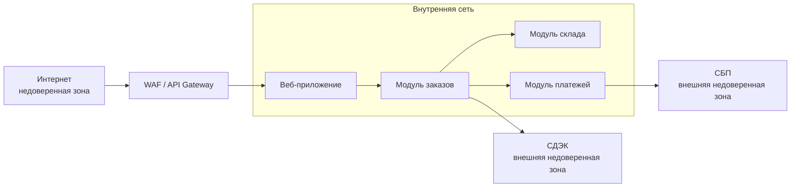

# Часть 3. Глава 3.5 — Архитектура безопасности

## Цель главы

Научиться моделировать угрозы, определять границы доверия и проектировать защиту критичных данных и операций интернет-магазина. Мы рассмотрим аутентификацию и авторизацию покупателей и сотрудников, защиту персональных данных, шифрование, управление секретами и журналирование значимых событий.

Безопасность не сводится к «включить HTTPS». Для магазина критичны доступ к заказам, корректность складских операций, защита платёжных данных и персональных данных покупателей. OWASP относит нарушение контроля доступа, криптографические ошибки, ошибки аутентификации и недостатки журналирования к числу наиболее значимых категорий рисков. [devguide.owasp](https://devguide.owasp.org/en/02-foundations/05-top-ten/)

## 1. Модель угроз

**Моделирование угроз** — систематический анализ того, кто может атаковать систему, какие активы защищаются, какие существуют пути атаки и какие меры снижают риск. Практический метод — STRIDE:

| Категория | Угроза | Пример в интернет-магазине |
|---|---|---|
| Spoofing | Подмена личности | Атакующий использует чужую сессию покупателя |
| Tampering | Изменение данных | Изменение количества или цены товара в запросе |
| Repudiation | Отрицание действия | Сотрудник отрицает отмену заказа |
| Information disclosure | Утечка информации | Доступ к персональным данным другого покупателя |
| Denial of service | Отказ в обслуживании | Массовые запросы препятствуют оформлению заказов |
| Elevation of privilege | Повышение привилегий | Менеджер получает права администратора |

### Активы, которые нужно защитить

- персональные данные покупателей;
- адреса доставки и контакты;
- заказы и их история;
- данные о платежах;
- учётные данные сотрудников;
- складские остатки и резервы;
- секреты интеграций с СБП и СДЭК;
- доступность витрины и оформления заказа.

## 2. Границы доверия

**Граница доверия** — место, где данные или запросы переходят от одной зоны с одними правилами к другой. На границе нельзя полагаться на то, что запрос «уже проверен» предыдущей системой.



### Границы интернет-магазина

| Граница | Что проверяется |
|---|---|
| Интернет → API Gateway | TLS, rate limiting, базовая валидация, защита от массовых запросов |
| Покупатель → веб-приложение | Аутентификация, права на корзину и заказы |
| Сотрудник → административный интерфейс | Роль, магазин, разрешённые операции |
| Модуль заказов → склад | Сервисная аутентификация, авторизация операции |
| Модуль платежей → СБП | TLS, секреты, проверка подписи уведомлений |
| Приложение → база данных | Отдельные учётные записи, минимальные права |

### Принцип zero trust

Не следует считать запрос доверенным только потому, что он поступил из внутренней сети. Аутентификация и авторизация выполняются явно для каждого доступа, а права предоставляются по принципу наименьших привилегий. [nvlpubs.nist](https://nvlpubs.nist.gov/nistpubs/SpecialPublications/NIST.SP.800-207.pdf)

## 3. Аутентификация

**Аутентификация** отвечает на вопрос: *кто выполняет запрос?*

Для покупателей и сотрудников нужны разные модели:

| Участник | Метод аутентификации | Особенности |
|---|---|---|
| Покупатель | Email/телефон + пароль, OAuth, одноразовый код | Защита от подбора пароля, восстановление доступа |
| Сотрудник | Корпоративная учётная запись, MFA | Обязательная MFA для административных операций |
| Сервис | Сервисный аккаунт, mTLS, подписанные запросы | Короткоживущие credentials |
| Внешний партнёр | API key, подпись, OAuth client credentials | Ограниченные scopes и квоты |

### Требования к паролям и сессиям

- Хранить только стойкий хеш пароля с солью, а не пароль в открытом виде.
- Использовать TLS для всех каналов передачи учётных данных.
- Ограничивать число неудачных попыток входа.
- Применять MFA для сотрудников с доступом к заказам, остаткам и настройкам.
- Использовать короткоживущие access-токены и обновляемые refresh-токены.
- Предусматривать выход из всех сессий при смене пароля.

### Антипаттерн: доверие к клиенту

Если фронтенд передаёт `userId` в теле запроса, а сервер не проверяет его по токену, покупатель может получить доступ к чужим заказам:

```http
GET /v1/orders?userId=cust-9999
```

Корректный подход:

```http
GET /v1/me/orders
Authorization: Bearer <access_token>
```

Идентификатор пользователя извлекается из проверенного токена, а не принимается на веру.

## 4. Авторизация

**Авторизация** отвечает на вопрос: *имеет ли authenticated субъект право выполнить это действие над этим ресурсом?* Аутентификация и авторизация — разные функции: знание личности не означает наличие прав. [devguide.owasp](https://devguide.owasp.org/en/02-foundations/05-top-ten/)

### Ролевая модель

| Роль | Разрешённые операции | Запрещённые операции |
|---|---|---|
| Покупатель | Создавать свои заказы, смотреть свои заказы, оплачивать их | Видеть чужие заказы, менять остатки |
| Менеджер | Обрабатывать заказы, отменять до сборки, просматривать заказы | Менять складские остатки напрямую |
| Сотрудник магазина | Оформлять продажи и заказы со склада | Управлять пользователями и настройками |
| Сотрудник склада | Резервировать, собирать, отгружать, фиксировать движения | Менять цены и каталог |
| Бухгалтер | Читать продажи и платежи | Изменять заказы и остатки |
| Администратор | Управлять пользователями и настройками | Выполнять операции от имени покупателя без аудита |

### Проверка на уровне операции

```text
Операция: Отменить заказ ord-50021

1. Кто выполняет запрос?
2. Какая роль у субъекта?
3. Принадлежит ли заказ его магазину?
4. Допустим ли текущий статус заказа для отмены?
5. Есть ли право `order:cancel`?
6. Фиксируется ли действие в журнале аудита?
```

Проверка должна выполняться на сервере. Скрытие кнопки в интерфейсе — улучшение удобства, но не механизм авторизации.

## 5. Защита данных

### Классификация данных

| Категория | Примеры | Меры |
|---|---|---|
| Публичные | Название товара, описание, цена | Обычная защита целостности |
| Внутренние | Складские остатки, себестоимость | Доступ по ролям |
| Персональные | ФИО, телефон, email, адрес | Шифрование, минимальный доступ, журналирование |
| Платёжные | Идентификаторы платежей, токены СБП | Не хранить реквизиты карт, шифрование, ограниченный доступ |
| Секреты | API-ключи, пароли БД, подписи | Secret manager, ротация, запрет в коде |

### Шифрование

- **In transit:** TLS для всех внешних и внутренних каналов, включая трафик между сервисами.
- **At rest:** шифрование базы данных, резервных копий и объектного хранилища.
- **Пароли:** хранить только стойкий хеш с солью.
- **Токены:** хранить хеш или зашифрованное значение, а не секрет в открытом виде.
- **Ключи:** хранить в managed KMS или secret manager, ротировать и ограничивать доступ.

Криптографические ошибки включают передачу чувствительных данных в открытом виде, отсутствие шифрования при хранении и небезопасное управление ключами. [devguide.owasp](https://devguide.owasp.org/en/02-foundations/05-top-ten/)

### Персональные данные

Для интернет-магазина следует применять принципы минимизации:

```text
Собирать только необходимые данные.
Хранить их ограниченное время.
Ограничивать доступ по роли и операции.
Логировать доступ к персональным данным.
Предусмотреть удаление или обезличивание по требованию.
```

Не следует хранить в заказе больше данных, чем необходимо для исполнения и учёта. Например, полная история изменений адреса обычно не нужна, если юридически требуется только адрес доставки конкретного заказа.

## 6. Управление секретами

**Секрет** — данные, компрометация которых даёт доступ к системе: пароль базы данных, API-ключ СБП, токен СДЭК, ключ подписи, credentials сервисного аккаунта.

### Правила

- Не хранить секреты в исходном коде, Docker-образе или открытом конфигурационном файле.
- Не передавать секреты в логах и сообщениях об ошибках.
- Использовать secret manager или переменные окружения, управляемые платформой.
- Выдавать минимально необходимые права каждой учётной записи.
- Ротировать ключи и credentials.
- Использовать отдельные секреты для development, staging и production.

```text
Некорректно:
DB_PASSWORD=super-secret-123 в application.properties

Корректно:
Приложение получает секрет из secret manager
по своей сервисной идентичности.
Доступ к секрету ограничен ролью.
```

## 7. Журналирование и аудит

**Аудит** фиксирует значимые действия так, чтобы можно было ответить на вопросы: кто, когда, что и над каким ресурсом сделал.

### Что журналировать

| Событие | Фиксируемые данные |
|---|---|
| Вход в систему | Пользователь, IP, время, результат |
| Неудачный вход | Пользователь, IP, причина, число попыток |
| Создание заказа | Заказ, покупатель, сумма, источник |
| Изменение статуса заказа | Старый и новый статус, инициатор |
| Резервирование и освобождение | SKU, склад, заказ, количество |
| Изменение остатка | До, после, причина, инициатор |
| Доступ к персональным данным | Сотрудник, заказ, цель доступа |
| Изменение прав | Кто, кому, какая роль |

### Структура записи аудита

```json
{
  "timestamp": "2026-11-01T19:41:12Z",
  "actorId": "user-318",
  "actorType": "EMPLOYEE",
  "role": "WAREHOUSE_OPERATOR",
  "action": "STOCK_RESERVED",
  "resourceType": "StockItem",
  "resourceId": "stock-771",
  "orderId": "ord-50021",
  "result": "SUCCESS",
  "ip": "203.0.113.24",
  "traceId": "b6f2e7a1-4f8c-4d19-9a2e-88b1c9d0f731"
}
```

Журналы должны защищаться от изменения, содержать `traceId` для сквозной корреляции и не включать пароли, платёжные реквизиты или полные персональные данные без необходимости. [devguide.owasp](https://devguide.owasp.org/en/02-foundations/05-top-ten/)

## 8. Защита доступности

Атака типа denial of service может помешать покупателям оформить заказ даже без доступа к данным.

| Мера | Назначение |
|---|---|
| Rate limiting | Ограничение частоты запросов с одного источника |
| WAF | Фильтрация распространённых веб-атак |
| CAPTCHA / proof-of-work | Защита форм регистрации и входа |
| Ограничение размера запроса | Защита от больших payload |
| Отдельные пулы ресурсов | Изоляция витрины, заказов и отчётов |
| Мониторинг аномалий | Выявление всплесков запросов и ошибок |

## Задания для закрепления

### Задание 1. Проведите STRIDE-анализ

Выберите сценарий «Покупатель оплачивает заказ через СБП» и составьте таблицу угроз по категориям STRIDE. Для каждой угрозы предложите меру снижения риска.

### Задание 2. Определите границы доверия

Постройте диаграмму границ доверия для цепочки:

```text
Покупатель -> CDN -> API Gateway -> веб-приложение ->
модуль заказов -> модуль платежей -> СБП
```

Укажите, какие проверки выполняются на каждой границе.

### Задание 3. Спроектируйте авторизацию

Определите правила доступа для операции «Отменить заказ»:

- какие роли могут выполнять операцию;
- при каких статусах заказа отмена допустима;
- какие дополнительные условия проверяются;
- что фиксируется в аудите.

### Задание 4. Проведите аудит секретов

Найдите проблемы в следующем решении:

```text
API-ключ СБП хранится в репозитории.
Пароль базы данных передаётся в URL.
Логи содержат полный номер телефона и адрес покупателя.
Все сотрудники используют одну учётную запись администратора.
```

Предложите исправления для каждой проблемы.

## Вопросы для самопроверки

**1. Чем авторизация отличается от аутентификации?**

A. Это синонимы  
B. Аутентификация подтверждает личность, авторизация проверяет права на действие  
C. Авторизация выполняется до аутентификации  
D. Аутентификация применяется только к сервисам

**Ответить**

<details>
<summary>Показать правильный ответ</summary>

**Правильный ответ: B.**

Аутентификация отвечает на вопрос «кто это?», авторизация — «имеет ли он право выполнить это действие?». Они являются отдельными функциями контроля доступа. [devguide.owasp](https://devguide.owasp.org/en/02-foundations/05-top-ten/)

</details>

***

**2. Какая уязвимость возникает, если сервер доверяет `userId`, переданному клиентом?**

A. SQL-инъекция  
B. Нарушение контроля доступа  
C. Медленный SQL-запрос  
D. Ошибка версионирования API

**Ответить**

<details>
<summary>Показать правильный ответ</summary>

**Правильный ответ: B.**

Идентификатор пользователя должен извлекаться из проверенного токена или серверной сессии. Доверие клиентскому `userId` позволяет получить доступ к чужим данным. [devguide.owasp](https://devguide.owasp.org/en/02-foundations/05-top-ten/)

</details>

***

**3. Где следует хранить API-ключ СБП?**

A. В исходном коде  
B. В открытом конфигурационном файле в репозитории  
C. В secret manager с ограниченным доступом  
D. В логе приложения для отладки

**Ответить**

<details>
<summary>Показать правильный ответ</summary>

**Правильный ответ: C.**

Секреты должны храниться в управляемом хранилище секретов, выдаваться по минимально необходимым правам и ротироваться. Их нельзя помещать в код, образ или логи. [devguide.owasp](https://devguide.owasp.org/en/02-foundations/05-top-ten/)

</details>

***

**4. Какой принцип предполагает проверку каждого доступа без неявного доверия по сетевому расположению?**

A. Defense in depth  
B. Zero trust  
C. Single sign-on  
D. Data minimization

**Ответить**

<details>
<summary>Показать правильный ответ</summary>

**Правильный ответ: B.**

Zero trust предполагает явную проверку идентичности, контекста и прав при каждом доступе, а не доверие только потому, что запрос пришёл из внутренней сети. [nvlpubs.nist](https://nvlpubs.nist.gov/nistpubs/SpecialPublications/NIST.SP.800-207.pdf)

</details>

## Что будет в главе 3.6

В следующей главе мы спроектируем наблюдаемость и SRE-практики: определим SLI и SLO для витрины, заказов и склада, выберем метрики, логи и трассировку, построим бюджет ошибок и опишем, как он влияет на приоритеты выпуска изменений и реагирование на инциденты.