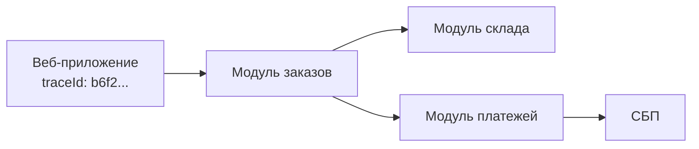

# Часть 3. Глава 3.6 — Наблюдаемость и SRE

## Цель главы

Научиться измерять реальное качество сервиса, а не полагаться на предположения о его надёжности. Мы определим SLI и SLO для интернет-магазина, выберем метрики, логи и трассировку, введём бюджет ошибок и опишем, как он влияет на приоритеты разработки и реакцию на инциденты.

**Наблюдаемость** — способность понять внутреннее состояние системы по её внешним сигналам: метрикам, логам и трассировкам. SLI измеряет фактическое поведение сервиса с точки зрения пользователя, а SLO связывает этот показатель с целевым уровнем надёжности. [sre](https://sre.google/workbook/implementing-slos/?authuser=1&hl=zh-cn)

## 1. SLI, SLO и бюджет ошибок

| Понятие | Определение | Пример |
|---|---|---|
| SLI | Измеримый показатель поведения сервиса | Доля запросов оформления заказа, завершившихся менее чем за 2 секунды |
| SLO | Целевое значение для SLI | Не менее 99% таких запросов за 30 дней |
| Error budget | Допустимый объём отклонений от SLO | При SLO 99% бюджет ошибок равен 1% |

SLO формулируется не как «система должна быть быстрой», а как измеримое обязательство: например, «99% запросов создания заказа завершаются успешно и не позднее чем за 2 секунды». [sre](https://sre.google/workbook/implementing-slos/?authuser=1&hl=zh-cn)

### Формула бюджета ошибок

\[
\text{Error budget} = 1 - \text{SLO}
\]

Например, при SLO 99,5%:

\[
\text{Error budget} = 1 - 0,995 = 0,005
\]

То есть допускается 0,5% неудовлетворительных запросов за период. [sre](https://sre.google/workbook/implementing-slos/?authuser=1&hl=zh-cn)

## 2. SLI и SLO интернет-магазина

| Пользовательский сценарий | SLI | SLO |
|---|---|---|
| Открытие карточки товара | Доля запросов с ответом не более 1,5 секунды | 99% за 30 дней |
| Поиск товаров | Доля запросов с ответом не более 2 секунд | 99% за 30 дней |
| Оформление заказа | Доля успешных запросов не более чем за 2 секунды | 99% за 30 дней |
| Резервирование товара | Доля операций без двойного резервирования | 100% за месяц |
| Оплата через СБП | Доля платежей, по которым получен определённый статус в течение 30 секунд | 99% за 30 дней |
| Доступность сервиса заказов | Доля успешных запросов к API заказов | 99,5% за 30 дней |
| Обновление остатка на сайте | Доля изменений, отражённых не позднее чем через 5 секунд | 99% за 30 дней |

### Почему не все SLO равны 99,99%

Высокий SLO требует затрат: резервирования, автоматизации, мониторинга, дежурства и более сложных процессов. Для первой версии интернет-магазина важнее обеспечить корректность резервирования и предсказуемость оформления заказа, чем обещать недостижимый уровень доступности.

## 3. Четыре золотых сигнала

В SRE выделяют четыре базовых сигнала здоровья сервиса: latency, traffic, errors и saturation. [sre](https://sre.google/workbook/slo-engineering-case-studies/)

| Сигнал | Вопрос | Метрики интернет-магазина |
|---|---|---|
| Latency | Как быстро обслуживаются запросы? | Время ответа карточки, оформления заказа, резервирования |
| Traffic | Сколько запросов поступает? | Просмотры, поиски, заказы, платежи |
| Errors | Как часто операции завершаются неудачно? | HTTP 5xx, бизнес-ошибки, неудачные платежи |
| Saturation | Насколько близок ресурс к исчерпанию? | Утилизация CPU, память, пул соединений, глубина очереди |

### Пример: сервис заказов

```text
Latency:
http_server_request_duration_seconds{service="orders",route="POST /v1/orders"}

Traffic:
http_server_requests_total{service="orders",route="POST /v1/orders"}

Errors:
http_server_requests_total{service="orders",status=~"5.."}
business_order_creation_failures_total

Saturation:
db_pool_active_connections
db_pool_waiting_connections
queue_depth_orders
```

## 4. Метрики, логи и трассировка

Метрики, логи и распределённая трассировка дополняют друг друга: метрики показывают, **что** происходит, логи — **какие события** произошли, трассировка — **где** запрос провёл время и через какие компоненты прошёл. [opentelemetry](https://opentelemetry.io/docs/concepts/observability-primer/)

| Сигнал | Назначение | Пример |
|---|---|---|
| Метрики | Агрегированное состояние и тренды | Количество заказов, p95 latency, error rate |
| Логи | Детали конкретных событий | Ошибка резервирования, отказ СБП, отмена заказа |
| Трассировка | Путь запроса через компоненты | Веб → заказы → склад → платежи |

### Метрики

```text
orders_created_total
orders_cancelled_total
orders_pending_payment
stock_reservations_active
stock_reservation_conflicts_total
payment_confirmation_duration_seconds
payment_failures_total
catalog_cache_hit_ratio
broker_consumer_lag
db_pool_active_connections
```

### Логи

```json
{
  "timestamp": "2026-11-01T19:45:12Z",
  "level": "ERROR",
  "service": "orders",
  "traceId": "b6f2e7a1-4f8c-4d19-9a2e-88b1c9d0f731",
  "orderId": "ord-50021",
  "event": "PAYMENT_CONFIRMATION_TIMEOUT",
  "paymentProvider": "SBP",
  "durationMs": 820,
  "message": "Payment provider did not respond within timeout"
}
```

В логах не должно быть паролей, платёжных реквизитов, полных персональных данных и секретов. Для отладки достаточно идентификаторов и корреляционных полей.

### Трассировка



Трассировка позволяет увидеть, например, что из 2 секунд оформления заказа 1,4 секунды занял вызов СБП, а не запрос к базе данных.

## 5. Корреляция сигналов

Ключевое требование наблюдаемости — возможность перейти от симптома к причине.

```text
Симптом:
Растёт доля неуспешных оформлений заказов.

Метрика:
payment_failures_total растёт.

Лог:
"SBP timeout after 800 ms".

Трассировка:
Веб -> заказы -> платежи -> СБП,
наибольшая задержка на внешнем вызове.

Вывод:
Деградация внешнего платёжного провайдера.
```

Для этого все три сигнала должны содержать общий контекст: `traceId`, `orderId`, `userId` или `requestId`.

## 6. Бюджет ошибок

**Бюджет ошибок** — допустимый объём отклонений от SLO за период. Он превращает надёжность из лозунга в управляемый ресурс: пока бюджет не исчерпан, команда может выпускать изменения; когда бюджет исчерпан, приоритет смещается на восстановление надёжности. [sre](https://sre.google/workbook/implementing-slos/?authuser=1&hl=zh-cn)

### Пример расчёта

```text
SLO оформления заказа: 99% за 30 дней.
Бюджет ошибок: 1%.

Ожидаемое число запросов за 30 дней: 180 000.
Допустимое число неудачных запросов:
180 000 × 1% = 1 800.
```

### Политика бюджета ошибок

| Состояние бюджета | Действие |
|---|---|
| Израсходовано менее 50% | Обычный темп поставки |
| Израсходовано 50–75% | Усилить контроль изменений, приоритет надёжности |
| Израсходовано 75–100% | Ограничить рискованные изменения, устранять причины |
| Бюджет исчерпан | Приостановить некритичные функциональные изменения, сосредоточиться на инцидентах и надёжности |

Бюджет ошибок должен быть связан с конкретными действиями: иначе он остаётся метрикой, на которую никто не реагирует. [sre](https://sre.google/workbook/implementing-slos/?authuser=1&hl=zh-cn)

## 7. Алерты

Алерты должны сообщать о проблемах, требующих действий, а не о каждом колебании метрики.

| Алерт | Условие | Приоритет |
|---|---|---|
| Рост ошибок оформления заказа | Error rate > 2% за 5 минут | Высокий |
| Задержка резервирования | p95 > 2 секунды за 10 минут | Высокий |
| Исчерпание пула соединений БД | Waiting connections > 0 в течение 5 минут | Высокий |
| Рост consumer lag | Задержка обработки событий > 10 минут | Средний |
| Недоступность СБП | Circuit breaker открыт более 5 минут | Высокий |
| Медленный каталог | p95 > 3 секунды за 15 минут | Средний |
| Подозрение на двойное резервирование | Любое нарушение инварианта | Критический |

### Хороший алерт

```text
Название: Высокая доля ошибок оформления заказа
Условие: error rate > 2% в течение 5 минут
Серьёзность: high
Ответственный: дежурный инженер
Первые действия:
1. Проверить статус СБП.
2. Проверить circuit breaker.
3. Проверить пул соединений БД.
4. Посмотреть трейсы неудачных запросов.
```

## 8. Практика SRE для первой версии

Для небольшой команды не нужно сразу строить сложную платформу наблюдаемости. Достаточно минимального, но связного набора:

- метрики запросов, ошибок, задержек и глубины очередей;
- структурированные логи с `traceId`;
- трассировка критичного пути оформления заказа;
- дашборды для витрины, заказов, склада и платежей;
- SLO для 3–5 ключевых пользовательских сценариев;
- бюджет ошибок и согласованная политика реагирования;
- регулярный разбор инцидентов.

## Задания для закрепления

### Задание 1. Определите SLI и SLO

Для каждого сценария сформулируйте SLI и SLO:

- покупатель открывает карточку товара;
- покупатель оформляет заказ;
- склад резервирует товар;
- платёж подтверждается;
- каталог обновляет отображаемый остаток.

### Задание 2. Выберите метрики

Распределите следующие показатели по четырём золотым сигналам:

- количество заказов в минуту;
- p95 времени оформления заказа;
- доля HTTP 5xx;
- утилизация CPU;
- глубина очереди;
- число активных резервов;
- количество неудачных платежей.

### Задание 3. Рассчитайте бюджет ошибок

SLO сервиса заказов — 99,5% за 30 дней. За период поступило 240 000 запросов.

Рассчитайте:

- бюджет ошибок в процентах;
- допустимое число неуспешных запросов;
- сколько ошибок уже допустимо, если зафиксировано 600 неуспешных запросов.

### Задание 4. Спроектируйте алерт

Создайте алерт для ситуации «резервирование товара недоступно более 5 минут». Укажите условие, серьёзность, ответственного, первые диагностические шаги и критерий закрытия инцидента.

## Вопросы для самопроверки

**1. Что такое SLI?**

A. Целевое значение надёжности  
B. Измеримый показатель фактического поведения сервиса  
C. Количество серверов  
D. Правило авторизации

**Ответить**

<details>
<summary>Показать правильный ответ</summary>

**Правильный ответ: B.**

SLI измеряет поведение сервиса с точки зрения пользователя, например долю запросов, обработанных быстрее заданного порога. [sre](https://sre.google/workbook/implementing-slos/?authuser=1&hl=zh-cn)

</details>

***

**2. Как рассчитывается бюджет ошибок?**

A. SLO × 100  
B. 1 − SLO  
C. SLI − SLO  
D. Количество ошибок × 2

**Ответить**

<details>
<summary>Показать правильный ответ</summary>

**Правильный ответ: B.**

Бюджет ошибок равен разности между 100% и SLO. Например, для SLO 99% бюджет составляет 1%. [sre](https://sre.google/workbook/implementing-slos/?authuser=1&hl=zh-cn)

</details>

***

**3. Какие сигналы входят в четыре золотых сигнала SRE?**

A. Логи, метрики, трейсы, алерты  
B. Latency, traffic, errors, saturation  
C. CPU, RAM, disk, network  
D. RTO, RPO, SLA, SLO

**Ответить**

<details>
<summary>Показать правильный ответ</summary>

**Правильный ответ: B.**

Четыре золотых сигнала — задержка, трафик, ошибки и насыщение ресурсов. Они помогают оценить здоровье сервиса с точки зрения пользовательского опыта и ёмкости. [sre](https://sre.google/workbook/slo-engineering-case-studies/)

</details>

***

**4. Зачем связывать `traceId` с логами и метриками?**

A. Чтобы увеличить объём логов  
B. Чтобы перейти от симптома к конкретному запросу и месту сбоя в распределённой системе  
C. Чтобы отключить алерты  
D. Чтобы заменить модульные тесты

**Ответить**

<details>
<summary>Показать правильный ответ</summary>

**Правильный ответ: B.**

Общий `traceId` позволяет связать метрику, лог и трассировку одного запроса. Это ускоряет диагностику в системе с несколькими компонентами и внешними зависимостями. [opentelemetry](https://opentelemetry.io/docs/concepts/observability-primer/)

</details>

## Что будет в главе 3.7

В следующей главе мы проверим архитектуру интернет-магазина на практике: проведём облегчённую архитектурную оценку ATAM-lite, определим fitness functions, спланируем нагрузочные испытания и учения по отказоустойчивости. Мы проверим, действительно ли система выдерживает пик, предотвращает двойное резервирование и восстанавливается в пределах согласованных RTO и RPO.