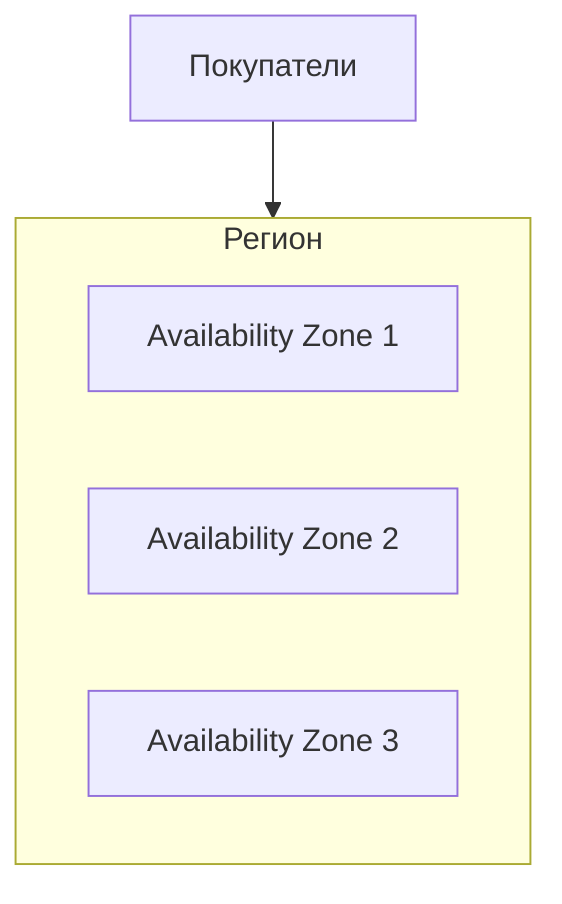

# Часть 4. Глава 4.1 — Облачная стратегия

## Цель главы

Научиться выбирать облачную модель не по лозунгу «переходим в облако», а на основе требований бизнеса, ограничений, рисков и целевых показателей надёжности. Мы определим облачную стратегию интернет-магазина: какая модель развёртывания подходит первой версии, какие обязанности остаются у команды, как выбирать регион и availability zones и по каким критериям выбирать управляемые сервисы.

Облачные модели различаются не только технологией, но и распределением ответственности. В NIST выделяются сервисные модели IaaS, PaaS и SaaS, а также модели развёртывания public, private, community и hybrid cloud; ответственность за защиту разделяется между потребителем и провайдером. [tsapps.nist](https://tsapps.nist.gov/publication/get_pdf.cfm?pub_id=909505.)

## 1. Исходная ситуация интернет-магазина

Сейчас система размещается на собственном сервере:

- простой самописный сайт;
- ручная обработка заказов;
- Excel для остатков;
- один склад и один офлайн-магазин;
- ограниченная ИТ-команда;
- нет выделенной платформенной команды;
- требуется резервное копирование и восстановление;
- в будущем возможны новые магазины, склады и интеграция с СДЭК.

Бизнес рассматривает облако как способ повысить надёжность, упростить эксплуатацию и подготовиться к росту. Однако это не означает, что нужно немедленно использовать сложные multi-cloud или multi-region решения.

## 2. Модели облачных сервисов

| Модель | Провайдер предоставляет | Команда управляет | Пример для магазина |
|---|---|---|---|
| IaaS | Виртуальные машины, сеть, хранилище | ОС, runtime, приложение, БД, обновления | Виртуальная машина с приложением и PostgreSQL |
| PaaS | Управляемую платформу выполнения и сервисы | Приложение, конфигурацию, данные | Managed PostgreSQL, managed Kubernetes, object storage |
| SaaS | Готовое приложение | Настройки, пользователей, интеграции | Готовая CRM, email-сервис, система аналитики |

### Что это означает для магазина

| Задача | IaaS | PaaS | SaaS |
|---|---|---|---|
| Запуск приложения | Самостоятельно | Проще | Не требуется |
| Обновление ОС и runtime | Команда | Частично провайдер | Провайдер |
| Резервное копирование БД | Команда | Частично провайдер, но политика — команда | Провайдер |
| Масштабирование | Настраивает команда | Частично автоматически | Провайдер |
| Гибкость | Высокая | Высокая | Ограниченная |
| Операционная сложность | Высокая | Средняя | Низкая |

Для небольшой команды предпочтительна комбинация **PaaS и managed services**: приложение остаётся под контролем команды, а инфраструктурные задачи — резервное копирование, патчи, отказоустойчивость хранилища — частично делегируются провайдеру.

## 3. Модели развёртывания

### Public cloud

Инфраструктура предоставляется публичным облачным провайдером и используется совместно с другими клиентами логически, но не физически.

**Плюсы:**

- быстрый старт;
- оплата по потреблению;
- управляемые базы данных, очереди, хранилища и мониторинг;
- проще реализовать резервирование и масштабирование.

**Минусы:**

- зависимость от провайдера;
- необходимость управлять стоимостью;
- требования к безопасности и соответствию остаются на команде.

### Private cloud

Инфраструктура выделена одной организации.

**Плюсы:**

- больше контроля;
- возможно соответствие специфическим требованиям.

**Минусы:**

- выше стоимость и операционная нагрузка;
- медленнее внедрение;
- требуется собственная экспертиза.

### Hybrid cloud

Комбинация локальной инфраструктуры и публичного облака, связанных едиными процессами и сетью. NIST определяет hybrid cloud как сочетание нескольких моделей развёртывания, сохраняющих самостоятельность, но связанных технологиями переносимости. [canada](https://www.canada.ca/en/government/system/digital-government/digital-government-innovations/cloud-services/cloud-security-risk-management-approach-procedures.html)

**Плюсы:**

- можно сохранить локальные системы, где это необходимо;
- поэтапная миграция;
- гибкость размещения данных.

**Минусы:**

- сложнее сеть, безопасность и эксплуатация;
- нужны единые identity, мониторинг и управление конфигурацией.

### Multi-cloud

Использование нескольких публичных провайдеров.

**Плюсы:**

- снижение зависимости от одного вендора;
- доступ к уникальным сервисам.

**Минусы:**

- дублирование навыков, инструментов, безопасности и эксплуатации;
- сложнее сеть, identity и наблюдаемость;
- часто выше совокупная стоимость.

## 4. Облачная стратегия для первой версии

Для интернет-магазина разумна стратегия:

```text
Public cloud + managed services,
с поэтапной миграцией и возможностью hybrid-подхода
для складских или локальных систем в будущем.
```

### Почему не multi-cloud на старте

Multi-cloud оправдан, когда есть конкретные причины: требования регулятора, необходимость использовать уникальный сервис другого провайдера или стратегическое требование избежать vendor lock-in. Для небольшой команды он чаще увеличивает сложность, чем снижает риск.

### Почему не полный отказ от локальной инфраструктуры

Если склад использует локальные терминалы, принтеры этикеток или систему учёта, которая не может быть быстро перенесена, возможен hybrid-сценарий:

```text
Облако:
- витрина;
- заказы;
- складской учёт;
- платежи;
- аналитика.

Локально:
- складские терминалы;
- принтеры;
- локальная сеть магазина;
- интеграционный агент.
```

Но это должно быть осознанным решением, а не случайным следствием старой инфраструктуры.

## 5. Регионы и Availability Zones

**Регион** — географически отделённая группа дата-центров облачного провайдера. **Availability Zone (AZ)** — физически и логически изолированная группа дата-центров внутри региона. Регионы изолированы друг от друга, а AZ внутри региона предназначены для изоляции отказов. [docs.aws.amazon](https://docs.aws.amazon.com/wellarchitected/latest/framework/rel_fault_isolation_multiaz_region_system.html)



### Правила выбора

| Критерий | Вопрос |
|---|---|
| Близость к пользователям | Где находятся покупатели и склады? |
| Задержка | Какая сетевая задержка до магазина и склада? |
| Доступность сервисов | Есть ли нужные managed services в регионе? |
| Стоимость | Как различается цена вычислений, хранения и трафика? |
| Data residency | Где разрешено хранить персональные данные? |
| Отказоустойчивость | Поддерживает ли сервис multi-AZ? |
| Disaster recovery | Где будут храниться резервные копии? |

### Рекомендация для первой версии

```text
Один регион.
Production-нагрузка — минимум в двух Availability Zones.
Резервные копии — в отдельном хранилище,
желательно с географической избыточностью.
Multi-region — не реализуется на старте,
но должна быть понятна стратегия восстановления.
```

Развёртывание production-нагрузки минимум в двух AZ является базовой практикой повышения доступности: отказ одной зоны не должен останавливать весь сервис. [docs.aws.amazon](https://docs.aws.amazon.com/wellarchitected/latest/framework/rel_fault_isolation_multiaz_region_system.html)

## 6. Модель общей ответственности

**Shared responsibility model** определяет, за что отвечает облачный провайдер, а за что — команда. Граница зависит от выбранной сервисной модели: в IaaS потребитель управляет большим объёмом, в SaaS — значительно меньшим. [tsapps.nist](https://tsapps.nist.gov/publication/get_pdf.cfm?pub_id=909505.)

| Область | Провайдер | Команда магазина |
|---|---|---|
| Физическая безопасность дата-центра | Да | Нет |
| Гипервизор и физическая сеть | Да | Нет |
| ОС виртуальной машины | Зависит от модели | В IaaS — да |
| Патчи runtime и зависимостей | Частично | В основном команда |
| Код приложения | Нет | Да |
| Конфигурация приложения | Нет | Да |
| Данные и их классификация | Нет | Да |
| Права доступа | Инструменты предоставляются | Настройка и контроль — команда |
| Резервные копии | Инструменты предоставляются | Политика, проверка восстановления — команда |
| Мониторинг бизнес-сценариев | Инструменты предоставляются | Метрики, SLO, алерты — команда |

### Важное следствие

Переход в облако не переносит ответственность за безопасность приложения, корректность данных, права доступа и резервное копирование на провайдера. Провайдер обеспечивает инфраструктуру и инструменты, но команда отвечает за их правильное использование. [tsapps.nist](https://tsapps.nist.gov/publication/get_pdf.cfm?pub_id=909505.)

## 7. Принципы выбора сервисов

Выбор облачного сервиса должен основываться на требованиях, а не на новизне технологии.

| Критерий | Вопрос |
|---|---|
| Соответствие задаче | Решает ли сервис нашу задачу без избыточной сложности? |
| Управляемость | Кто отвечает за патчи, масштабирование и восстановление? |
| Переносимость | Насколько сложно будет сменить провайдера или сервис? |
| Стоимость | Какова стоимость при текущей и прогнозируемой нагрузке? |
| Надёжность | Каковы SLA, multi-AZ и возможности восстановления? |
| Безопасность | Как управляются identity, секреты, шифрование и сеть? |
| Наблюдаемость | Есть ли метрики, логи, трассировка и интеграция с мониторингом? |
| Экспертиза команды | Сможет ли команда эксплуатировать сервис? |

### Пример выбора для магазина

| Задача | Возможный выбор | Обоснование |
|---|---|---|
| Приложение | Контейнеры в managed Kubernetes или managed app platform | Управляемое масштабирование и поставка |
| Основная БД | Managed PostgreSQL с автоматическими копиями | Транзакции, зрелость, управляемое восстановление |
| Файлы | Object storage | Дешёвое хранение изображений и документов |
| Очереди | Managed queue / pub-sub | Надёжная асинхронная интеграция |
| Секреты | Managed secret manager | Централизованное хранение и ротация |
| Мониторинг | Managed metrics, logs, tracing | Единая наблюдаемость |
| CDN | Managed CDN | Ускорение витрины и снижение нагрузки |

## 8. ADR-004: облачная стратегия

```text
# ADR-004: Использовать public cloud и managed services

Статус: Принято

## Контекст

Магазин эксплуатирует систему на собственном сервере.
Команда небольшая, выделенной платформенной команды нет.
Требуются надёжное резервное копирование, масштабируемость витрины
и готовность к росту числа складов и магазинов.

## Рассмотренные варианты

1. Продолжать эксплуатацию на собственном сервере.
2. Public cloud с IaaS.
3. Public cloud с managed services и PaaS.
4. Multi-cloud.
5. Hybrid cloud.

## Решение

Используется public cloud с управляемыми сервисами:
managed database, object storage, managed queue/pub-sub,
secret manager, monitoring и CDN.

Приложение развёртывается в контейнерах.
Production размещается минимум в двух Availability Zones одного региона.
Резервные копии хранятся отдельно от основной инфраструктуры.

## Последствия

Положительные:
- снижается операционная нагрузка;
- упрощаются резервное копирование и масштабирование;
- ускоряется внедрение изменений;
- появляется основа для будущего роста.

Отрицательные:
- возникает зависимость от облачного провайдера;
- требуется контроль затрат;
- команда должна освоить облачную безопасность и эксплуатацию;
- часть ответственности за данные и доступ остаётся у команды.

Условия пересмотра:
- появление требований к размещению данных в локальной инфраструктуре;
- необходимость использования уникальных сервисов другого провайдера;
- существенный рост команды и потребность в независимых платформах.
```

## Задания для закрепления

### Задание 1. Выберите модель сервиса

Для каждой задачи выберите IaaS, PaaS или SaaS и обоснуйте выбор:

- размещение собственного приложения;
- управляемая PostgreSQL;
- корпоративная почта;
- объектное хранилище изображений;
- управляемый Kubernetes;
- готовая CRM.

### Задание 2. Определите ответственность

Составьте таблицу ответственности для managed PostgreSQL:

- физическая безопасность дата-центра;
- патчи СУБД;
- создание резервных копий;
- политика хранения копий;
- проверка восстановления;
- разграничение доступа к данным;
- шифрование;
- мониторинг бизнес-метрик.

### Задание 3. Выберите регион и топологию

Определите критерии выбора региона для интернет-магазина с покупателями и складом в одном городе. Предложите топологию для первой версии и объясните, почему multi-region не является обязательным.

### Задание 4. Оцените multi-cloud

Руководитель предлагает: «Используем два облачных провайдера, чтобы не зависеть ни от одного». Сформулируйте три вопроса, которые нужно задать до принятия решения, и условия, при которых multi-cloud действительно оправдан.

## Вопросы для самопроверки

**1. Что означает shared responsibility model?**

A. Провайдер отвечает за всё, включая данные приложения  
B. Ответственность за безопасность и эксплуатацию разделяется между провайдером и потребителем  
C. Команда отвечает за физическую безопасность дата-центра  
D. Потребитель не отвечает за права доступа

**Ответить**

<details>
<summary>Показать правильный ответ</summary>

**Правильный ответ: B.**

Провайдер отвечает за облачную инфраструктуру и предоставляемые сервисы, а потребитель — за свои данные, конфигурацию, права доступа, приложение и корректное использование инструментов. [tsapps.nist](https://tsapps.nist.gov/publication/get_pdf.cfm?pub_id=909505.)

</details>

***

**2. Чем Availability Zone отличается от региона?**

A. AZ — это отдельный регион  
B. Регион состоит из нескольких изолированных Availability Zones  
C. AZ всегда находится в другом городе  
D. Регион не подходит для production

**Ответить**

<details>
<summary>Показать правильный ответ</summary>

**Правильный ответ: B.**

Регион — географически изолированная группа дата-центров, а Availability Zone — изолированная группа инфраструктуры внутри региона. Для отказоустойчивости production обычно размещают минимум в двух AZ. [docs.aws.amazon](https://docs.aws.amazon.com/wellarchitected/latest/framework/rel_fault_isolation_multiaz_region_system.html)

</details>

***

**3. Какая облачная стратегия наиболее разумна для первой версии интернет-магазина с небольшой командой?**

A. Multi-cloud с самостоятельным управлением всеми сервисами  
B. Public cloud с managed services и размещением в нескольких AZ  
C. Private cloud без managed services  
D. Отказ от резервного копирования

**Ответить**

<details>
<summary>Показать правильный ответ</summary>

**Правильный ответ: B.**

Managed services снижают операционную нагрузку, а размещение в нескольких AZ повышает доступность без сложности multi-region или multi-cloud.

</details>

***

**4. Почему переход в облако не снимает с команды ответственность за данные?**

A. Потому что облако не хранит данные  
B. Потому что команда отвечает за классификацию, доступ, конфигурацию, резервные политики и проверку восстановления  
C. Потому что провайдер не предоставляет хранилищ  
D. Потому что данные всегда остаются на локальном сервере

**Ответить**

<details>
<summary>Показать правильный ответ</summary>

**Правильный ответ: B.**

Провайдер обеспечивает инфраструктуру и инструменты, но потребитель отвечает за данные, их защиту, права доступа, конфигурацию и корректность процессов восстановления. [tsapps.nist](https://tsapps.nist.gov/publication/get_pdf.cfm?pub_id=909505.)

</details>

## Что будет в главе 4.2

В следующей главе мы спроектируем **landing zone и guardrails** для интернет-магазина: структуру аккаунтов и окружений, федерацию идентификации, базовую сетевую конфигурацию, policy as code и контроль допустимых облачных ресурсов.