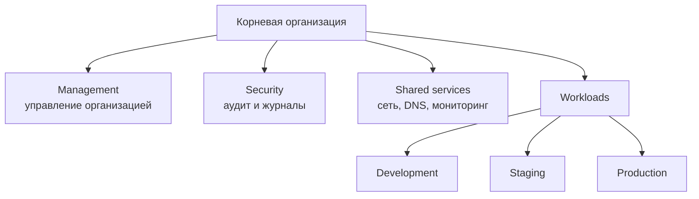
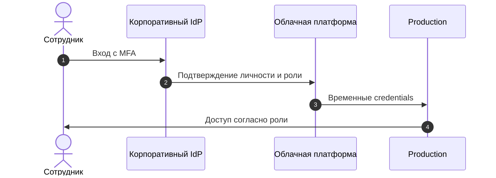
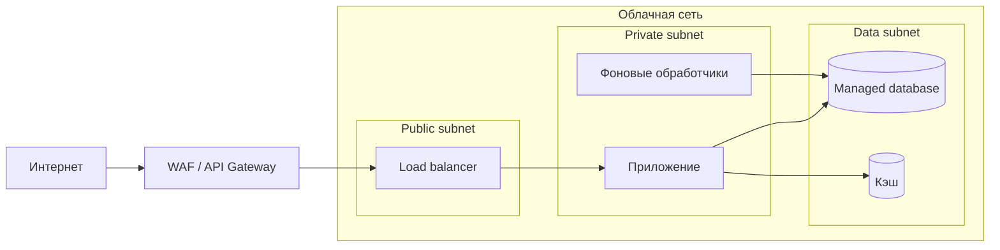
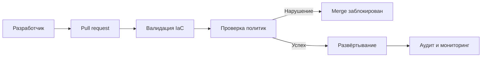

# Часть 4. Глава 4.2 — Landing zone и guardrails

## Цель главы

Научиться создавать управляемую облачную основу для интернет-магазина: разделять окружения и аккаунты, централизованно управлять идентификацией, задавать сетевые базовые правила и контролировать допустимые ресурсы через policy as code. Landing zone — это не «ещё один сервис», а фундамент, на котором команда сможет безопасно развёртывать и развивать систему.

**Landing zone** — заранее спроектированная облачная среда с базовыми правилами идентификации, сети, безопасности, логирования и управления. Она задаёт стартовую конфигурацию, в которой создаются рабочие окружения и развёртываются приложения. [docs.aws.amazon](https://docs.aws.amazon.com/prescriptive-guidance/latest/transitioning-to-multiple-aws-accounts/create-landing-zone.html)

## 1. Зачем нужна landing zone

Без общей основы каждый новый сервис создаётся по собственным правилам:

- у одного проекта открыт публичный доступ к базе данных;
- у другого нет резервных копий;
- секреты хранятся в переменных окружения;
- логи не собираются централизованно;
- сотрудники получают постоянные административные права;
- невозможно понять, кто и зачем создал ресурс.

Landing zone предотвращает это, задавая обязательные правила на уровне платформы, а не на уровне отдельных разработчиков. [docs.aws.amazon](https://docs.aws.amazon.com/wellarchitected/2025-02-25/framework/sec_securely_operate_multi_accounts.md)

## 2. Структура аккаунтов и окружений

Для интернет-магазина не нужно сразу создавать десятки аккаунтов. Достаточно минимальной, но раздельной структуры.



| Аккаунт / подписка | Назначение | Ключевые правила |
|---|---|---|
| Management | Управление организацией, биллингом и политиками | Минимум постоянных пользователей, нет production-нагрузки |
| Security | Централизованные журналы, аудит, алерты безопасности | Доступ только у роли безопасности |
| Shared services | Общая сеть, DNS, централизованный мониторинг | Управляется платформенной ролью |
| Development | Разработка и эксперименты | Ограниченные лимиты, тестовые данные |
| Staging | Проверка релизов и интеграций | Конфигурация близка к production |
| Production | Реальные заказы, склад, платежи | Строгий доступ, multi-AZ, аудит |

### Почему разделять окружения

Разделение окружений позволяет:

- ограничить последствия ошибки;
- применять разные уровни доступа;
- тестировать изменения без риска для продаж;
- контролировать стоимость;
- применять более строгие политики к production.

## 3. Федерация идентификации

**Федерация идентификации** позволяет использовать корпоративного identity provider (IdP) для доступа к облачным аккаунтам. Сотрудник входит один раз через корпоративную учётную запись и получает временные права в нужном окружении. [learn.microsoft](https://learn.microsoft.com/en-us/azure/cloud-adoption-framework/ready/landing-zone/design-area/identity-access-landing-zones)



### Принципы

- Не создавать постоянных локальных пользователей для каждого сотрудника.
- Использовать группы и роли, а не индивидуальные назначения прав.
- Предоставлять временные credentials.
- Требовать MFA для доступа к production.
- Разделять права по окружениям: доступ к development не означает доступ к production.
- Применять принцип наименьших привилегий.

### Роли интернет-магазина

| Роль | Development | Staging | Production |
|---|---|---|---|
| Разработчик | Чтение, развёртывание тестовых версий | Чтение, ограниченное развёртывание | Нет постоянного доступа |
| DevOps | Управление инфраструктурой | Управление инфраструктурой | Доступ через change process |
| Дежурный инженер | Чтение | Чтение | Ограниченный доступ по инциденту |
| Аудитор | Чтение журналов | Чтение журналов | Чтение журналов |
| Приложение | Сервисная роль | Сервисная роль | Сервисная роль с минимальными правами |

## 4. Сетевая базовая конфигурация

Сеть должна отражать границы доверия: интернет, витрина, внутренние сервисы, база данных и административный доступ не должны находиться в одной плоской сети.



### Базовые правила

| Правило | Назначение |
|---|---|
| База данных только в private subnet | Прямой доступ из интернета запрещён |
| Приложение в private subnet | Вход только через балансировщик |
| Security groups по принципу минимального доступа | БД принимает соединения только от приложения |
| Отдельные security groups для витрины, заказов и отчётов | Ограничение горизонтального перемещения |
| Egress-контроль | Ограничение исходящих соединений |
| Централизованные логи сетевых событий | Возможность расследования инцидентов |
| Приватные подключения к управляемым сервисам | Трафик не выходит в публичный интернет без необходимости |

### Пример правил

```text
База данных:
- разрешено: TCP 5432 от security group приложения;
- запрещено: доступ из интернета;
- требуется TLS.

Приложение:
- разрешено: HTTPS от load balancer;
- разрешено: исходящие вызовы к СБП и брокеру;
- запрещено: прямой доступ из интернета.

Административный доступ:
- только через bastion, VPN или identity-aware proxy;
- MFA обязателен;
- действия журналируются.
```

## 5. Policy as code

**Policy as code** — выражение организационных правил в виде проверяемых политик, которые автоматически применяются или проверяются при создании и изменении ресурсов. Политики могут быть preventive — блокировать недопустимое действие — или detective — выявлять нарушение после создания. [docs.aws.amazon](https://docs.aws.amazon.com/wellarchitected/2025-02-25/framework/sec_securely_operate_multi_accounts.md)

### Примеры guardrails

| Правило | Тип | Последствие нарушения |
|---|---|---|
| Запретить public access к базе данных | Preventive | Создание ресурса блокируется |
| Требовать шифрование хранилищ | Preventive | Ресурс не создаётся |
| Запретить security group с `0.0.0.0/0` для БД | Preventive | Изменение отклоняется |
| Требовать теги `environment`, `owner`, `cost-center` | Preventive | Ресурс не создаётся |
| Проверять отсутствие секретов в IaC | Detective | Pipeline завершается ошибкой |
| Требовать включённые логи аудита | Detective | Создаётся нарушение и алерт |
| Ограничить типы виртуальных машин в development | Preventive | Недопустимый тип не создаётся |

### Пример политики

```yaml
policy: require-database-encryption
scope: production
resource: managed-database
rules:
  encryption_at_rest: required
  public_access: denied
  backup_retention_days: ">= 30"
  tls_required: true
  tags:
    required:
      - environment
      - owner
      - cost-center
```

### Политика и процесс

Policy as code эффективен, только если он встроен в процесс:



## 6. Infrastructure as Code в landing zone

Landing zone должна создаваться и изменяться как код. Это обеспечивает воспроизводимость, ревью изменений и возможность восстановить конфигурацию.

```text
infrastructure/
├── org/
│   ├── accounts/
│   ├── policies/
│   └── identity/
├── network/
│   ├── vpc/
│   ├── dns/
│   └── security-groups/
├── environments/
│   ├── dev/
│   ├── staging/
│   └── production/
└── modules/
    ├── database/
    ├── queue/
    ├── object-storage/
    └── monitoring/
```

### Правила IaC

- Изменения инфраструктуры проходят через pull request.
- Нельзя изменять production вручную, кроме согласованных аварийных действий.
- Каждое изменение должно быть воспроизводимым.
- Модули должны быть переиспользуемыми и параметризуемыми.
- Секреты не хранятся в IaC-репозитории.
- Состояние инфраструктуры защищено и хранится централизованно.

## 7. Guardrails для интернет-магазина

| Область | Guardrail |
|---|---|
| Идентификация | Доступ к production только через federated identity и MFA |
| Сеть | База данных недоступна из интернета |
| Данные | Шифрование при хранении и передаче обязательно |
| Резервирование | Автоматические копии и проверка восстановления |
| Затраты | Обязательные теги стоимости и лимиты окружений |
| Изменения | Инфраструктура изменяется только через pipeline |
| Наблюдаемость | Централизованные логи и метрики обязательны |
| Интеграции | Секреты СБП и СДЭК хранятся в secret manager |

## Задания для закрепления

### Задание 1. Спроектируйте структуру аккаунтов

Определите минимальную структуру аккаунтов или подписок для интернет-магазина. Для каждой единицы укажите назначение, основные роли и ограничения.

### Задание 2. Спроектируйте сетевые правила

Составьте security group rules для:

- managed PostgreSQL;
- приложения;
- административного доступа;
- фонового обработчика очередей.

Укажите источник, порт, протокол и обоснование.

### Задание 3. Напишите policy as code

Создайте политику для production-базы данных:

- запрет публичного доступа;
- обязательное шифрование;
- обязательные теги;
- срок хранения резервных копий;
- требование TLS.

### Задание 4. Найдите нарушения

Проанализируйте ситуацию:

```text
Разработчик создал базу данных в production с публичным доступом.
Пароль сохранён в Terraform-файле.
Теги owner и cost-center отсутствуют.
Доступ к консоли выдан через постоянный локальный пользователь.
```

Определите нарушения и предложите preventive и detective guardrails.

## Вопросы для самопроверки

**1. Что такое landing zone?**

A. Отдельный микросервис  
B. Базовая управляемая облачная среда с правилами identity, сети, безопасности и логирования  
C. Тип базы данных  
D. Способ балансировки нагрузки

**Ответить**

<details>
<summary>Показать правильный ответ</summary>

**Правильный ответ: B.**

Landing zone задаёт стартовую основу для развёртывания workloads: структуру аккаунтов, identity, сеть, безопасность, логирование и governance. [docs.aws.amazon](https://docs.aws.amazon.com/prescriptive-guidance/latest/transitioning-to-multiple-aws-accounts/create-landing-zone.html)

</details>

***

**2. Зачем использовать federated identity вместо локальных пользователей?**

A. Чтобы увеличить число паролей  
B. Чтобы использовать корпоративную учётную запись, MFA и временные права, упрощая контроль доступа  
C. Чтобы отключить журналирование  
D. Чтобы разрешить всем доступ к production

**Ответить**

<details>
<summary>Показать правильный ответ</summary>

**Правильный ответ: B.**

Федерация позволяет централизованно управлять идентичностью, применять MFA и выдавать временные credentials согласно роли. [learn.microsoft](https://learn.microsoft.com/en-us/azure/cloud-adoption-framework/ready/landing-zone/design-area/identity-access-landing-zones)

</details>

***

**3. Какая политика является preventive guardrail?**

A. Алерт после создания публично доступной базы данных  
B. Блокировка создания базы данных с публичным доступом  
C. Еженедельный отчёт о затратах  
D. Ручной обзор архитектуры раз в год

**Ответить**

<details>
<summary>Показать правильный ответ</summary>

**Правильный ответ: B.**

Preventive guardrail блокирует недопустимое действие до его выполнения. Detective control лишь выявляет нарушение после факта. [docs.aws.amazon](https://docs.aws.amazon.com/wellarchitected/2025-02-25/framework/sec_securely_operate_multi_accounts.md)

</details>

***

**4. Почему базу данных следует размещать в private subnet?**

A. Чтобы ускорить интернет-трафик  
B. Чтобы исключить прямой доступ из интернета и ограничить соединения доверенными компонентами  
C. Потому что private subnet дешевле  
D. Потому что база данных не требует сети

**Ответить**

<details>
<summary>Показать правильный ответ</summary>

**Правильный ответ: B.**

Private subnet и security groups ограничивают поверхность атаки: база принимает соединения только от приложения, а не из интернета.

</details>

## Что будет в главе 4.3

В следующей главе мы спроектируем контейнерную платформу интернет-магазина: образ приложения, оркестрацию Kubernetes, service discovery, конфигурацию и секреты, probe-проверки, автомасштабирование workloads и безопасное развёртывание в нескольких Availability Zones.