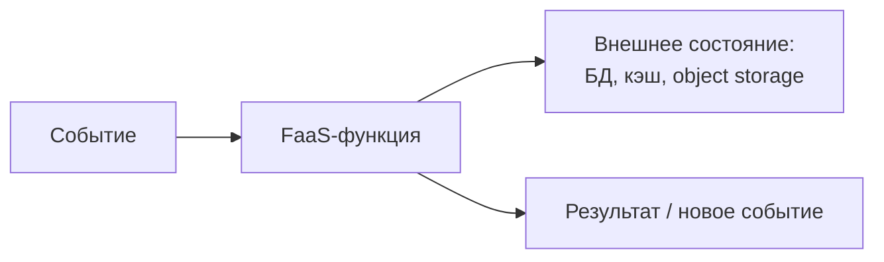
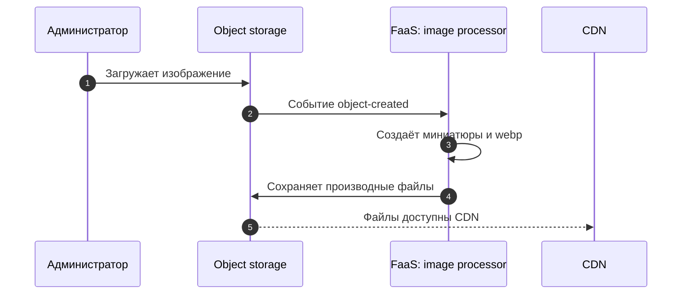

# Часть 4. Глава 4.4 — Serverless и управляемые сервисы

## Цель главы

Научиться определять, где в интернет-магазине оправданы serverless-функции и управляемые сервисы, а где они создают избыточную сложность. Мы рассмотрим FaaS, событийный запуск, managed databases, object storage, квоты, cold start и ограничения длительных операций.

**Serverless** не означает отсутствие серверов. Это модель, при которой провайдер управляет вычислительными ресурсами, масштабированием и частью эксплуатации, а команда отвечает за код, конфигурацию, данные, права доступа и стоимость. FaaS выполняет короткие stateless-функции в ответ на события. [vetoralabs](https://www.vetoralabs.com/system-design/concepts/cloud-native/serverless-faas)

## 1. Что такое FaaS

**FaaS** (Function-as-a-Service) — модель выполнения, в которой функция запускается по событию: HTTP-запросу, сообщению в очереди, загрузке файла, изменению данных или расписанию. Провайдер управляет средой выполнения и масштабированием, а функция не должна полагаться на локальное состояние между вызовами. [vetoralabs](https://www.vetoralabs.com/system-design/concepts/cloud-native/serverless-faas)



### Характеристики FaaS

| Свойство | Значение для архитектуры |
|---|---|
| Событийный запуск | Функция не должна постоянно работать в ожидании задачи |
| Stateless | Состояние хранится во внешнем хранилище |
| Автоматическое масштабирование | Не нужно вручную управлять числом экземпляров |
| Оплата по использованию | Стоимость зависит от числа вызовов и времени выполнения |
| Ограниченное время выполнения | Долгие процессы требуют декомпозиции |
| Cold start | Первый вызов после простоя может быть медленнее |

## 2. Где FaaS оправдан в интернет-магазине

Не следует переносить в FaaS весь модуль заказов. Ядро системы — заказы, остатки и резервы — требует устойчивых транзакций, предсказуемой задержки и сложной бизнес-логики. Но отдельные задачи хорошо подходят для событийных функций.

| Задача | Триггер | Почему подходит FaaS |
|---|---|---|
| Генерация миниатюр изображений | Загрузка файла в object storage | Короткая, событийная, нерегулярная нагрузка |
| Отправка email или SMS | Событие `OrderShipped` | Асинхронная задача, не блокирует заказ |
| Формирование PDF-накладной | Событие `OrderReadyForFulfillment` | Разовая задача с ограниченной длительностью |
| Импорт прайс-листа | Загрузка файла | Пакетная обработка |
| Ночная сверка остатков | Расписание | Периодическая задача |
| Обогащение аналитических событий | Событие из потока | Обработка потока данных |
| Уведомление о статусе доставки | Вебхук СДЭК | Событийная интеграция |

### Пример: обработка изображения товара



Функция не участвует в оформлении заказа и не влияет на критичный путь покупки. При сбое её можно повторить без риска для остатков или платежей.

## 3. Где FaaS не подходит

| Задача | Почему FaaS не подходит |
|---|---|
| Оформление заказа | Требуется предсказуемая задержка и строгая согласованность |
| Резервирование последнего товара | Критичная конкурентная операция, чувствительная к cold start |
| Длительная миграция данных | Ограничение времени выполнения |
| Сложный складской workflow | Нужны состояние, компенсации и координация |
| Постоянное WebSocket-соединение | FaaS не предназначен для долгоживущего состояния |
| Высокочастотный синхронный API | Cold start и стоимость могут стать проблемой |

### Антипаттерн: распределённый монолит из функций

Если одна бизнес-операция разбита на десять функций, которые синхронно вызывают друг друга, система получает сетевые задержки, сложность отладки и зависимость от квот, но не получает реальной автономности. Serverless должен упрощать отдельные задачи, а не дробить связную предметную операцию.

## 4. Событийный запуск

Событие может поступать из разных источников:

| Источник | Пример | Особенности |
|---|---|---|
| HTTP API Gateway | Вебхук СДЭК | Синхронный или асинхронный ответ |
| Очередь | Новое задание на формирование накладной | At-least-once, нужна идемпотентность |
| Object storage | Загружено изображение | Событие о создании объекта |
| Расписание | Ночная сверка остатков | Периодический запуск |
| Поток событий | `StockChanged` | Обработка потока |
| Изменение БД | Новая запись аудита | Зависит от возможностей платформы |

### Идемпотентность

Асинхронные события часто доставляются по модели **at-least-once**. Функция может быть вызвана повторно, поэтому она обязана безопасно обрабатывать дубликаты. [bewiseapps](https://bewiseapps.com/software-architecture-wise/distributed-systems/serverless-and-space-based)

```text
Событие: OrderShipped
messageId: msg-771

При первом вызове:
- отправить email;
- сохранить messageId как обработанный.

При повторном вызове:
- найти messageId;
- пропустить отправку.
```

## 5. Cold start

**Cold start** — задержка, возникающая при инициализации нового экземпляра функции: запуск среды, загрузка runtime, инициализация зависимостей и подключений. Его длительность зависит от языка, размера пакета, числа зависимостей и конфигурации сети. [bewiseapps](https://bewiseapps.com/software-architecture-wise/distributed-systems/serverless-and-space-based)

### Как снизить влияние

| Мера | Эффект |
|---|---|
| Уменьшить размер deployment package | Быстрее загрузка |
| Убрать неиспользуемые зависимости | Меньше инициализация |
| Использовать лёгкий runtime | Меньше overhead |
| Выносить инициализацию за пределы обработчика | Переиспользование в тёплом экземпляре |
| Использовать provisioned concurrency | Устраняет часть cold start, но увеличивает стоимость |
| Не использовать FaaS на критичном синхронном пути | Исключает влияние cold start на покупателя |

### Пример

```text
Функция отправки email:
cold start 500 мс — приемлемо.

Функция резервирования товара:
cold start 800 мс — неприемлемо,
поскольку операция входит в критичный путь
и должна завершаться в пределах 500 мс.
```

## 6. Квоты и ограничения

Serverless-платформы имеют квоты на время выполнения, объём памяти, число одновременных вызовов, размер payload и пропускную способность event source mapping. Эти ограничения необходимо учитывать на этапе архитектуры, а не обнаруживать в production. [docs.aws.amazon](https://docs.aws.amazon.com/lambda/latest/dg/lambda-managed-instances-quotas.html)

| Ограничение | Влияние | Мера |
|---|---|---|
| Максимальное время выполнения | Долгая задача будет прервана | Разбить на шаги, использовать очередь или workflow |
| Лимит одновременных вызовов | Перегрузка может привести к throttling | Ограничение concurrency, очередь, приоритизация |
| Лимит payload | Нельзя передавать большие файлы через событие | Передавать ссылку на объект в storage |
| Пропускная способность источника | Узкое место при обработке потока | Партиционирование, несколько потребителей |
| Лимит исходящих соединений | Проблема с пулом соединений к БД | Connection pooling через прокси или managed service |

### Пример: большое изображение

Некорректно передавать изображение в теле события:

```json
{
  "eventType": "ImageUploaded",
  "imageBase64": "..."
}
```

Корректно передавать ссылку:

```json
{
  "eventType": "ImageUploaded",
  "bucket": "shop-product-images",
  "objectKey": "products/889/original.jpg"
}
```

Функция читает объект из object storage по ссылке.

## 7. Managed databases

**Managed database** — база данных, для которой провайдер берёт на себя часть эксплуатации: резервное копирование, патчи, отказоустойчивость, мониторинг и масштабирование. Но команда сохраняет ответственность за схему, индексы, права доступа, миграции, стоимость и проверку восстановления.

| Возможность | Значение для магазина |
|---|---|
| Автоматические резервные копии | Снижает риск потери заказов и остатков |
| Multi-AZ | Повышает доступность |
| Read replicas | Разгружают отчёты и аналитику |
| Automated failover | Сокращает RTO |
| Managed secrets | Уменьшает риск утечки credentials |
| Monitoring | Даёт метрики производительности и доступности |

### Ответственность команды

Даже при managed database команда должна:

- проектировать схему и индексы;
- контролировать миграции;
- ограничивать права сервисных учётных записей;
- настраивать retention резервных копий;
- проверять восстановление;
- следить за стоимостью и производительностью;
- не допускать прямого доступа из интернета.

## 8. Object storage

**Object storage** подходит для файлов, которые не требуют транзакционной целостности и частого изменения: изображения товаров, документы, экспортированные отчёты, резервные копии.

```text
shop-product-images/
└── products/
    └── 889/
        ├── original.jpg
        ├── thumb-200.webp
        └── thumb-600.webp

shop-documents/
└── orders/
    └── ord-50021/
        └── invoice.pdf
```

### Правила

- Хранить объекты по стабильному ключу, а не по времени загрузки.
- Использовать versioning для защиты от удаления или перезаписи.
- Ограничивать публичный доступ; раздавать файлы через CDN или подписанные URL.
- Шифровать данные при хранении.
- Не хранить секреты в bucket.
- Настраивать lifecycle-правила для временных файлов.

## 9. ADR-005: FaaS для периферийных задач

```text
# ADR-005: Использовать FaaS для событийных периферийных задач

Статус: Принято

## Контекст

Система интернет-магазина включает критичный путь заказов,
складского учёта и платежей. Отдельные задачи — обработка
изображений, уведомления, документы, импорт прайс-листов
и вебхуки доставки — имеют нерегулярную нагрузку
и не должны нагружать основной сервис.

## Решение

Критичный путь реализуется в контейнерном приложении.
Для периферийных событийных задач используются FaaS-функции.

FaaS применяется для:
- обработки изображений;
- отправки уведомлений;
- генерации PDF;
- импорта прайс-листов;
- обработки вебхуков СДЭК;
- ночной сверки остатков.

FaaS не применяется для:
- оформления заказа;
- резервирования товара;
- подтверждения платежа;
- длительных миграций;
- операций, требующих устойчивого состояния.

## Последствия

Положительные:
- снижается нагрузка на основное приложение;
- проще масштабировать нерегулярные задачи;
- оплата соответствует фактическому использованию;
- периферийные сбои не блокируют продажи.

Отрицательные:
- добавляется зависимость от квот и cold start;
- требуется идемпотентная обработка событий;
- усложняется наблюдаемость распределённых процессов;
- часть операций требует внешнего состояния.

Условия пересмотра:
- если критичный путь начнёт использовать FaaS;
- если появятся длительные рабочие процессы;
- если лимиты платформы ограничат бизнес-сценарии.
```

## Задания для закрепления

### Задание 1. Выберите модель выполнения

Для каждой задачи выберите FaaS, контейнерный workload или managed service и обоснуйте выбор:

- оформление заказа;
- генерация миниатюр изображений;
- отправка email после отгрузки;
- резервирование последнего товара;
- ночная сверка остатков;
- хранение изображений;
- приём вебхука СДЭК;
- формирование аналитических отчётов.

### Задание 2. Спроектируйте событийную функцию

Спроектируйте FaaS-функцию для обработки события `OrderShipped`:

- триггер;
- входные данные;
- идемпотентность;
- внешние зависимости;
- обработка ошибки;
- DLQ;
- метрики.

### Задание 3. Устраните cold start

Функция резервирования товара написана на FaaS и имеет cold start 900 мс. Целевое время операции — 500 мс. Предложите не менее трёх архитектурных решений.

### Задание 4. Спроектируйте object storage

Определите структуру bucket для изображений товаров и документов заказов. Укажите ключи объектов, versioning, правила доступа, шифрование и lifecycle-политики.

## Вопросы для самопроверки

**1. Какое свойство FaaS наиболее важно учитывать при проектировании?**

A. Функция хранит состояние между вызовами  
B. Функция обычно stateless и должна использовать внешнее состояние  
C. Функция всегда выполняется дольше 15 минут  
D. Функция не может быть вызвана событием

**Ответить**

<details>
<summary>Показать правильный ответ</summary>

**Правильный ответ: B.**

FaaS-функция не должна полагаться на локальное состояние между вызовами. Состояние хранится в базе данных, кэше, object storage или очереди. [vetoralabs](https://www.vetoralabs.com/system-design/concepts/cloud-native/serverless-faas)

</details>

***

**2. Что такое cold start?**

A. Ошибка сети при вызове API  
B. Задержка инициализации нового экземпляра функции перед обработкой события  
C. Отказ базы данных  
D. Превышение квоты хранилища

**Ответить**

<details>
<summary>Показать правильный ответ</summary>

**Правильный ответ: B.**

Cold start возникает, когда платформе нужно инициализировать новую среду выполнения функции. [bewiseapps](https://bewiseapps.com/software-architecture-wise/distributed-systems/serverless-and-space-based)

</details>

***

**3. Для какой задачи FaaS обычно не подходит?**

A. Создание миниатюры загруженного изображения  
B. Отправка email после отгрузки заказа  
C. Резервирование последнего экземпляра товара на критичном пути  
D. Ночная сверка остатков

**Ответить**

<details>
<summary>Показать правильный ответ</summary>

**Правильный ответ: C.**

Резервирование входит в критичный путь и требует предсказуемой задержки, строгой согласованности и контроля конкурентного доступа. [vetoralabs](https://www.vetoralabs.com/system-design/concepts/cloud-native/serverless-faas)

</details>

***

**4. Почему в событии следует передавать ссылку на объект, а не сам файл?**

A. Чтобы увеличить размер сообщения  
B. Чтобы не превышать лимит payload и не дублировать большие данные  
C. Потому что object storage не поддерживает файлы  
D. Потому что FaaS не может читать файлы

**Ответить**

<details>
<summary>Показать правильный ответ</summary>

**Правильный ответ: B.**

Событие должно содержать идентификаторы и ссылку на объект. Сам файл функция читает из object storage по необходимости. [vetoralabs](https://www.vetoralabs.com/system-design/concepts/cloud-native/serverless-faas)

</details>

## Что будет в главе 4.5

В следующей главе мы спроектируем облачную сеть и edge для интернет-магазина: сегментацию VPC, ingress и egress, DNS, CDN, приватные подключения к управляемым сервисам и защищённый доступ сотрудников к административному интерфейсу.