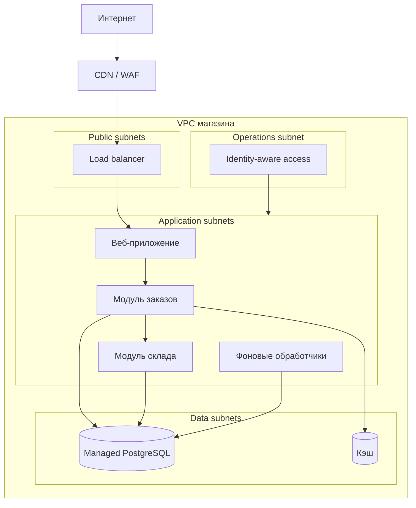
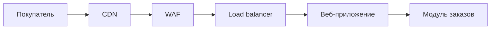
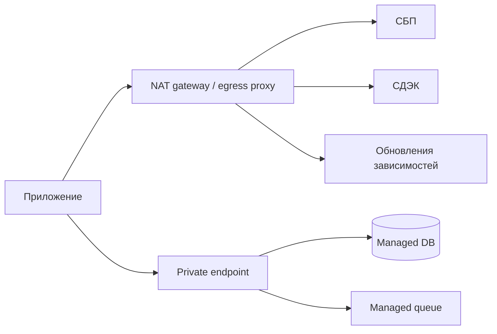
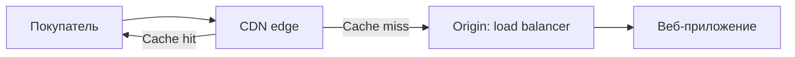
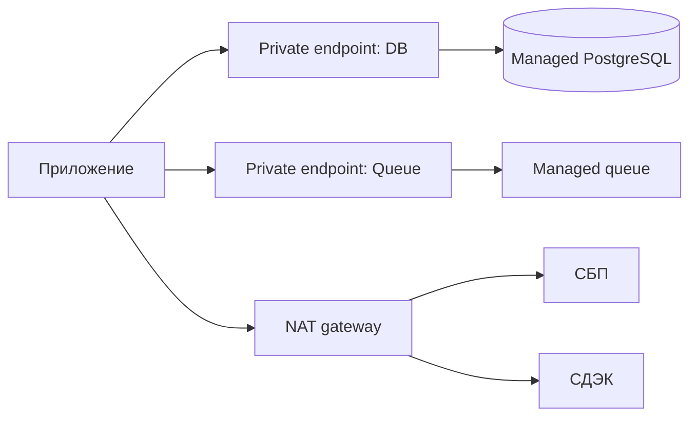

# Часть 4. Глава 4.5 — Облачные сети и Edge

## Цель главы

Научиться проектировать сетевую архитектуру облачного интернет-магазина: сегментировать VPC, контролировать ingress и egress, настраивать DNS, ускорять витрину через CDN и подключаться к управляемым сервисам приватно. Сеть должна отражать границы доверия, а не быть плоским пространством, где все компоненты могут обращаться друг к другу.

**VPC** — логически изолированная сеть в облаке. Она делится на подсети, размещаемые в Availability Zones; сегментация и правила безопасности определяют, какой трафик разрешён между компонентами и внешним миром. [builder.aws](https://builder.aws.com/content/3KpU6PvowbwrzEW68fTXXdLeWUn/decoding-the-cloud)

## 1. Сегментация VPC

Для интернет-магазина не следует размещать витрину, базу данных, административные инструменты и фоновые обработчики в одной подсети. Сегментация ограничивает последствия компрометации и упрощает применение политик.



### Подсети

| Подсеть | Назначение | Доступ из интернета |
|---|---|---|
| Public | Балансировщик, WAF, NAT gateway | Только через публичные endpoints |
| Application | Веб-приложение, заказы, склад, обработчики | Нет |
| Data | База данных, кэш | Нет |
| Operations | Административный доступ, инструменты эксплуатации | Только через VPN или identity-aware proxy |

### Правило сегментации

```text
Покупатель -> CDN -> Load balancer -> Веб-приложение
Веб-приложение -> Модуль заказов -> Складская БД
Сотрудник -> Identity-aware proxy -> Административный интерфейс
Отчёты -> Read replica
```

Прямой доступ из интернета к базе данных, кэшу или внутренним модулям запрещён.

## 2. Ingress

**Ingress** — путь входящего трафика в систему. Для интернет-магазина вход должен быть контролируемым и единообразным: пользователь не обращается напрямую к отдельным Pod или внутренним сервисам.



### Компоненты ingress

| Компонент | Назначение |
|---|---|
| CDN | Кэширование статики, снижение нагрузки на origin |
| WAF | Фильтрация распространённых веб-атак |
| Load balancer | Терминация TLS и распределение трафика |
| Ingress controller | Маршрутизация запросов к сервисам Kubernetes |
| API Gateway | Единая точка внешних API и вебхуков |

### Правила ingress

- Внешний трафик принимается только через CDN/WAF и балансировщик.
- TLS обязателен для всех пользовательских соединений.
- Прямой доступ к Pod по IP запрещён.
- Вебхуки СБП и СДЭК проходят через отдельный контролируемый endpoint.
- Административный интерфейс не публикуется в общий интернет без identity-aware proxy или VPN.
- Правила WAF и rate limiting настраиваются отдельно для витрины, API и вебхуков.

## 3. Egress

**Egress** — исходящий трафик из частной сети: вызовы внешних API, загрузка обновлений, обращение к сторонним сервисам. Egress должен быть явным: по умолчанию не следует разрешать всем Pod доступ ко всему интернету. [learn.microsoft](https://learn.microsoft.com/en-us/azure/architecture/networking/architecture/hub-spoke)



### Правила egress

| Назначение | Способ | Контроль |
|---|---|---|
| Managed database | Private endpoint | Только из application subnets |
| Managed queue | Private endpoint | Только для нужных сервисных ролей |
| СБП | NAT gateway или egress proxy | Разрешённый FQDN, TLS, аудит |
| СДЭК | NAT gateway или egress proxy | Разрешённый FQDN, TLS, аудит |
| Обновления пакетов | Ограниченный proxy или приватный registry | Контролируемый список источников |
| Произвольный интернет | Запрещён по умолчанию | Исключения оформляются явно |

### Зачем ограничивать egress

Ограничение исходящего трафика снижает риск:

- утечки данных при компрометации Pod;
- нежелательных вызовов внешних сервисов;
- скрытых зависимостей от публичных endpoints;
- непредсказуемых затрат на NAT и трафик.

## 4. DNS

**DNS** переводит доменные имена в адреса. В облачной среде DNS особенно важен для private endpoints: внутреннее имя сервиса должно корректно разрешаться в частный IP, а не в публичный адрес. [learn.microsoft](https://learn.microsoft.com/en-us/azure/dns/private-resolver-endpoints-rulesets)

```text
Публичные имена:
shop.example.com        -> CDN
api.shop.example.com    -> API Gateway / load balancer
admin.shop.example.com  -> identity-aware proxy

Приватные имена:
orders.internal.shop    -> orders-service
inventory.internal.shop -> inventory-service
db.internal.shop        -> private endpoint managed PostgreSQL
queue.internal.shop     -> private endpoint managed queue
```

### Правила DNS

- Использовать отдельные публичные и приватные DNS-зоны.
- Для private endpoints настраивать private DNS zone.
- Не полагаться на ручное указание IP-адресов в конфигурации.
- Использовать короткие TTL для записей, которые могут меняться при failover.
- Контролировать разрешение имён через централизованный DNS.
- Запрещать произвольные внешние DNS-запросы из private subnets, если это возможно.

### Антипаттерн: ошибка private DNS

Если приложение обращается к `db.example.com`, но DNS возвращает публичный IP managed database, трафик пойдёт через интернет либо соединение будет отклонено. Private endpoint работает только вместе с корректной private DNS-зоной. [github](https://github.com/mchittineni/ultimate-devops-guide/blob/main/azure-engineering/how-do-you-design-an-azure-virtual-network.md)

## 5. CDN и Edge

**CDN** кэширует контент в edge-локациях ближе к пользователю. Это снижает задержку, уменьшает нагрузку на origin и повышает устойчивость витрины при пиках. [builder.aws](https://builder.aws.com/content/3KpU6PvowbwrzEW68fTXXdLeWUn/decoding-the-cloud)



### Что кэшировать

| Контент | TTL | Стратегия |
|---|---:|---|
| Статические файлы: JS, CSS, шрифты | Долго, с версионированием | `Cache-Control: immutable` |
| Изображения товаров | Долго | Версионирование URL |
| Карточки товаров | Коротко | Инвалидация по событию |
| HTML страниц каталога | Коротко или не кэшировать | Учитывать персонализацию |
| API заказов | Не кэшировать | Динамичные и чувствительные данные |
| Ответы вебхуков | Не кэшировать | Требуется точная обработка |

### Правила CDN

- Статику версионировать в имени файла: `app.8f31c2d.js`.
- Не кэшировать персонализированные ответы без явной стратегии.
- Настраивать WAF на edge.
- Ограничивать origin только трафиком CDN, если это возможно.
- Использовать отдельные правила кэширования для каталога, API и статики.
- Мониторить cache hit ratio и origin load.

## 6. Приватные подключения

**Private endpoint** предоставляет управляемому сервису частный IP внутри VPC. Трафик к базе данных, очереди или object storage не выходит в публичный интернет. [aws.github](https://aws.github.io/aws-networking-best-practices/connectivity/internet/)



### Преимущества

- Снижается поверхность атаки.
- Управляемые сервисы можно закрыть от публичного доступа.
- Трафик остаётся внутри контролируемой сети.
- Упрощается применение сетевых политик.
- Снижаются расходы на NAT для обращений к облачным сервисам. [aws.github](https://aws.github.io/aws-networking-best-practices/connectivity/internet/)

### Ограничения

- Требуется корректная private DNS.
- Private endpoints имеют собственную стоимость.
- Нужно управлять квотами и IP-адресацией.
- Не все внешние сервисы поддерживают приватное подключение.

## 7. Сетевая политика для интернет-магазина

| Источник | Назначение | Протокол/порт | Правило |
|---|---|---|---|
| Интернет | CDN | HTTPS 443 | Разрешено |
| CDN | Load balancer | HTTPS 443 | Разрешено |
| Load balancer | Веб-приложение | HTTP 8080 | Разрешено |
| Веб-приложение | Модуль заказов | HTTP 80 | Разрешено |
| Модуль заказов | Managed PostgreSQL | TCP 5432 | Разрешено |
| Интернет | Managed PostgreSQL | Любой | Запрещено |
| Модуль заказов | СБП | HTTPS 443 | Разрешено через egress proxy |
| Модуль заказов | Произвольный интернет | Любой | Запрещено |
| Сотрудник | Admin UI | HTTPS 443 | Только через identity-aware proxy |
| Отчётный сервис | Read replica | TCP 5432 | Разрешено |

## 8. ADR-006: приватные endpoints и контролируемый egress

```text
# ADR-006: Использовать private endpoints и контролируемый egress

Статус: Принято

## Контекст

Система интернет-магазина обрабатывает персональные данные,
заказы, складские остатки и платежи. Управляемые сервисы
не должны быть доступны из интернета, а исходящие вызовы
к СБП и СДЭК должны быть контролируемыми.

## Решение

1. Managed database, queue и object storage доступны
   через private endpoints.
2. Публичный доступ к managed services отключён.
3. Исходящий трафик к внешним API идёт через NAT gateway
   или egress proxy с разрешённым списком FQDN.
4. Настраиваются private DNS zones для private endpoints.
5. Витрина обслуживается через CDN и WAF.
6. Административный доступ выполняется только через
   identity-aware proxy с MFA.

## Последствия

Положительные:
- уменьшается поверхность атаки;
- трафик к managed services не выходит в интернет;
- упрощается контроль исходящих соединений;
- снижаются риски утечки данных при компрометации Pod.

Отрицательные:
- требуется настройка private DNS;
- добавляется стоимость private endpoints и NAT;
- усложняется диагностика сетевых проблем;
- необходим процесс согласования новых внешних зависимостей.

Условия пересмотра:
- появление новых внешних интеграций;
- изменение требований к data residency;
- существенное изменение топологии сети или регионов.
```

## Задания для закрепления

### Задание 1. Спроектируйте VPC

Разделите VPC интернет-магазина на подсети и разместите компоненты:

- CDN;
- load balancer;
- веб-приложение;
- модуль заказов;
- модуль склада;
- managed PostgreSQL;
- кэш;
- административный доступ.

Укажите, какие подсети публичные, а какие частные.

### Задание 2. Определите ingress-правила

Составьте правила входящего трафика для:

- покупателя;
- вебхука СБП;
- вебхука СДЭК;
- сотрудника;
- мониторинга.

Укажите путь трафика и обязательные проверки.

### Задание 3. Определите egress-правила

Составьте политику исходящего трафика для модуля заказов:

- managed database;
- managed queue;
- СБП;
- СДЭК;
- обновление зависимостей;
- произвольный интернет.

### Задание 4. Диагностируйте DNS

Приложение не может подключиться к managed PostgreSQL через private endpoint. DNS возвращает публичный IP. Опишите причину, последствия и шаги исправления.

## Вопросы для самопроверки

**1. Зачем сегментировать VPC на подсети?**

A. Чтобы все компоненты могли свободно обращаться друг к другу  
B. Чтобы ограничить сетевые пути, уменьшить поверхность атаки и применять политики по зонам ответственности  
C. Чтобы увеличить число публичных IP  
D. Чтобы отказаться от security groups

**Ответить**

<details>
<summary>Показать правильный ответ</summary>

**Правильный ответ: B.**

Сегментация отделяет публичный ingress, приложение, данные и операции. Это ограничивает горизонтальное перемещение и позволяет применять разные правила доступа. [builder.aws](https://builder.aws.com/content/3KpU6PvowbwrzEW68fTXXdLeWUn/decoding-the-cloud)

</details>

***

**2. Какой компонент обычно находится в public subnet?**

A. Managed PostgreSQL  
B. Load balancer  
C. Модуль склада  
D. Кэш

**Ответить**

<details>
<summary>Показать правильный ответ</summary>

**Правильный ответ: B.**

Балансировщик принимает внешний трафик и передаёт его в частные подсети приложения. База данных и внутренние сервисы размещаются в private subnets. [builder.aws](https://builder.aws.com/content/3KpU6PvowbwrzEW68fTXXdLeWUn/decoding-the-cloud)

</details>

***

**3. Зачем нужен private endpoint для managed database?**

A. Чтобы дать базе данных публичный IP  
B. Чтобы приложение обращалось к сервису по частному IP внутри VPC, без выхода в интернет  
C. Чтобы отключить TLS  
D. Чтобы заменить DNS

**Ответить**

<details>
<summary>Показать правильный ответ</summary>

**Правильный ответ: B.**

Private endpoint предоставляет частный IP внутри VPC и позволяет отключить публичный доступ к managed service. [aws.github](https://aws.github.io/aws-networking-best-practices/connectivity/internet/)

</details>

***

**4. Что следует кэшировать в CDN?**

A. Ответы API оформления заказа  
B. Версионированные статические файлы и изображения товаров  
C. Персональные данные покупателя  
D. Вебхуки СБП

**Ответить**

<details>
<summary>Показать правильный ответ</summary>

**Правильный ответ: B.**

CDN эффективен для статического и слабо изменяющегося контента. Динамичные API, персональные данные и вебхуки не должны кэшироваться без специальной стратегии. [builder.aws](https://builder.aws.com/content/3KpU6PvowbwrzEW68fTXXdLeWUn/decoding-the-cloud)

</details>

## Что будет в главе 4.6

В следующей главе мы спроектируем Infrastructure as Code и доставку интернет-магазина: модульную структуру IaC, CI/CD-пайплайн, управление конфигурациями окружений, миграции базы данных, а также стратегии blue-green и canary-развёртывания.