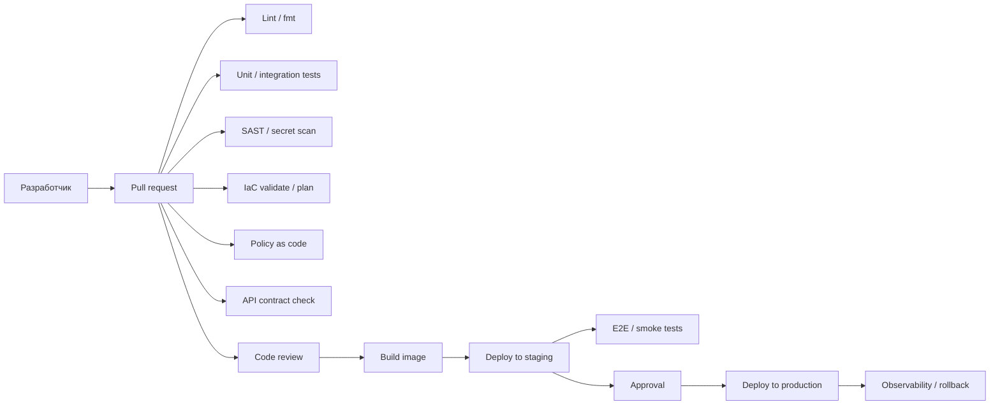
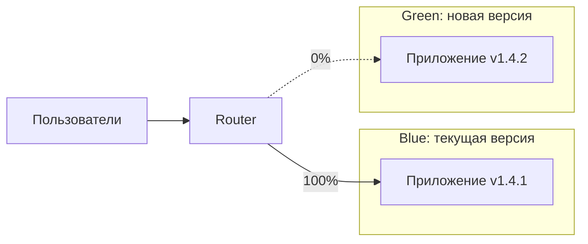
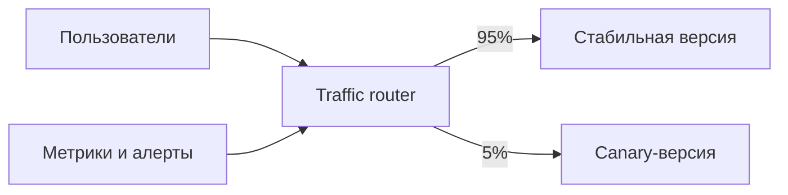

# Часть 4. Глава 4.6 — Infrastructure as Code и доставка

## Цель главы

Научиться управлять облачной инфраструктурой интернет-магазина как кодом и строить безопасный процесс поставки: от pull request до production. Мы спроектируем модули IaC, CI/CD-пайплайн, конфигурацию окружений, миграции базы данных и стратегии blue-green и canary-развёртывания.

**Infrastructure as Code (IaC)** — практика описания инфраструктуры в декларативном коде, который хранится в системе контроля версий, проверяется автоматически и применяется через автоматизированный pipeline. Это делает среду воспроизводимой, обозреваемой и управляемой. [developer.pingidentity](https://developer.pingidentity.com/terraform/best_practices.html)

## 1. Принципы IaC

Инфраструктура интернет-магазина — сеть, кластер, база данных, очереди, права доступа, мониторинг — должна создаваться не вручную, а из кода.

| Принцип | Значение |
|---|---|
| Декларативность | Описываем желаемое состояние, а не последовательность команд |
| Версионирование | Каждое изменение инфраструктуры имеет автора, причину и историю |
| Идемпотентность | Повторное применение не создаёт дубликаты ресурсов |
| Модульность | Повторяющиеся конструкции выносятся в модули |
| Разделение окружений | Development, staging и production имеют изолированные state и параметры |
| Проверяемость | План изменений, политики и тесты выполняются до применения |
| Минимальные права | Pipeline и сервисы получают только необходимые разрешения |

### Антипаттерн: ручные изменения в production

Если инженер вручную изменил security group, размер базы данных или переменную окружения, состояние облака перестаёт соответствовать коду. Это называется **configuration drift**. Позже применение IaC может либо не обнаружить изменение, либо непредсказуемо его перезаписать.

## 2. Модули Infrastructure as Code

Модуль инкапсулирует повторяемую часть инфраструктуры: например, managed PostgreSQL, очередь, object storage или Kubernetes workload.

```text
infrastructure/
├── modules/
│   ├── network/
│   ├── database/
│   ├── queue/
│   ├── object-storage/
│   ├── kubernetes-workload/
│   ├── monitoring/
│   └── secrets/
├── environments/
│   ├── dev/
│   ├── staging/
│   └── production/
└── policies/
```

### Пример модуля базы данных

```hcl
module "orders_database" {
  source = "../../modules/database"

  environment       = "production"
  database_name     = "shop_orders"
  engine_version    = "16"
  instance_class    = "db.standard-2"
  multi_az          = true
  backup_retention  = 30
  deletion_protection = true

  allowed_security_groups = [
    module.orders_service.security_group_id
  ]

  tags = {
    owner       = "shop-platform"
    cost-center = "ecommerce"
    environment = "production"
  }
}
```

### Правила модулей

| Правило | Обоснование |
|---|---|
| Один модуль — одна ответственность | Проще тестировать и переиспользовать |
| Явные входные параметры | Модуль не должен угадывать контекст |
| Осмысленные выходные значения | Модуль возвращает ID, endpoint, security group |
| Обязательные теги | Стоимость, владелец, окружение |
| Запрет секретов в коде | Секреты поступают из secret manager |
| Версионирование модулей | Изменение модуля не должно неожиданно ломать потребителей |

## 3. Состояние IaC

Состояние инфраструктуры — данные о том, какие ресурсы уже созданы и как они связаны с кодом. Его нужно хранить централизованно, защищать и блокировать от одновременных изменений. [learn.microsoft](https://learn.microsoft.com/th-th/azure/databricks/lakehouse-architecture/deployment-guide/iac)

```text
Remote state:
- отдельное защищённое хранилище;
- блокировка на время применения;
- шифрование;
- ограниченный доступ;
- отдельное состояние для каждого окружения.
```

| Практика | Причина |
|---|---|
| Отдельный state для dev, staging, production | Ошибка в одном окружении не затрагивает другие |
| State locking | Исключает конкурентное применение изменений |
| Ограниченный доступ к state | State может содержать чувствительные метаданные |
| Резервное копирование state | Позволяет восстановить управление инфраструктурой |
| Запрет локального state для production | Исключает рассинхронизацию и потерю истории |

## 4. CI/CD-пайплайн

**CI/CD** — автоматизированный путь от изменения кода до развёртывания. Для IaC и приложения он должен включать проверку качества, безопасности, контрактов и политик до применения изменений.



### Этапы pipeline

| Этап | Проверки | Результат |
|---|---|---|
| Commit / PR | Линт, unit-тесты, secret scan, IaC validate | Качество кода |
| Plan | `plan` инфраструктуры, policy check, contract diff | Предсказуемое изменение |
| Build | Сборка образа, SBOM, сканирование уязвимостей | Версионированный артефакт |
| Staging | Развёртывание, миграции, smoke и E2E | Проверка интеграции |
| Approval | Ручное согласование для production | Контроль риска |
| Production | Canary или blue-green, наблюдаемость | Безопасный выпуск |
| Post-deploy | Метрики, алерты, автоматический rollback | Быстрая реакция |

### Важное правило

Pipeline должен применять инфраструктуру, а не быть единственным местом, где возможно ручное изменение. Любое исключение должно быть временным, журналируемым и затем возвращённым в код.

## 5. Конфигурация окружений

Окружения различаются не кодом, а параметрами: размером ресурсов, лимитами, доменами, количеством реплик и уровнем доступа.

| Параметр | Development | Staging | Production |
|---|---:|---:|---:|
| Реплики веб-приложения | 1 | 2 | 3–12 |
| База данных | Малый экземпляр | Средний | Multi-AZ, production-класс |
| Резервные копии | Ежедневно | Ежедневно | Каждые 5–15 минут |
| Доступ разработчиков | Широкий | Ограниченный | Через change process |
| Внешние интеграции | Sandbox | Sandbox или тестовые | Production |
| Данные | Тестовые | Обезличенные | Реальные |
| Алерты | Минимальные | Основные | Полный набор |

### Принципы конфигурации

- Один и тот же код IaC применяется во всех окружениях.
- Различаются только параметры, а не структура модулей.
- Production-конфигурация не должна существовать только на компьютере инженера.
- Секреты не хранятся в `tfvars`, Helm values или открытом коде.
- Изменение production требует review, policy check и audit.

## 6. Миграции базы данных

Миграции — наиболее рискованная часть поставки: они изменяют данные и могут быть трудно обратимыми. При blue-green или canary-развёртывании старая и новая версии приложения могут работать одновременно, поэтому схема должна быть совместима с обеими. [builder.aws](https://builder.aws.com/content/3Jb3FxJwXA3uoqAM84cUepAN6ld/bluegreen-deployment-safe-cutover-or-false-confidence)

### Паттерн expand–contract

```text
1. Expand:
   добавить новое поле или таблицу,
   сохранив совместимость со старой версией.

2. Migrate:
   развернуть код, который пишет в старое и новое поле,
   заполняет новые данные и читает новое поле.

3. Contract:
   после стабилизации удалить старое поле или таблицу.
```

### Пример: переименование поля

Некорректно:

```sql
ALTER TABLE orders
RENAME COLUMN customer_email TO contact_email;
```

Старая версия приложения перестанет работать.

Корректно:

```sql
-- Expand
ALTER TABLE orders
ADD COLUMN contact_email VARCHAR(255);

-- Migrate
UPDATE orders
SET contact_email = customer_email;

-- Contract, после стабилизации
ALTER TABLE orders
DROP COLUMN customer_email;
```

### Правила миграций

- Миграция выполняется до или совместно с совместимой версией приложения.
- Нельзя в одном релизе удалять поле и развертывать код, который его использует.
- Миграции должны быть идемпотентными или иметь явный журнал применённых версий.
- Тяжёлые операции — например, создание индекса на большой таблице — планируются отдельно.
- Для каждой миграции должен быть план отката или forward-fix.

## 7. Blue-green развёртывание

**Blue-green** предполагает две идентичные production-среды: текущая обслуживает трафик, новая разворачивается рядом, проверяется и затем получает трафик. [builder.aws](https://builder.aws.com/content/3Jb3FxJwXA3uoqAM84cUepAN6ld/bluegreen-deployment-safe-cutover-or-false-confidence)



### Процесс

1. Развёртывается green-версия.
2. Выполняются smoke-тесты и синтетические проверки.
3. Трафик переключается на green.
4. Метрики наблюдаются в течение bake period.
5. При проблемах трафик возвращается на blue.
6. После стабилизации blue-версия выводится из эксплуатации. [builder.aws](https://builder.aws.com/content/3Jb3FxJwXA3uoqAM84cUepAN6ld/bluegreen-deployment-safe-cutover-or-false-confidence)

### Ограничение

Blue-green даёт быстрый откат приложения, но не решает проблему несовместимой миграции БД. Если green изменила схему так, что blue не может работать, мгновенный откат невозможен. [builder.aws](https://builder.aws.com/content/3Jb3FxJwXA3uoqAM84cUepAN6ld/bluegreen-deployment-safe-cutover-or-false-confidence)

## 8. Canary развёртывание

**Canary** направляет небольшой процент трафика на новую версию и постепенно увеличивает его при устойчивых метриках. [builder.aws](https://builder.aws.com/content/3CRE0sUkv7aQTimJ695xwuSMzOZ/ci-cd-strategy-patterns-and-common-pitfalls)



### План canary

| Этап | Доля трафика | Длительность | Критерии перехода |
|---|---:|---:|---|
| 1 | 1–5% | 10–15 минут | Error rate и latency в норме |
| 2 | 25% | 15–30 минут | Нет роста ошибок и бизнес-аномалий |
| 3 | 50% | 30 минут | SLO соблюдается |
| 4 | 100% | Постоянно | Стабильная работа |

### Метрики canary

- error rate;
- p95 и p99 latency;
- количество ошибок резервирования;
- доля успешных платежей;
- количество заказов;
- глубина очереди;
- бизнес-конверсия.

Если canary ухудшает метрики, трафик автоматически возвращается на стабильную версию. [builder.aws](https://builder.aws.com/content/3CRE0sUkv7aQTimJ695xwuSMzOZ/ci-cd-strategy-patterns-and-common-pitfalls)

## 9. Выбор стратегии для интернет-магазина

| Сценарий | Стратегия | Обоснование |
|---|---|---|
| Изменение интерфейса витрины | Rolling или canary | Низкий риск, простая проверка |
| Новая версия модуля заказов | Canary | Критичный путь, нужны бизнес-метрики |
| Изменение модели склада | Expand–contract + canary | Требуется совместимость версий |
| Инфраструктурное изменение | Plan, policy check, staging, production | Контроль риска |
| Срочный hotfix | Canary с ускоренным наблюдением | Быстрота без потери контроля |
| Крупный релиз платформы | Blue-green | Возможность быстрого переключения |

Для первой версии интернет-магазина обычно достаточно **rolling update + canary для критичных сервисов**. Полноценный blue-green оправдан, когда стоимость дублирования среды оправдана скоростью отката.

## Задания для закрепления

### Задание 1. Спроектируйте модуль IaC

Создайте спецификацию модуля `managed-postgres`:

- входные параметры;
- выходные значения;
- обязательные теги;
- политики безопасности;
- параметры резервного копирования;
- ограничения использования.

### Задание 2. Постройте pipeline

Опишите CI/CD-пайплайн для изменения, добавляющего новое поле в API заказов и миграцию БД. Укажите проверки на каждом этапе и точку ручного согласования.

### Задание 3. Примените expand–contract

Требуется переименовать поле `customer_phone` в `contact_phone`. Опишите три релиза: expand, migrate и contract. Объясните, почему нельзя выполнить всё за один релиз.

### Задание 4. Выберите стратегию развёртывания

Для каждого изменения выберите rolling, blue-green или canary:

- изменение текста на странице;
- новая версия модуля заказов;
- миграция складской модели;
- обновление версии Kubernetes;
- добавление нового поля в API;
- срочное исправление уязвимости.

## Вопросы для самопроверки

**1. Что такое configuration drift?**

A. Автоматическое масштабирование приложения  
B. Расхождение между фактическим состоянием инфраструктуры и её описанием в IaC  
C. Ошибка в модульном тесте  
D. Замедление запроса к базе данных

**Ответить**

<details>
<summary>Показать правильный ответ</summary>

**Правильный ответ: B.**

Drift возникает, когда ресурсы изменяются вручную или вне pipeline. Это делает IaC ненадёжным источником истины и усложняет откаты. [learn.microsoft](https://learn.microsoft.com/th-th/azure/databricks/lakehouse-architecture/deployment-guide/iac)

</details>

***

**2. Зачем использовать отдельный state для каждого окружения?**

A. Чтобы уменьшить количество файлов  
B. Чтобы изолировать изменения и ограничить влияние ошибки одного окружения на другие  
C. Чтобы разрешить общий доступ к production  
D. Чтобы отказаться от блокировок

**Ответить**

<details>
<summary>Показать правильный ответ</summary>

**Правильный ответ: B.**

Разделение state ограничивает радиус ошибки и позволяет применять разные политики и параметры к dev, staging и production. [learn.microsoft](https://learn.microsoft.com/th-th/azure/databricks/lakehouse-architecture/deployment-guide/iac)

</details>

***

**3. Почему при blue-green развёртывании миграция БД должна быть обратно совместимой?**

A. Потому что базы данных не поддерживают изменения  
B. Потому что старая и новая версии приложения могут работать одновременно, и откат должен оставаться возможным  
C. Потому что миграции всегда мгновенны  
D. Потому что blue-green не использует базу данных

**Ответить**

<details>
<summary>Показать правильный ответ</summary>

**Правильный ответ: B.**

Несовместимая миграция может сделать старую версию неработоспособной и лишить возможности быстрого отката. Используется паттерн expand–contract. [builder.aws](https://builder.aws.com/content/3Jb3FxJwXA3uoqAM84cUepAN6ld/bluegreen-deployment-safe-cutover-or-false-confidence)

</details>

***

**4. Какое преимущество даёт canary-развёртывание?**

A. Полная замена среды за один шаг  
B. Постепенное направление трафика на новую версию с контролем метрик и возможностью отката  
C. Отказ от наблюдаемости  
D. Обязательное ручное тестирование каждого запроса

**Ответить**

<details>
<summary>Показать правильный ответ</summary>

**Правильный ответ: B.**

Canary ограничивает влияние потенциально проблемного релиза и позволяет автоматически вернуть трафик на стабильную версию при ухудшении метрик. [builder.aws](https://builder.aws.com/content/3CRE0sUkv7aQTimJ695xwuSMzOZ/ci-cd-strategy-patterns-and-common-pitfalls)

</details>

## Что будет в главе 4.7

В следующей главе мы рассмотрим FinOps и эффективность ресурсов интернет-магазина: модель совокупной стоимости, распределение затрат по командам и бизнес-функциям, правайзинг ресурсов, управление storage и network costs, а также архитектурные решения, которые предотвращают неконтролируемый рост облачных расходов.