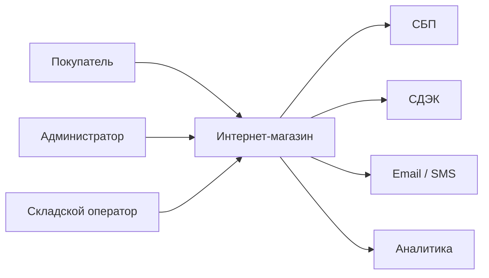
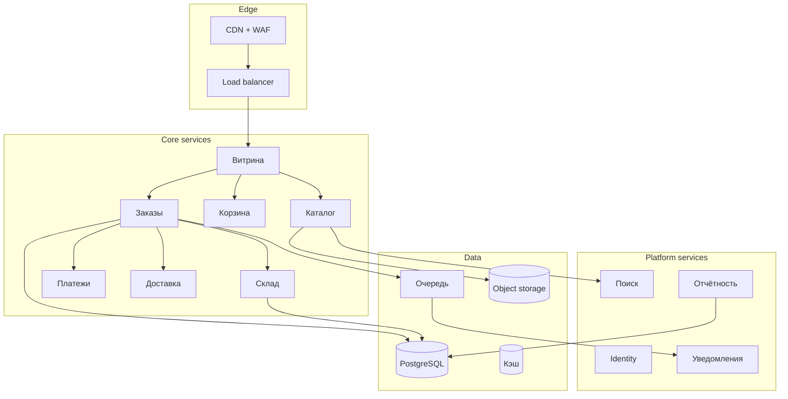
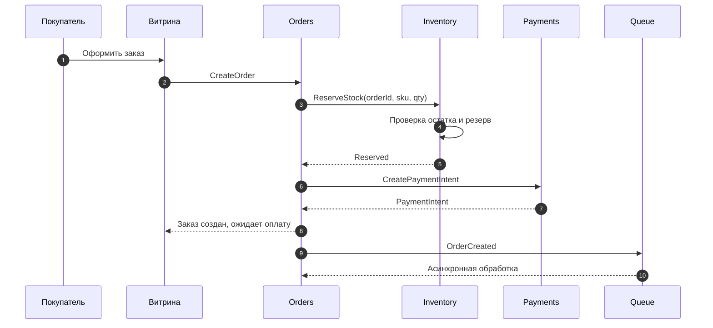
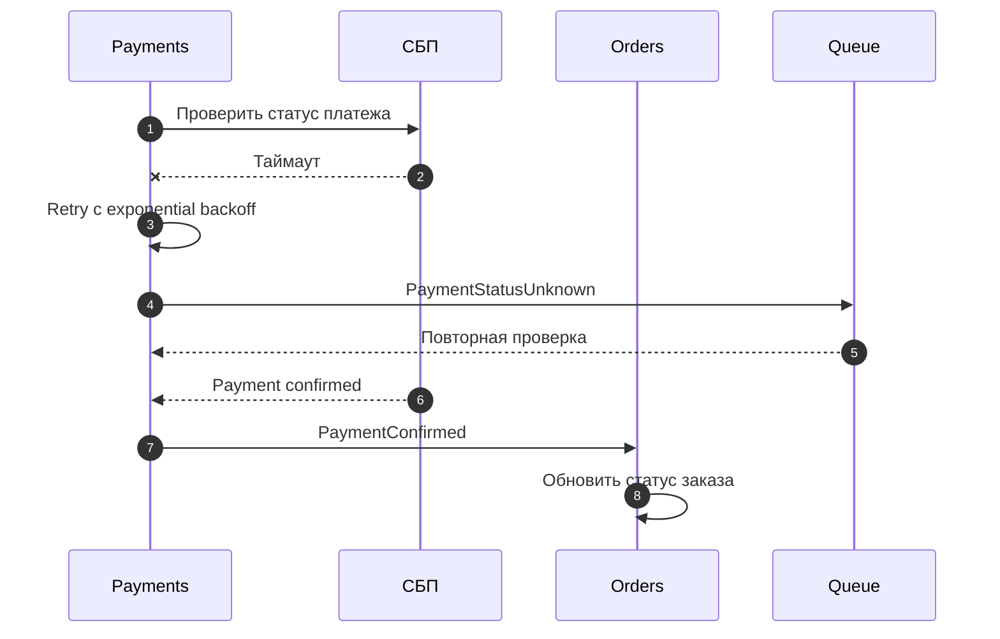
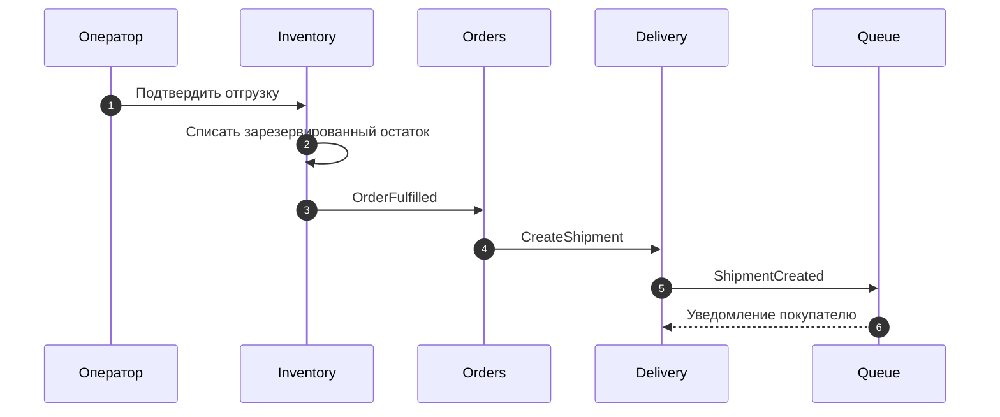
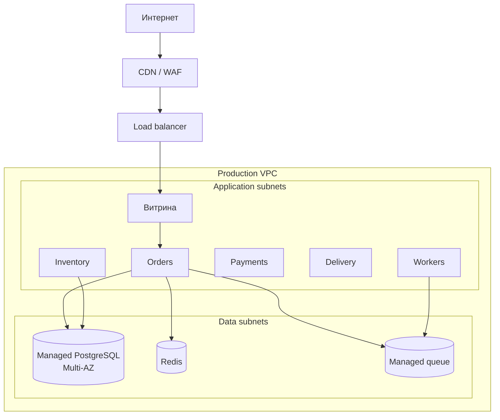

# Часть 4. Глава 4.8 — Итоговая архитектура интернет-магазина

## Цель главы

Собрать ранее спроектированные решения в целостную архитектурную модель интернет-магазина. Мы консолидируем компоненты, критические сценарии, SLO, риски и roadmap эволюции. Итоговая документация должна позволять новой команде понять систему без чтения всего исходного кода.

Для этого используются три взаимодополняющих представления: **building block view** описывает статическую декомпозицию, **runtime view** — поведение системы в ключевых сценариях, а **deployment view** — инфраструктуру и размещение компонентов. [docs.arc42](https://docs.arc42.org/section-7/)

## 1. Контекст системы

Интернет-магазин обслуживает покупателей, администраторов, складских операторов и внешние сервисы. Его главная бизнес-цель — обеспечить стабильную продажу товаров при корректном учёте остатков, платежей и доставки.

### Внешние участники

| Участник | Роль | Основные ожидания |
|---|---|---|
| Покупатель | Просмотр, заказ, оплата | Быстрая витрина, корректный резерв, статус заказа |
| Администратор | Управление каталогом и заказами | Контролируемый доступ, аудит действий |
| Складской оператор | Отгрузка, приёмка, инвентаризация | Актуальные остатки и понятные задания |
| СБП | Приём платежей | Надёжные вебхуки и идемпотентная обработка |
| СДЭК | Доставка | Передача заказа, статусы доставки |
| Аналитика | Отчётность | Согласованные события и данные |

## 2. Building block view

**Building block view** показывает, из каких компонентов состоит система и какие зависимости между ними существуют. Это статическая модель: она отвечает на вопрос «что есть в системе», но не описывает порядок выполнения операций. [docs.arc42](https://docs.arc42.org/section-5/)

### Компоненты и ответственность

| Компонент | Ответственность | Основные данные |
|---|---|---|
| Витрина | Отображение каталога, корзины, оформления заказа | Товары, сессия, заказ |
| Каталог | Товары, категории, цены, медиа | Product, Category, Price |
| Корзина | Временный выбор покупателя | Cart, CartItem |
| Заказы | Создание, статус, история заказа | Order, OrderItem |
| Склад | Остатки, резервы, движения, инвентаризация | Stock, Reservation, StockMovement |
| Платежи | Инициация и подтверждение оплаты | Payment, PaymentEvent |
| Доставка | Расчёт, выбор способа, статусы | Shipment, DeliveryStatus |
| Identity | Аутентификация и авторизация | User, Role, Session |
| Уведомления | Email, SMS, push | Notification |
| Поиск | Поиск и фильтрация товаров | Search index |
| Отчётность | Аналитика и отчёты | Aggregates, reports |

## 3. Runtime view

**Runtime view** описывает, как компоненты взаимодействуют в конкретных сценариях: оформлении заказа, резервировании товара, оплате, отгрузке и сбое внешней интеграции. [docs.arc42](https://docs.arc42.org/section-6/)

### Сценарий: покупка последнего товара

### Сценарий: сбой СБП

### Сценарий: отгрузка заказа

## 4. Критические SLO

SLO должны быть определены не только для технических метрик, но и для бизнес-операций.

| Сценарий | SLO | Целевое значение |
|---|---|---|
| Открытие карточки товара | Availability | 99.9% |
| Поиск товаров | p95 latency | не более 300 мс |
| Оформление заказа | Availability | 99.95% |
| Резервирование товара | p95 latency | не более 500 мс |
| Подтверждение платежа | Availability | 99.95% |
| Обновление статуса доставки | Event processing | не более 5 минут |
| Восстановление после сбоя | RTO | не более 30 минут |
| Потеря заказов при аварии | RPO | не более 5 минут |

## 5. Deployment view

**Deployment view** показывает, где выполняются компоненты: в каких подсетях, кластерах, регионах и окружениях. Для распределённой системы это обязательная часть документации. [docs.arc42](https://docs.arc42.org/section-7/)

### Окружения

| Окружение | Назначение | Особенности |
|---|---|---|
| Development | Разработка и локальная интеграция | Быстрый цикл, тестовые данные |
| Staging | Проверка релиза | Конфигурация близка к production |
| Production | Обслуживание покупателей | Multi-AZ, полный мониторинг, строгий доступ |

## 6. Кросс-функциональные требования

| Требование | Решение |
|---|---|
| Доступность | Multi-AZ, health checks, autoscaling, graceful degradation |
| Производительность | Кэш, CDN, индексы, read replicas, асинхронные задачи |
| Надёжность | Идемпотентность, retry, DLQ, outbox, резервные копии |
| Безопасность | TLS, RBAC, secrets, private endpoints, WAF, аудит |
| Наблюдаемость | Метрики, логи, трейсы, алерты, dashboards |
| Управляемость | IaC, CI/CD, миграции, canary, rollback |
| Стоимость | Теги, budgets, rightsizing, lifecycle-политики |

## 7. Реестр архитектурных рисков

| Риск | Влияние | Мера |
|---|---|---|
| Oversell последнего товара | Отмена заказа, потеря доверия | Атомарный резерв, идемпотентность, reconciliation |
| Дублирование вебхука СБП | Двойное подтверждение платежа | Idempotency key, unique constraint |
| Потеря событий | Заказ не уходит на склад или в доставку | Outbox, persistent queue, DLQ |
| Медленный каталог при распродаже | Падение конверсии | CDN, кэш, autoscaling, load testing |
| Несовместимая миграция БД | Невозможность отката | Expand–contract, canary, миграционные тесты |
| Утечка персональных данных | Регуляторные и репутационные потери | Шифрование, RBAC, audit, private network |
| Cost anomaly | Непредсказуемый бюджет | Теги, budgets, anomaly detection |
| Деградация внешнего API | Задержка оформления заказа | Timeout, circuit breaker, fallback, queue |

## 8. Roadmap эволюции

Архитектура не должна быть застывшей. Она развивается по мере роста нагрузки, команды и бизнес-требований.

| Этап | Цель | Ключевые решения |
|---|---|---|
| MVP | Быстрый запуск | Модульный монолит, managed PostgreSQL, CDN, базовая observability |
| Рост каталога | Производительность поиска | Search service, кэш, CDN-оптимизация |
| Рост заказов | Надёжность критичного пути | Outbox, DLQ, идемпотентные интеграции, canary |
| Масштабирование склада | Автономность домена | Выделение Inventory service, событийная интеграция |
| Многорегиональность | Доступность и latency | Региональное размещение, data replication, failover |
| Зрелая платформа | Управляемость | Platform team, policy as code, FinOps, self-service infrastructure |

## 9. Итоговый архитектурный принцип

Интернет-магазин должен сохранять простой и надёжный критический путь — **каталог → корзина → заказ → резерв → оплата → отгрузка**, — не усложняя его преждевременной микросервисной декомпозицией. Периферийные функции выносятся в асинхронные и serverless-решения, а инфраструктура, безопасность, наблюдаемость и стоимость управляются как часть архитектуры.

## Задания для закрепления

### Задание 1. Соберите итоговую схему

Постройте C4 Container Diagram интернет-магазина:

- пользователи;
- edge;
- core services;
- platform services;
- data stores;
- внешние системы.

### Задание 2. Опишите runtime-сценарий

Опишите сценарий «покупатель оплатил заказ, но вебхук СБП пришёл дважды». Укажите участников, сообщения, идемпотентность, обработку ошибки и метрики.

### Задание 3. Составьте реестр рисков

Выберите пять наиболее критичных рисков интернет-магазина. Для каждого укажите вероятность, влияние, mitigation и владельца.

### Задание 4. Сформируйте roadmap

Определите три ближайших архитектурных улучшения для интернет-магазина. Для каждого укажите бизнес-причину, ожидаемый эффект, стоимость и критерии успеха.

## Вопросы для самопроверки

**1. Что описывает building block view?**

A. Порядок сообщений во времени  
B. Статическую декомпозицию системы на компоненты и их зависимости  
C. Размещение компонентов в облаке  
D. Только структуру базы данных

**Ответить**

Показать правильный ответ

**Правильный ответ: B.**

Building block view показывает статические строительные блоки системы и связи между ними. [docs.arc42](https://docs.arc42.org/section-5/)

***

**2. Для чего нужен runtime view?**

A. Чтобы описать сетевые подсети  
B. Чтобы показать, как компоненты взаимодействуют в конкретных сценариях и при ошибках  
C. Чтобы заменить ADR  
D. Чтобы описать только пользовательский интерфейс

**Ответить**

Показать правильный ответ

**Правильный ответ: B.**

Runtime view описывает поведение строительных блоков в важных сценариях, включая внешние интеграции, администрирование и обработку ошибок. [docs.arc42](https://docs.arc42.org/section-6/)

***

**3. Что описывает deployment view?**

A. Структуру классов  
B. Техническую инфраструктуру и отображение программных компонентов на неё  
C. Только список API  
D. Бизнес-процессы без технических деталей

**Ответить**

Показать правильный ответ

**Правильный ответ: B.**

Deployment view описывает инфраструктуру, окружения, топологию и отображение building blocks на элементы инфраструктуры. [docs.arc42](https://docs.arc42.org/section-7/)

***

**4. Почему outbox важен для интернет-магазина?**

A. Он ускоряет CDN  
B. Он гарантирует публикацию доменного события вместе с изменением данных в одной транзакции  
C. Он заменяет базу данных  
D. Он устраняет необходимость в очереди

**Ответить**

Показать правильный ответ

**Правильный ответ: B.**

Outbox предотвращает расхождение между изменением состояния в БД и публикацией события, что критично для заказов, склада и платежей.

## Итог курса

Вы прошли полный архитектурный цикл проектирования интернет-магазина:

1. Определили бизнес-контекст, NFR и критические сценарии.
2. Спроектировали модульную архитектуру и границы доменов.
3. Выбрали модель данных, транзакции и стратегии согласованности.
4. Спроектировали API, события, интеграции и отказоустойчивость.
5. Рассмотрели cloud-native, Kubernetes, serverless, сети, IaC и FinOps.
6. Собрали итоговую архитектуру с SLO, рисками и roadmap.

Следующий логичный шаг — превратить эту модель в рабочую документацию: заполнить ADR-журнал, создать C4-диаграммы, определить SLO-дашборды и согласовать первый релизный план.