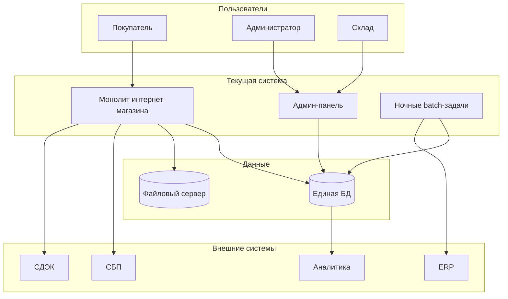
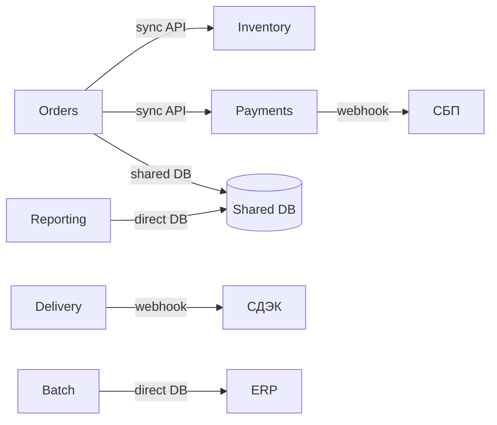
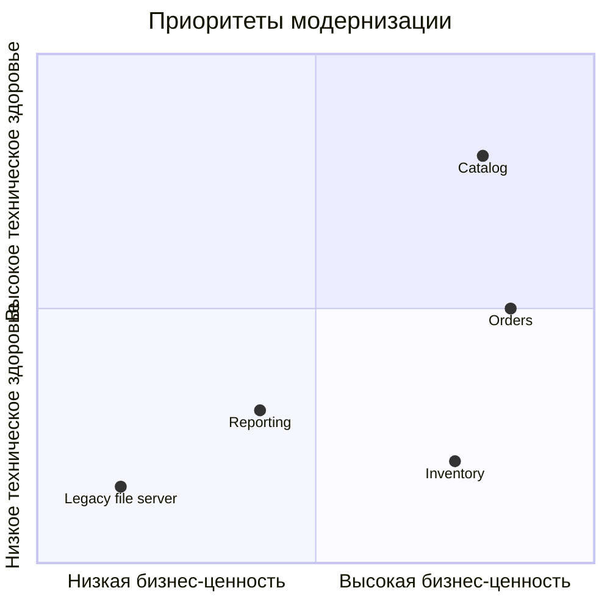

# Часть 5. Глава 5.1 — Оценка существующей системы

## Цель главы

Научиться оценивать текущую архитектуру интернет-магазина до начала модернизации. Оценка нужна не для составления перечня недостатков, а для принятия обоснованных решений: что сохранить, что улучшить, что заменить и что вывести из эксплуатации.

**Оценка текущей архитектуры** — систематический анализ компонентов, данных, интеграций, технического долга, рисков и бизнес-критичности системы. Её результат — карта текущего состояния и приоритизированный список архитектурных изменений. [ensono](https://www.ensono.com/wp-content/uploads/2026/03/Strategic-Modernization-Assessment-Guide.pdf)

## 1. Зачем оценивать текущее состояние

Модернизация без оценки превращается в набор локальных улучшений: команда переписывает один сервис, переносит базу данных или внедряет Kubernetes, не понимая, как это влияет на смежные системы.

Оценка должна ответить на четыре вопроса:

1. Как система устроена сейчас?
2. Какие ограничения мешают бизнесу?
3. Какие зависимости определяют последовательность изменений?
4. Какие улучшения дадут наибольшую ценность при приемлемом риске?

Качественная оценка связывает технический долг с бизнес-последствиями: задержками релизов, инцидентами, стоимостью поддержки и ограничениями роста. [hcltech](https://www.hcltech.com/application-modernization-services)

## 2. Карта текущей архитектуры

Первый шаг — зафиксировать **as-is architecture**: компоненты, данные, интеграции, окружения, команды и внешние системы.



### Что фиксировать

| Область | Вопросы |
|---|---|
| Приложения | Какие системы и модули существуют? Кто их владелец? |
| Данные | Где хранятся данные? Кто владелец схемы? Какие данные дублируются? |
| Интеграции | Какие синхронные и асинхронные связи существуют? |
| Инфраструктура | Где выполняются компоненты? Какие окружения используются? |
| Процессы | Как выпускаются изменения? Как обрабатываются инциденты? |
| Команды | Кто отвечает за компонент, данные и эксплуатацию? |
| Наблюдаемость | Какие метрики, логи и трейсы доступны? |

## 3. Технический долг

**Технический долг** — накопленные компромиссы в архитектуре, коде, данных, инфраструктуре или процессах, которые сегодня ускорили поставку, но увеличивают стоимость изменений, риск инцидентов или сложность поддержки.

Важно отличать долг от просто «старого кода». Старая система может быть стабильной и хорошо соответствовать бизнесу. Долг возникает, когда решение перестало соответствовать текущим требованиям или активно препятствует развитию. [techtarget](https://www.techtarget.com/news/How-to-reduce-and-eliminate-technical-debt/846442/)

### Виды долга

| Вид долга | Пример в интернет-магазине | Последствие |
|---|---|---|
| Архитектурный | Модули заказов и склада обращаются к одной таблице | Невозможно изменить склад без риска для заказов |
| Кодовый | Дублирование логики расчёта скидок | Разные цены в корзине и заказе |
| Данные | Нет владельца поля `status` в заказе | Непредсказуемые переходы статусов |
| Инфраструктурный | Ручное изменение production | Configuration drift |
| Интеграционный | Прямое обращение к БД ERP | Скрытая связность систем |
| Процессный | Ручное развертывание | Долгие и рискованные релизы |
| Безопасность | Устаревшая библиотека с уязвимостью | Риск компрометации |

### Оценка долга

Каждый элемент долга следует описывать одинаково:

```text
ID: TD-014
Область: Модуль заказов
Описание: Orders и Inventory используют общую таблицу stock_items
Бизнес-эффект: Изменение складской модели замедляет релизы заказов
Риск: Высокий
Стоимость владения: Высокая
Владелец: Platform team
Возможное решение: Выделить Inventory API и событийную интеграцию
Приоритет: Высокий
```

## 4. Анализ зависимостей

**Анализ зависимостей** определяет, какие компоненты, данные и внешние системы влияют друг на друга. Он показывает, можно ли изменить систему локально или изменение неизбежно затронет смежные области. [orbussoftware](https://www.orbussoftware.com/solutions/use-case/application-technology-lifecycle-management)



### Типы зависимостей

| Тип | Пример | Риск |
|---|---|---|
| Синхронная API | Orders вызывает Inventory | Задержка и отказ распространяются по цепочке |
| Асинхронная | OrderCreated в очереди | Требуется идемпотентность и мониторинг |
| Общая база данных | Orders и Inventory в одной схеме | Скрытая связность |
| Общая библиотека | Общий модуль расчёта цен | Согласованные изменения, но связанность релизов |
| Прямой доступ к данным | Reporting читает таблицы Orders | Изменение схемы ломает отчёты |
| Внешняя интеграция | СБП, СДЭК | Зависимость от SLA и форматов партнёра |

### Карта критичности

| Компонент | Бизнес-критичность | Техническое здоровье | Действие |
|---|---:|---:|---|
| Orders | Высокая | Среднее | Инвестировать и постепенно улучшать |
| Inventory | Высокая | Низкое | Приоритет модернизации |
| Catalog | Высокая | Высокое | Оптимизировать точечно |
| Reporting | Средняя | Низкое | Рассмотреть замену или изоляцию |
| Legacy ERP integration | Средняя | Низкое | Планировать миграцию |
| Старый файловый сервер | Низкая | Низкое | Вывести из эксплуатации |

## 5. Приоритизация модернизации

Не весь технический долг нужно устранять. Приоритеты определяются сочетанием бизнес-ценности, риска, стоимости изменений и стратегической значимости. [techtarget](https://www.techtarget.com/news/How-to-reduce-and-eliminate-technical-debt/846442/)

### Матрица ценность — здоровье



| Квадрант | Решение |
|---|---|
| Высокая ценность, низкое здоровье | Приоритетная модернизация |
| Высокая ценность, высокое здоровье | Поддерживать и развивать |
| Низкая ценность, низкое здоровье | Вывести из эксплуатации |
| Низкая ценность, высокое здоровье | Минимальная поддержка |

### Критерии приоритета

| Критерий | Вопрос |
|---|---|
| Бизнес-влияние | Насколько ограничение мешает продажам или росту? |
| Риск | Может ли долг привести к инциденту или потере данных? |
| Стоимость изменений | Сколько стоит устранение? |
| Стоимость владения | Сколько система стоит в эксплуатации? |
| Блокирующий эффект | Мешает ли долг другим инициативам? |
| Стратегическая значимость | Нужен ли компонент в целевой архитектуре? |

## 6. Оценка готовности к изменениям

Помимо компонентов, нужно оценить способность организации безопасно изменять систему.

| Измерение | Слабая готовность | Зрелая готовность |
|---|---|---|
| Deployment | Ручной релиз раз в несколько недель | Автоматизированный pipeline |
| Observability | Логи только на серверах | Метрики, трейсы, алерты, dashboards |
| Тестирование | Ручные проверки | Автотесты, contract tests, E2E |
| Данные | Нет владельца схемы | Data ownership и миграции |
| Безопасность | Ручные проверки | Policy as code, scanning, audit |
| Эксплуатация | Инциденты разбираются без ретроспективы | SLO, postmortems, improvement backlog |

## 7. ADR-008: приоритет модернизации склада

```text
# ADR-008: Приоритизировать модернизацию Inventory

Статус: Принято

## Контекст

Orders и Inventory используют общую таблицу stock_items.
Изменение складской логики требует координации с командой
заказов, увеличивает время релиза и создаёт риск oversell.

## Решение

1. Inventory выделяется в отдельный домен и сервис.
2. Прямой доступ Orders к таблицам Inventory прекращается.
3. Вводится Inventory API для синхронных операций
   резервирования и списания.
4. События StockChanged и StockReserved публикуются
   через outbox.
5. Миграция выполняется поэтапно с параллельной
   эксплуатацией старой и новой логики.

## Последствия

Положительные:
- снижается связность Orders и Inventory;
- ускоряются изменения складской логики;
- упрощается масштабирование склада;
- снижается риск oversell.

Отрицательные:
- требуется миграция данных;
- появляется распределённая согласованность;
- необходимы новые API-контракты и наблюдаемость.

Условия пересмотра:
- если объём заказов не оправдает эксплуатационную
  сложность отдельного сервиса;
- если появится более критичный архитектурный риск.
```

## Задания для закрепления

### Задание 1. Постройте as-is карту

Опишите текущую архитектуру интернет-магазина:

- приложения и модули;
- хранилища данных;
- интеграции;
- внешние системы;
- владельцы;
- критичные зависимости.

### Задание 2. Классифицируйте технический долг

Разделите следующие проблемы по видам долга: архитектурный, кодовый, data, infrastructure, integration, process, security:

- ручное развертывание;
- общая таблица заказов и склада;
- дублирование расчёта скидок;
- устаревшая библиотека с CVE;
- прямой доступ отчётов к таблицам заказов;
- отсутствие владельца схемы БД.

### Задание 3. Постройте карту зависимостей

Определите зависимости для изменения модуля Inventory:

- какие компоненты вызывают Inventory;
- какие данные читают напрямую;
- какие события зависят от склада;
- какие внешние системы затронет изменение.

### Задание 4. Приоритизируйте инициативы

Оцените по шкале от 1 до 5 бизнес-влияние, риск, стоимость и блокирующий эффект:

- выделение Inventory;
- внедрение CI/CD;
- замена файлового сервера;
- оптимизация поиска;
- миграция отчётности;
- внедрение SLO.

Обоснуйте порядок работ.

## Вопросы для самопроверки

**1. Что такое технический долг?**

A. Любой старый код  
B. Накопленные компромиссы, которые увеличивают стоимость изменений, риск или сложность поддержки  
C. Отсутствие документации  
D. Использование open-source библиотек

**Ответить**

<details>
<summary>Показать правильный ответ</summary>

**Правильный ответ: B.**

Технический долг — это осознанные или накопленные компромиссы, которые сегодня упростили решение, но создают будущие издержки. [techtarget](https://www.techtarget.com/news/How-to-reduce-and-eliminate-technical-debt/846442/)

</details>

***

**2. Почему важно анализировать зависимости перед модернизацией?**

A. Чтобы увеличить число сервисов  
B. Чтобы понять последовательность изменений и не нарушить работу смежных систем  
C. Чтобы отказаться от интеграций  
D. Чтобы перенести все данные в одну базу

**Ответить**

<details>
<summary>Показать правильный ответ</summary>

**Правильный ответ: B.**

Зависимости определяют, какие изменения можно выполнить локально, а какие требуют поэтапной миграции и координации. [orbussoftware](https://www.orbussoftware.com/solutions/use-case/application-technology-lifecycle-management)

</details>

***

**3. Какой компонент следует приоритизировать при высокой бизнес-ценности и низком техническом здоровье?**

A. Вывести из эксплуатации  
B. Не изменять  
C. Приоритетно модернизировать  
D. Перенести в архив

**Ответить**

<details>
<summary>Показать правильный ответ</summary>

**Правильный ответ: C.**

Такой компонент важен для бизнеса, но его техническое состояние ограничивает развитие и создаёт риск. [compelframework](https://www.compelframework.org/articles/the-technology-architecture-roadmap)

</details>

***

**4. Какой признак указывает на архитектурный долг?**

A. Длинное имя переменной  
B. Общая таблица, к которой обращаются несколько доменов  
C. Отсутствие unit-теста для одной функции  
D. Большой размер логотипа

**Ответить**

<details>
<summary>Показать правильный ответ</summary>

**Правильный ответ: B.**

Общая таблица создаёт скрытую связность между доменами и затрудняет независимое развитие модулей. [aspiresys](https://www.aspiresys.com/blog/digital-software-engineering/application-transformation/from-code-smells-to-cloud-native-a-practical-guide-to-eliminating-technical-debt-in-legacy-applications/)

</details>

## Что будет в главе 5.2

В следующей главе мы рассмотрим стратегии миграции: подход 6R, паттерн Strangler Fig, параллельную эксплуатацию, миграцию данных и выбор стратегии для отдельных компонентов интернет-магазина.